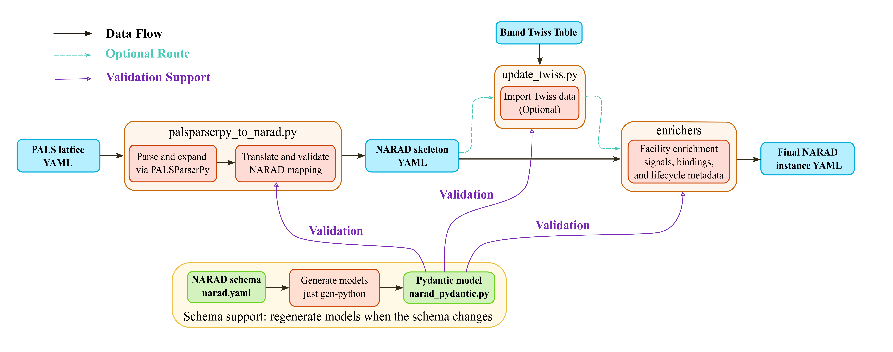

# NARAD-DataServices

This repository contains the code for the NARAD Data Services, which provide access to schemas and ontologies for the NARAD project. 
The services are built using LinkML and are designed to facilitate the integration and use of accelerator operations data across various applications.

## Prerequisites
Install [uv](https://docs.astral.sh/uv/), which manages the Python version,
virtual environment, and Python dependencies for this project:

```console
pipx install uv
```

See the [uv installation guide](https://docs.astral.sh/uv/getting-started/installation/)
for alternatives to `pipx`. For detailed best practices for Python environments
with uv, see the [Berkeley BOP guide](https://berkeleybop.org/best_practice/python_environments).

Install [Just](https://github.com/casey/just), which provides the repository's
build and generation commands:

```console
uv tool install rust-just
```

The project also requires Git, CMake, and a C++ compiler to build its PALS
parser dependency.

## Environment Setup

The project declares
[PALSParserPy](https://github.com/pals-project/PALSParserPy) as an editable local
dependency. `uv sync` installs it automatically alongside the other dependencies
and retains it on subsequent syncs. The wrapper uses the shared library built by
[PALSParserCpp](https://github.com/pals-project/PALSParserCpp).

The configured checkout layout is:

```text
Documents/
├── NARAD/
│   └── NARAD-DataServices/
└── PALS/
    ├── PALSParserCpp/
    └── PALSParserPy/
```

For a fresh setup, run these commands from the NARAD-DataServices repository root
(skip cloning and building if the parser checkouts and C++ build already exist):

```console
mkdir -p ../../PALS
git clone https://github.com/pals-project/PALSParserCpp.git ../../PALS/PALSParserCpp
git clone https://github.com/pals-project/PALSParserPy.git ../../PALS/PALSParserPy
cmake -S ../../PALS/PALSParserCpp -B ../../PALS/PALSParserCpp/build
cmake --build ../../PALS/PALSParserCpp/build
uv sync
```

The local source is configured in `[tool.uv.sources]` in `pyproject.toml`. If your
Python wrapper checkout is elsewhere, update it with
`uv add --editable /path/to/PALSParserPy`. This also updates `uv.lock`.

If PALSParserCpp is stored elsewhere, set `PALS_PARSER_CPP_DIR` to its checkout
or `PALS_PARSER_CPP_LIB` to the compiled shared library before using
PALSParserPy. `uv sync` installs the Python wrapper; the C++ library is built
separately. See the upstream
[PALSParserPy installation guide](https://pals-project.github.io/PALSParserPy/guide/installation.html)
for details.

Verify the complete environment with:

```console
uv run python -c "import palsparserpy; print(palsparserpy.__file__)"
uv run pytest
```

## PALS-to-NARAD Workflow

Translator code and facility enrichment rules are kept in `src/translators/`.
PALS inputs are tracked in `examples/pals_inputs/`, while final NARAD instances
remain directly under `examples/`.
Reproducible skeletons are written to the ignored
`.local/translation/skeletons/` workspace.

[](pals_narad_workflow.png)

*PALS-to-NARAD translation and validation workflow. Click the diagram to view
it at full resolution.*

Skeletons are intermediate facility payloads and intentionally do not carry
instance versions, creation dates, or change logs. The facility enricher owns
that lifecycle metadata and creates the tracked final instance at version
`0.0.0` with a facility-specific initial change-log entry.

### BtA example

Generate the PALSParserPy-based NARAD skeleton, add the available Twiss data,
and create the enriched BtA instance with:

```console
uv run python src/translators/palsparserpy_to_narad.py \
  -input examples/pals_inputs/bta.pals.yaml
uv run python src/translators/update_twiss.py \
  --twiss src/translators/resources/bta_twiss.dat \
  --input .local/translation/skeletons/bta_narad_skeleton_palsparserpy.yaml
uv run python src/translators/enrichers/bta.py
```

### Toy ring example

Generate the hypothetical EIC toy ring instance with fictional EPICS PVs using:

```console
uv run python src/translators/palsparserpy_to_narad.py \
  -input examples/pals_inputs/toy_ring.pals.yaml
uv run python src/translators/enrichers/toy_ring.py
```

This reads `.local/translation/skeletons/toy_ring_narad_skeleton_palsparserpy.yaml`
and writes `examples/toy_ring_narad_instance.yaml`. Naming rules and signal semantics
are configured at the top of the script. Each corrector gets H and V supply
status, current setpoint, current readback, and minimum/maximum allowed setpoint
signals (`Current-SP.DRVL` / `Current-SP.DRVH`, current in A); each BPM
gets X and Y position readbacks in mm. Use `--input` and `--output` to override
the default paths.

### Twiss-table importer

`src/translators/update_twiss.py` also works with Booster and other NARAD YAML files:

```console
uv run python src/translators/update_twiss.py \
  --twiss src/translators/resources/booster_twiss.dat \
  --input .local/translation/skeletons/booster_narad_skeleton_palsparserpy.yaml \
  --output /tmp/booster_with_twiss.yaml
```

Both `--input` and `--twiss` are required. Omit `--output` to update the input
in place. The importer reads column names from a header containing `name` and
`s`, supports reordered or additional columns and Fortran `D` exponents, and
stops before `Lord Elements:`. It updates only matching YAML components (names
are case insensitive; repeated names match in occurrence order). Unmatched
components and table rows are left alone. Supported Twiss fields present in
the table overwrite those fields in YAML; existing extra fields, group IDs,
and values marked `---` in the table are preserved. Positions are updated only
for component kinds supporting `LongitudinalPlacementP`. The result is validated
against the NARAD model before writing.

## Known PALS-to-NARAD Gaps

The PALSParserPy translator currently produces a flattened, control-neutral
NARAD skeleton. PALSParserPy resolves expressions and expands the selected
lattice before NARAD mapping, but not every source concept has a corresponding
NARAD representation yet.

| PALS feature | Current behavior | Remaining gap |
| --- | --- | --- |
| Multiple branches | PALSParserPy expands all branches, including branches created by forks. | The translator currently requires exactly one branch per lattice. NARAD occurrence identity and relations across multiple beamlines still need to be defined. |
| Forks | PALSParserPy resolves fork destinations and creates the resulting branches. | NARAD has a `Fork` function value and `HasConnectingBranch` relation, but no concrete `Fork` component or `ForkP` parameter group. Fork elements and their connectivity are therefore not translated. |
| Multipass beamlines | The translator preserves the beamline-level `multipass` flag and emits a warning. | NARAD does not yet distinguish a shared physical component from its separate pass occurrences or relate those occurrences across passes. |
| Constants and variables | PALSParserPy evaluates them, and translated component parameters contain the resulting numeric values. | Named constants, variables, original expressions, and evaluation provenance are not retained in NARAD. |
| Controllers | PALSParserPy evaluates controller expressions before translation, so the controlled parameter values are present in the generated components. | Controller entities, knob variables, expressions, control types, and parameter-level dependencies are not represented. The existing NARAD `Controls` relation only describes component-to-component control. |
| Includes, inheritance, repeats, and expressions | These are resolved during PALS expansion, and their expanded component values and order are translated. | The generated skeleton does not preserve the original authoring constructs or their provenance. |
| Other unsupported element kinds | Unsupported expanded elements are reported and omitted. No precedence relation is created across the resulting gap. | Each kind needs an explicit NARAD class/mapping decision before the skeleton can represent the complete lattice. |

Until these gaps are addressed, generated skeletons should be treated as
resolved lattice snapshots rather than lossless round-trip representations of
the original PALS source.


## Repository Structure

* [docs/](docs/) — generated and maintained documentation resources.
* [examples/](examples/) — final NARAD instances that validate against the
  current schema.
  * [pals_inputs/](examples/pals_inputs/) — PALS source lattices used by the
    translators.
* [src/narad/schema/](src/narad/schema/) — the authoritative LinkML schema.
* [src/translators/](src/translators/) — temporary in-repository PALS-to-NARAD
  translation and facility-enrichment workflow.
* [tests/](tests/) — translator, enrichment, and schema regression tests and
  their small test fixtures.

The `project/`, `src/narad/datamodel/`, and `docs/schema/` directories are
generated locally and ignored by Git. Translation skeletons and other
intermediates are written under `.local/translation/`, which is also ignored.

## Using the Schemas
* `just gen-project`
  * Generates project artifacts under `project/` and Python models under
    `src/narad/datamodel/`. These outputs are reproducible and are not tracked.

* `just gen-doc`
  * Generates documentation from the schema into `docs/elements/`. The recipe
    takes no arguments; the following generator flags are set in the `gen-doc`
    recipe in `justfile`:
    * `--truncate-descriptions False`
    * `--diagram-type er_diagram`
    * `--example-directory doc_examples/`, where example files are located
    * `--subfolder-type-separation`, which generates documentation in
      subfolders for compatibility with mkdocs
    * `--template-directory docs/templates-linkml`
  * To pass extra flags, set `LINKML_GENERATORS_DOC_ARGS` in
    `config.public.mk`.

* `just gen-python`
  * Generates Python classes in `src/narad/datamodel/` from the LinkML schema.

* Validate a final instance:

  ```console
  uv run linkml-validate \
    --schema src/narad/schema/narad.yaml \
    examples/bta_narad_instance.yaml
  ```

  Replace the instance path with any other tracked instance, including
  `examples/booster_narad_instance.yaml`,
  `examples/toy_ring_narad_instance.yaml`,
  `examples/GUN_thru_MV.linkml.yaml`, or `examples/INJECTOR.linkml.yaml`.

* Generate the OWL schema into the ignored project directory:

  ```console
  mkdir -p project/owl
  uv run gen-owl src/narad/schema/narad.yaml > project/owl/narad.owl.ttl
  ```
