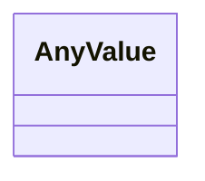

# Class: AnyValue 


_Unconstrained type — accepts any YAML/JSON value (string, number, object, list, etc.)._


URI: [linkml:Any](https://w3id.org/linkml/Any)





<!-- no inheritance hierarchy -->


## Slots

| Name | Cardinality and Range | Description | Inheritance |
| ---  | --- | --- | --- |


## Usages

| used by | used in | type | used |
| ---  | --- | --- | --- |
| [FacilityParamSet](FacilityParamSet.md) | [properties](properties.md) | range | [AnyValue](AnyValue.md) |


## Identifier and Mapping Information


### Schema Source


* from schema: https://w3id.org/narad_linkml/schema/narad/system


## Mappings

| Mapping Type | Mapped Value |
| ---  | ---  |
| self | linkml:Any |
| native | narad:AnyValue |


## LinkML Source

<!-- TODO: investigate https://stackoverflow.com/questions/37606292/how-to-create-tabbed-code-blocks-in-mkdocs-or-sphinx -->

### Direct

<details>
```yaml
name: AnyValue
description: Unconstrained type — accepts any YAML/JSON value (string, number, object,
  list, etc.).
from_schema: https://w3id.org/narad_linkml/schema/narad/system
class_uri: linkml:Any

```
</details>

### Induced

<details>
```yaml
name: AnyValue
description: Unconstrained type — accepts any YAML/JSON value (string, number, object,
  list, etc.).
from_schema: https://w3id.org/narad_linkml/schema/narad/system
class_uri: linkml:Any

```
</details>