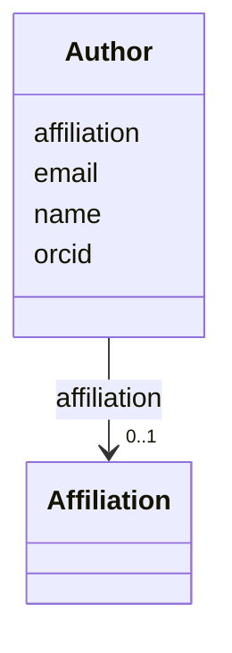

# Class: Author 


_Contains authorship information for a representation of an accelerator facility and its operations._


URI: [pals:Author](https://pals-project.readthedocs.io/Author)





<!-- no inheritance hierarchy -->

## Slots

| Name | Cardinality and Range | Description | Inheritance |
| ---  | --- | --- | --- |
| [name](name.md) | 0..1 <br/> [String](String.md) | The name of the entity | direct |
| [affiliation](affiliation.md) | 0..1 <br/> [Affiliation](Affiliation.md) | The affiliation of the author or component, as a ROR | direct |
| [email](email.md) | 0..1 <br/> [String](String.md) | The email address of the author | direct |
| [orcid](orcid.md) | 0..1 <br/> [String](String.md) | The ORCID identifier of the author | direct |


## Usages

| used by | used in | type | used |
| ---  | --- | --- | --- |
| [PALSAccelerator](PALSAccelerator.md) | [authors](authors.md) | range | [Author](Author.md) |


## Identifier and Mapping Information


### Schema Source


* from schema: https://w3id.org/accelerator-core


## Mappings

| Mapping Type | Mapped Value |
| ---  | ---  |
| self | pals:Author |
| native | pals:Author |


## LinkML Source

<!-- TODO: investigate https://stackoverflow.com/questions/37606292/how-to-create-tabbed-code-blocks-in-mkdocs-or-sphinx -->

### Direct

<details>
```yaml
name: Author
description: Contains authorship information for a representation of an accelerator
  facility and its operations.
from_schema: https://w3id.org/accelerator-core
slots:
- name
- affiliation
attributes:
  email:
    name: email
    description: The email address of the author.
    from_schema: https://w3id.org/accelerator-core
    rank: 1000
    domain_of:
    - Author
    range: string
    pattern: ^[^@]+@[^@]+\.[^@]+$
  orcid:
    name: orcid
    description: The ORCID identifier of the author.
    from_schema: https://w3id.org/accelerator-core
    rank: 1000
    domain_of:
    - Author
    range: string
    pattern: ^https://orcid\.org/\d{4}-\d{4}-\d{4}-\d{3}[\dX]$

```
</details>

### Induced

<details>
```yaml
name: Author
description: Contains authorship information for a representation of an accelerator
  facility and its operations.
from_schema: https://w3id.org/accelerator-core
attributes:
  email:
    name: email
    description: The email address of the author.
    from_schema: https://w3id.org/accelerator-core
    rank: 1000
    alias: email
    owner: Author
    domain_of:
    - Author
    range: string
    pattern: ^[^@]+@[^@]+\.[^@]+$
  orcid:
    name: orcid
    description: The ORCID identifier of the author.
    from_schema: https://w3id.org/accelerator-core
    rank: 1000
    alias: orcid
    owner: Author
    domain_of:
    - Author
    range: string
    pattern: ^https://orcid\.org/\d{4}-\d{4}-\d{4}-\d{3}[\dX]$
  name:
    name: name
    description: The name of the entity. For example, the name of the person or organization.
    from_schema: https://w3id.org/accelerator-core
    rank: 1000
    alias: name
    owner: Author
    domain_of:
    - Author
    - Affiliation
    range: string
  affiliation:
    name: affiliation
    description: The affiliation of the author or component, as a ROR.
    from_schema: https://w3id.org/accelerator-core
    rank: 1000
    alias: affiliation
    owner: Author
    domain_of:
    - PALSAccelerator
    - Author
    range: Affiliation
    inlined: true

```
</details>