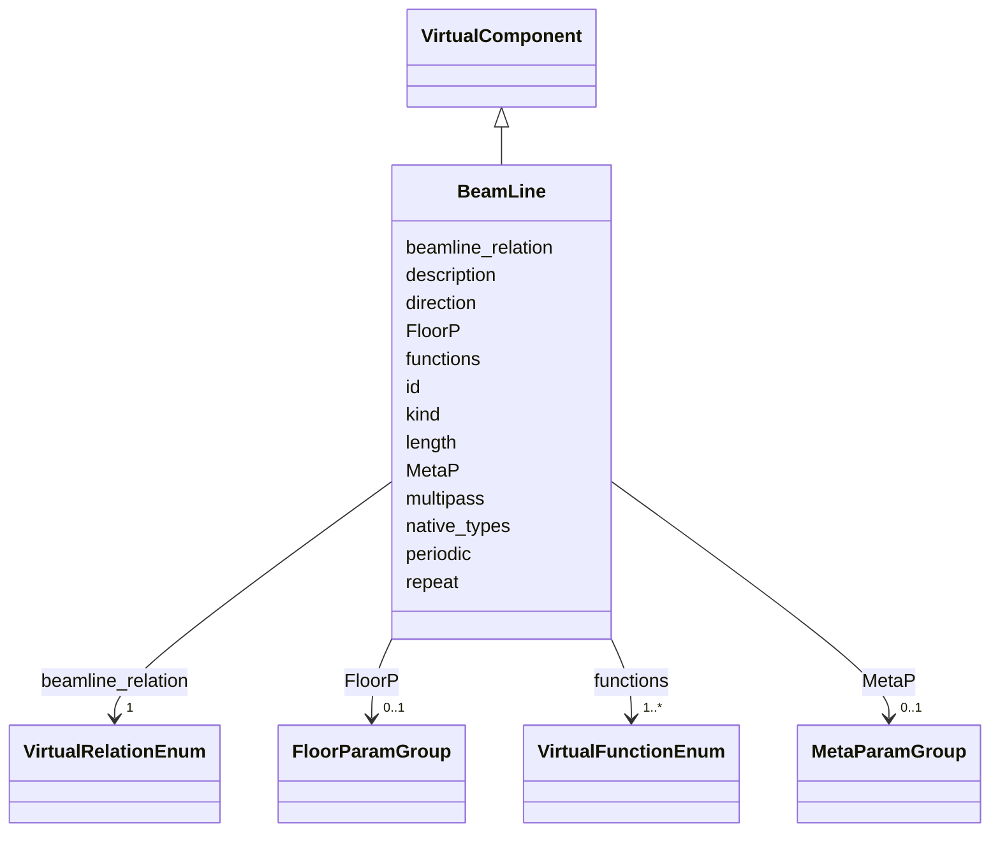

# Class: BeamLine 


_PALS element for an ordered sequence of beamline elements defining a beam path._


URI: [pals:BeamLine](https://pals-project.readthedocs.io/BeamLine)





## Inheritance
* [Component](Component.md) [ [HasMetaP](HasMetaP.md)]
    * [VirtualComponent](VirtualComponent.md) [ [HasFloorP](HasFloorP.md)]
        * **BeamLine**


## Slots

| Name | Cardinality and Range | Description | Inheritance |
| ---  | --- | --- | --- |
| [length](length.md) | 0..1 <br/> [Float](Float.md) | The total length of the BeamLine | direct |
| [description](description.md) | 0..1 <br/> [String](String.md) | A human-readable description of the instance | direct |
| [multipass](multipass.md) | 0..1 <br/> [Boolean](Boolean.md) | Indicates whether the BeamLine is a multipass BeamLine, where the beam passes... | direct |
| [periodic](periodic.md) | 0..1 <br/> [Boolean](Boolean.md) | Indicates whether orbit and Twiss parameters periodic | direct |
| [repeat](repeat.md) | 0..1 <br/> [Integer](Integer.md) | Repetition count | direct |
| [direction](direction.md) | 0..1 <br/> [Integer](Integer.md) | Beam direction along the BeamLine: +1 or -1 | direct |
| [functions](functions.md) | 1..* <br/> [VirtualFunctionEnum](VirtualFunctionEnum.md) | The function of the virtual component,  which can be used to identify the com... | [VirtualComponent](VirtualComponent.md) |
| [beamline_relation](beamline_relation.md) | 1 <br/> [VirtualRelationEnum](VirtualRelationEnum.md) | The relationship of the virtual component to the beamline,  which can be used... | [VirtualComponent](VirtualComponent.md) |
| [FloorP](FloorP.md) | 0..1 <br/> [FloorParamGroup](FloorParamGroup.md) | A mixin for floor plan parameters that are aligned with PALS FloorP (Floor Pl... | [HasFloorP](HasFloorP.md) |
| [id](id.md) | 1 <br/> [String](String.md) | A unique identifier for the instance | [Component](Component.md) |
| [kind](kind.md) | 1 <br/> [String](String.md) | The LinkML class name of this instance | [Component](Component.md) |
| [native_types](native_types.md) | * <br/> [String](String.md) | The native type of the component in the source system, which can be used to i... | [Component](Component.md) |
| [MetaP](MetaP.md) | 0..1 <br/> [MetaParamGroup](MetaParamGroup.md) | A mixin for metadata parameters that are aligned with PALS MetaP (Metadata Pa... | [HasMetaP](HasMetaP.md) |


## Usages

| used by | used in | type | used |
| ---  | --- | --- | --- |
| [Facility](Facility.md) | [beamlines](beamlines.md) | range | [BeamLine](BeamLine.md) |
| [ComponentRelation](ComponentRelation.md) | [beamline_context](beamline_context.md) | range | [BeamLine](BeamLine.md) |


## Identifier and Mapping Information


### Schema Source


* from schema: https://w3id.org/accelerator-core


## Mappings

| Mapping Type | Mapped Value |
| ---  | ---  |
| self | pals:BeamLine |
| native | pals:BeamLine |
| exact | pals:BeamLine |


## LinkML Source

<!-- TODO: investigate https://stackoverflow.com/questions/37606292/how-to-create-tabbed-code-blocks-in-mkdocs-or-sphinx -->

### Direct

<details>
```yaml
name: BeamLine
description: PALS element for an ordered sequence of beamline elements defining a
  beam path.
from_schema: https://w3id.org/accelerator-core
exact_mappings:
- pals:BeamLine
is_a: VirtualComponent
slots:
- length
- description
slot_usage:
  length:
    name: length
    description: The total length of the BeamLine. For pals interoperability, use
      m as the unit of length.
attributes:
  multipass:
    name: multipass
    description: Indicates whether the BeamLine is a multipass BeamLine, where the
      beam passes through the same physical elements multiple times. If not provided,
      the default assumption is that the BeamLine is single-pass.
    from_schema: https://w3id.org/accelerator-core
    rank: 1000
    slot_uri: pals:multipass
    domain_of:
    - BeamLine
    range: boolean
  periodic:
    name: periodic
    description: Indicates whether orbit and Twiss parameters periodic. If not provided,
      the default assumption is that the BeamLine is not periodic.
    from_schema: https://w3id.org/accelerator-core
    rank: 1000
    slot_uri: pals:periodic
    domain_of:
    - BeamLine
    range: boolean
  repeat:
    name: repeat
    description: 'Repetition count. If not provided, the default assumption is that
      the beamline is not repeated and the value is 1.

      If value is greater than 1, the beamline is repeated that many times.'
    from_schema: https://w3id.org/accelerator-core
    rank: 1000
    slot_uri: pals:repeat
    domain_of:
    - BeamLine
    range: integer
  direction:
    name: direction
    description: 'Beam direction along the BeamLine: +1 or -1. Longitudinal orientation.
      Default is +1.'
    from_schema: https://w3id.org/accelerator-core
    rank: 1000
    slot_uri: pals:direction
    domain_of:
    - BeamLine
    range: integer

```
</details>

### Induced

<details>
```yaml
name: BeamLine
description: PALS element for an ordered sequence of beamline elements defining a
  beam path.
from_schema: https://w3id.org/accelerator-core
exact_mappings:
- pals:BeamLine
is_a: VirtualComponent
slot_usage:
  length:
    name: length
    description: The total length of the BeamLine. For pals interoperability, use
      m as the unit of length.
attributes:
  multipass:
    name: multipass
    description: Indicates whether the BeamLine is a multipass BeamLine, where the
      beam passes through the same physical elements multiple times. If not provided,
      the default assumption is that the BeamLine is single-pass.
    from_schema: https://w3id.org/accelerator-core
    rank: 1000
    slot_uri: pals:multipass
    alias: multipass
    owner: BeamLine
    domain_of:
    - BeamLine
    range: boolean
  periodic:
    name: periodic
    description: Indicates whether orbit and Twiss parameters periodic. If not provided,
      the default assumption is that the BeamLine is not periodic.
    from_schema: https://w3id.org/accelerator-core
    rank: 1000
    slot_uri: pals:periodic
    alias: periodic
    owner: BeamLine
    domain_of:
    - BeamLine
    range: boolean
  repeat:
    name: repeat
    description: 'Repetition count. If not provided, the default assumption is that
      the beamline is not repeated and the value is 1.

      If value is greater than 1, the beamline is repeated that many times.'
    from_schema: https://w3id.org/accelerator-core
    rank: 1000
    slot_uri: pals:repeat
    alias: repeat
    owner: BeamLine
    domain_of:
    - BeamLine
    range: integer
  direction:
    name: direction
    description: 'Beam direction along the BeamLine: +1 or -1. Longitudinal orientation.
      Default is +1.'
    from_schema: https://w3id.org/accelerator-core
    rank: 1000
    slot_uri: pals:direction
    alias: direction
    owner: BeamLine
    domain_of:
    - BeamLine
    range: integer
  length:
    name: length
    description: The total length of the BeamLine. For pals interoperability, use
      m as the unit of length.
    from_schema: https://w3id.org/accelerator-core
    rank: 1000
    slot_uri: pals:length
    alias: length
    owner: BeamLine
    domain_of:
    - LongitudinalPlacementParamGroup
    - BeamLine
    range: float
  description:
    name: description
    description: A human-readable description of the instance.
    from_schema: https://w3id.org/accelerator-core
    rank: 1000
    alias: description
    owner: BeamLine
    domain_of:
    - PALS
    - MetaParamGroup
    - BeamLine
    range: string
  functions:
    name: functions
    description: The function of the virtual component,  which can be used to identify
      the component across different source systems.
    from_schema: https://w3id.org/accelerator-core
    slot_uri: pals:virtual_function
    alias: functions
    owner: BeamLine
    domain_of:
    - PhysicalComponent
    - VirtualComponent
    - SupportingFacilityComponent
    range: VirtualFunctionEnum
    required: true
    multivalued: true
  beamline_relation:
    name: beamline_relation
    description: The relationship of the virtual component to the beamline,  which
      can be used to identify the component across different source systems.
    from_schema: https://w3id.org/accelerator-core
    slot_uri: pals:virtual_beamline_relation
    alias: beamline_relation
    owner: BeamLine
    domain_of:
    - PhysicalComponent
    - VirtualComponent
    range: VirtualRelationEnum
    required: true
  FloorP:
    name: FloorP
    description: A mixin for floor plan parameters that are aligned with PALS FloorP
      (Floor Plan Parameters) for interoperability with the Particle Accelerator Language
      Standard (PALS).
    from_schema: https://w3id.org/accelerator-core
    rank: 1000
    alias: FloorP
    owner: BeamLine
    domain_of:
    - HasFloorP
    range: FloorParamGroup
    inlined: true
  id:
    name: id
    description: A unique identifier for the instance.
    from_schema: https://w3id.org/accelerator-core
    rank: 1000
    slot_uri: pals:id
    identifier: true
    alias: id
    owner: BeamLine
    domain_of:
    - Affiliation
    - Component
    - Signal
    - Relationship
    range: string
    required: true
  kind:
    name: kind
    description: The LinkML class name of this instance.
    from_schema: https://w3id.org/accelerator-core
    rank: 1000
    slot_uri: pals:kind
    alias: kind
    owner: BeamLine
    domain_of:
    - PALS
    - Component
    - Signal
    range: string
    required: true
  native_types:
    name: native_types
    description: The native type of the component in the source system, which can
      be used to identify the component across different source systems.
    from_schema: https://w3id.org/accelerator-core
    rank: 1000
    alias: native_types
    owner: BeamLine
    domain_of:
    - Component
    range: string
    multivalued: true
  MetaP:
    name: MetaP
    description: A mixin for metadata parameters that are aligned with PALS MetaP
      (Metadata Parameters) for interoperability with the Particle Accelerator Language
      Standard (PALS).
    from_schema: https://w3id.org/accelerator-core
    rank: 1000
    alias: MetaP
    owner: BeamLine
    domain_of:
    - HasMetaP
    range: MetaParamGroup
    inlined: true

```
</details>