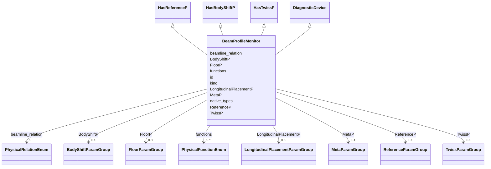

# Class: BeamProfileMonitor 


_A diagnostic device used to measure transverse beam profile._


URI: [pals:BeamProfileMonitor](https://pals-project.readthedocs.io/BeamProfileMonitor)





## Inheritance
* [Component](Component.md) [ [HasMetaP](HasMetaP.md)]
    * [PhysicalComponent](PhysicalComponent.md) [ [HasFloorP](HasFloorP.md) [HasLongitudinalPlacementP](HasLongitudinalPlacementP.md)]
        * [DiagnosticDevice](DiagnosticDevice.md)
            * **BeamProfileMonitor** [ [HasReferenceP](HasReferenceP.md) [HasBodyShiftP](HasBodyShiftP.md) [HasTwissP](HasTwissP.md)]


## Slots

| Name | Cardinality and Range | Description | Inheritance |
| ---  | --- | --- | --- |
| [ReferenceP](ReferenceP.md) | 0..1 <br/> [ReferenceParamGroup](ReferenceParamGroup.md) | A mixin for reference parameters that are aligned with PALS ReferenceP (Refer... | [HasReferenceP](HasReferenceP.md) |
| [BodyShiftP](BodyShiftP.md) | 0..1 <br/> [BodyShiftParamGroup](BodyShiftParamGroup.md) | A mixin for floor plan shift parameters that are aligned with PALS BodyShiftP... | [HasBodyShiftP](HasBodyShiftP.md) |
| [TwissP](TwissP.md) | 0..1 <br/> [TwissParamGroup](TwissParamGroup.md) | A mixin for Twiss parameters that are aligned with PALS TwissP (Twiss Paramet... | [HasTwissP](HasTwissP.md) |
| [functions](functions.md) | 1..* <br/> [PhysicalFunctionEnum](PhysicalFunctionEnum.md) | The function of the physical component,  which can be used to identify the co... | [PhysicalComponent](PhysicalComponent.md) |
| [beamline_relation](beamline_relation.md) | 1 <br/> [PhysicalRelationEnum](PhysicalRelationEnum.md) | The relationship of the physical component to the beamline,  which can be use... | [PhysicalComponent](PhysicalComponent.md) |
| [FloorP](FloorP.md) | 0..1 <br/> [FloorParamGroup](FloorParamGroup.md) | A mixin for floor plan parameters that are aligned with PALS FloorP (Floor Pl... | [HasFloorP](HasFloorP.md) |
| [LongitudinalPlacementP](LongitudinalPlacementP.md) | 0..1 <br/> [LongitudinalPlacementParamGroup](LongitudinalPlacementParamGroup.md) | A mixin for an element's extent and position along the longitudinal (beam-dir... | [HasLongitudinalPlacementP](HasLongitudinalPlacementP.md) |
| [id](id.md) | 1 <br/> [String](String.md) | A unique identifier for the instance | [Component](Component.md) |
| [kind](kind.md) | 1 <br/> [String](String.md) | The LinkML class name of this instance | [Component](Component.md) |
| [native_types](native_types.md) | * <br/> [String](String.md) | The native type of the component in the source system, which can be used to i... | [Component](Component.md) |
| [MetaP](MetaP.md) | 0..1 <br/> [MetaParamGroup](MetaParamGroup.md) | A mixin for metadata parameters that are aligned with PALS MetaP (Metadata Pa... | [HasMetaP](HasMetaP.md) |


## Identifier and Mapping Information


### Schema Source


* from schema: https://w3id.org/accelerator-core


## Mappings

| Mapping Type | Mapped Value |
| ---  | ---  |
| self | pals:BeamProfileMonitor |
| native | pals:BeamProfileMonitor |
| broad | pals:Instrument |


## LinkML Source

<!-- TODO: investigate https://stackoverflow.com/questions/37606292/how-to-create-tabbed-code-blocks-in-mkdocs-or-sphinx -->

### Direct

<details>
```yaml
name: BeamProfileMonitor
description: A diagnostic device used to measure transverse beam profile.
from_schema: https://w3id.org/accelerator-core
broad_mappings:
- pals:Instrument
is_a: DiagnosticDevice
mixins:
- HasReferenceP
- HasBodyShiftP
- HasTwissP

```
</details>

### Induced

<details>
```yaml
name: BeamProfileMonitor
description: A diagnostic device used to measure transverse beam profile.
from_schema: https://w3id.org/accelerator-core
broad_mappings:
- pals:Instrument
is_a: DiagnosticDevice
mixins:
- HasReferenceP
- HasBodyShiftP
- HasTwissP
attributes:
  ReferenceP:
    name: ReferenceP
    description: A mixin for reference parameters that are aligned with PALS ReferenceP
      (Reference Parameters) for interoperability with the Particle Accelerator Language
      Standard (PALS).
    from_schema: https://w3id.org/accelerator-core
    rank: 1000
    alias: ReferenceP
    owner: BeamProfileMonitor
    domain_of:
    - HasReferenceP
    range: ReferenceParamGroup
    inlined: true
  BodyShiftP:
    name: BodyShiftP
    description: A mixin for floor plan shift parameters that are aligned with PALS
      BodyShiftP (Floor Plan Shift Parameters) for interoperability with the Particle
      Accelerator Language Standard (PALS).
    from_schema: https://w3id.org/accelerator-core
    rank: 1000
    alias: BodyShiftP
    owner: BeamProfileMonitor
    domain_of:
    - HasBodyShiftP
    range: BodyShiftParamGroup
    inlined: true
  TwissP:
    name: TwissP
    description: A mixin for Twiss parameters that are aligned with PALS TwissP (Twiss
      Parameters) for interoperability with the Particle Accelerator Language Standard
      (PALS).
    from_schema: https://w3id.org/accelerator-core
    rank: 1000
    alias: TwissP
    owner: BeamProfileMonitor
    domain_of:
    - HasTwissP
    range: TwissParamGroup
    inlined: true
  functions:
    name: functions
    description: The function of the physical component,  which can be used to identify
      the component across different source systems.
    from_schema: https://w3id.org/accelerator-core
    rank: 1000
    slot_uri: pals:physical_function
    alias: functions
    owner: BeamProfileMonitor
    domain_of:
    - PhysicalComponent
    - VirtualComponent
    - SupportingFacilityComponent
    range: PhysicalFunctionEnum
    required: true
    multivalued: true
  beamline_relation:
    name: beamline_relation
    description: The relationship of the physical component to the beamline,  which
      can be used to identify the component across different source systems.
    from_schema: https://w3id.org/accelerator-core
    rank: 1000
    slot_uri: pals:physical_beamline_relation
    alias: beamline_relation
    owner: BeamProfileMonitor
    domain_of:
    - PhysicalComponent
    - VirtualComponent
    range: PhysicalRelationEnum
    required: true
  FloorP:
    name: FloorP
    description: A mixin for floor plan parameters that are aligned with PALS FloorP
      (Floor Plan Parameters) for interoperability with the Particle Accelerator Language
      Standard (PALS).
    from_schema: https://w3id.org/accelerator-core
    rank: 1000
    alias: FloorP
    owner: BeamProfileMonitor
    domain_of:
    - HasFloorP
    range: FloorParamGroup
    inlined: true
  LongitudinalPlacementP:
    name: LongitudinalPlacementP
    description: A mixin for an element's extent and position along the longitudinal
      (beam-direction, "s") axis that are aligned with PALS LongitudinalPlacementP
      (Longitudinal Placement Parameters) for interoperability with the Particle Accelerator
      Language Standard (PALS).
    from_schema: https://w3id.org/accelerator-core
    rank: 1000
    alias: LongitudinalPlacementP
    owner: BeamProfileMonitor
    domain_of:
    - HasLongitudinalPlacementP
    range: LongitudinalPlacementParamGroup
    inlined: true
  id:
    name: id
    description: A unique identifier for the instance.
    from_schema: https://w3id.org/accelerator-core
    rank: 1000
    slot_uri: pals:id
    identifier: true
    alias: id
    owner: BeamProfileMonitor
    domain_of:
    - Affiliation
    - Component
    - Signal
    - Relationship
    range: string
    required: true
  kind:
    name: kind
    description: The LinkML class name of this instance.
    from_schema: https://w3id.org/accelerator-core
    rank: 1000
    slot_uri: pals:kind
    designates_type: true
    alias: kind
    owner: BeamProfileMonitor
    domain_of:
    - PALSAccelerator
    - Component
    - Signal
    range: string
    required: true
  native_types:
    name: native_types
    description: The native type of the component in the source system, which can
      be used to identify the component across different source systems.
    from_schema: https://w3id.org/accelerator-core
    rank: 1000
    alias: native_types
    owner: BeamProfileMonitor
    domain_of:
    - Component
    range: string
    multivalued: true
  MetaP:
    name: MetaP
    description: A mixin for metadata parameters that are aligned with PALS MetaP
      (Metadata Parameters) for interoperability with the Particle Accelerator Language
      Standard (PALS).
    from_schema: https://w3id.org/accelerator-core
    rank: 1000
    alias: MetaP
    owner: BeamProfileMonitor
    domain_of:
    - HasMetaP
    range: MetaParamGroup
    inlined: true

```
</details>