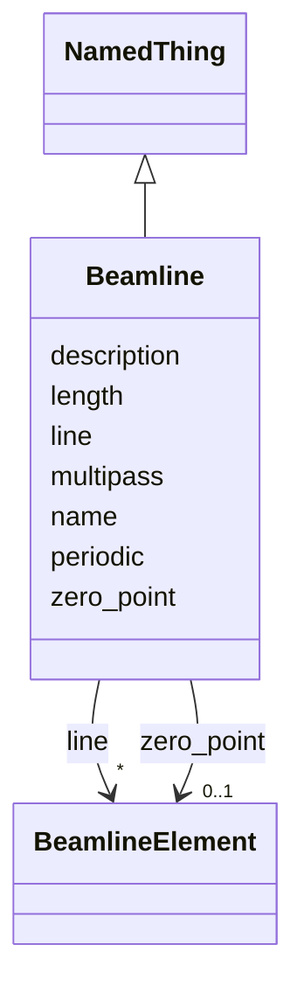

# Class: Beamline 


_A top-level NARAD-system for an ordered sequence of beamline elements defining a beam path._


URI: [narad:Beamline](https://w3id.org/narad_linkml/schema/narad/Beamline)





## Inheritance
* [NamedThing](NamedThing.md)
    * **Beamline**


## Slots

| Name | Cardinality and Range | Description | Inheritance |
| ---  | --- | --- | --- |
| [multipass](multipass.md) | 0..1 <br/> [Boolean](Boolean.md) | Indicates whether this beamline is a multipass recirculating line (true) or a... | direct |
| [length](length.md) | 0..1 <br/> [Float](Float.md) | Physical length of the element in meters | direct |
| [zero_point](zero_point.md) | 0..1 <br/> [BeamlineElement](BeamlineElement.md) | Name of a line item used as a reference point when  the beamline is used as a... | direct |
| [periodic](periodic.md) | 0..1 <br/> [Boolean](Boolean.md) | For a beamline, indicates whether the orbit and Twiss parameters are periodic... | direct |
| [line](line.md) | * <br/> [BeamlineElement](BeamlineElement.md) | Ordered sequence of beamline elements in this beamline | direct |
| [name](name.md) | 1 <br/> [String](String.md) | Human-readable name or local string key for the entity | [NamedThing](NamedThing.md) |
| [description](description.md) | 0..1 <br/> [String](String.md) | Detailed description of the entity | [NamedThing](NamedThing.md) |


## Usages

| used by | used in | type | used |
| ---  | --- | --- | --- |
| [NaradModel](NaradModel.md) | [beamlines](beamlines.md) | range | [Beamline](Beamline.md) |


## Identifier and Mapping Information


### Schema Source


* from schema: https://w3id.org/narad_linkml/schema/narad/system


## Mappings

| Mapping Type | Mapped Value |
| ---  | ---  |
| self | narad:Beamline |
| native | narad:Beamline |
| exact | pals:BeamLine |


## LinkML Source

<!-- TODO: investigate https://stackoverflow.com/questions/37606292/how-to-create-tabbed-code-blocks-in-mkdocs-or-sphinx -->

### Direct

<details>
```yaml
name: Beamline
description: A top-level NARAD-system for an ordered sequence of beamline elements
  defining a beam path.
from_schema: https://w3id.org/narad_linkml/schema/narad/system
exact_mappings:
- pals:BeamLine
is_a: NamedThing
slots:
- multipass
- length
- zero_point
- periodic
- line

```
</details>

### Induced

<details>
```yaml
name: Beamline
description: A top-level NARAD-system for an ordered sequence of beamline elements
  defining a beam path.
from_schema: https://w3id.org/narad_linkml/schema/narad/system
exact_mappings:
- pals:BeamLine
is_a: NamedThing
attributes:
  multipass:
    name: multipass
    description: Indicates whether this beamline is a multipass recirculating line
      (true) or a single-pass line (false).
    from_schema: https://w3id.org/narad_linkml/schema/narad/system
    rank: 1000
    alias: multipass
    owner: Beamline
    domain_of:
    - Beamline
    range: boolean
  length:
    name: length
    description: Physical length of the element in meters.
    from_schema: https://w3id.org/narad_linkml/schema/narad/system
    rank: 1000
    alias: length
    owner: Beamline
    domain_of:
    - Beamline
    - BeamlineElement
    range: float
  zero_point:
    name: zero_point
    description: Name of a line item used as a reference point when  the beamline
      is used as a subline."
    from_schema: https://w3id.org/narad_linkml/schema/narad/system
    rank: 1000
    alias: zero_point
    owner: Beamline
    domain_of:
    - Beamline
    range: BeamlineElement
    multivalued: false
    inlined: false
  periodic:
    name: periodic
    description: For a beamline, indicates whether the orbit and Twiss parameters
      are periodic (true) or non-periodic (false).
    from_schema: https://w3id.org/narad_linkml/schema/narad/system
    rank: 1000
    alias: periodic
    owner: Beamline
    domain_of:
    - Beamline
    range: boolean
  line:
    name: line
    description: Ordered sequence of beamline elements in this beamline. Serializes
      as a list of element names (BeamlineElement names) referencing the keys in the
      elements map This is not a direct containment slot; the actual element definitions
      are in the top-level elements map.
    from_schema: https://w3id.org/narad_linkml/schema/narad/system
    rank: 1000
    alias: line
    owner: Beamline
    domain_of:
    - Beamline
    range: BeamlineElement
    multivalued: true
    inlined: false
  name:
    name: name
    description: Human-readable name or local string key for the entity.
    from_schema: https://w3id.org/narad_linkml/schema/narad/system
    rank: 1000
    identifier: true
    alias: name
    owner: Beamline
    domain_of:
    - NamedThing
    range: string
    required: true
  description:
    name: description
    description: Detailed description of the entity.
    from_schema: https://w3id.org/narad_linkml/schema/narad/system
    rank: 1000
    alias: description
    owner: Beamline
    domain_of:
    - NamedThing
    range: string

```
</details>