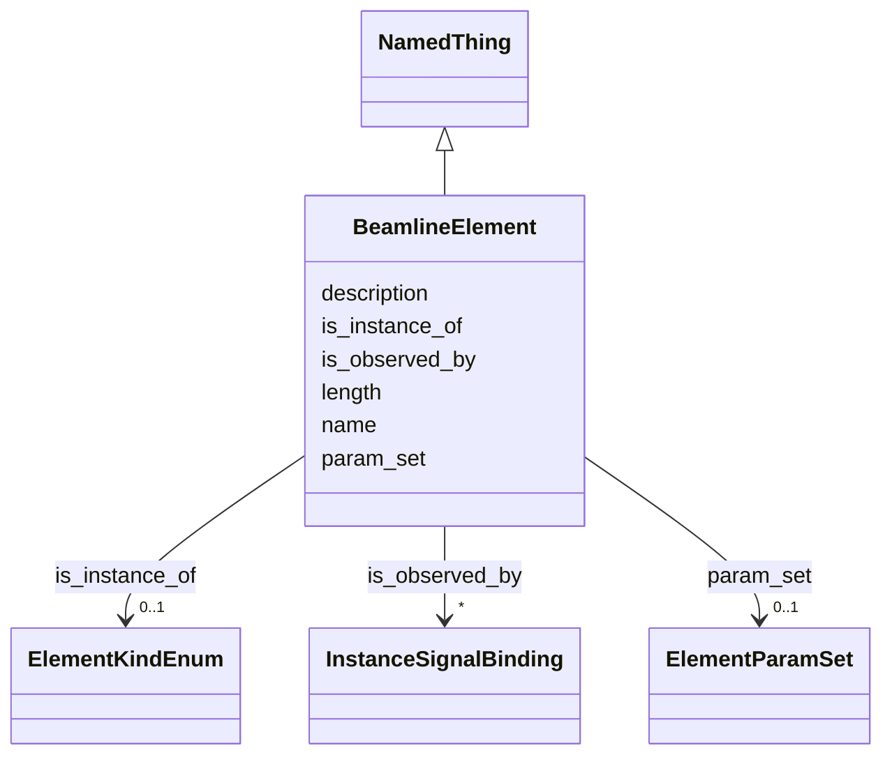

# Class: BeamlineElement 


_A single element in a beamline with its kind and optional NARAD capability annotations._


URI: [narad:BeamlineElement](https://example.org/narad_linkml/schema/narad/BeamlineElement)





## Inheritance
* [NamedThing](NamedThing.md)
    * **BeamlineElement**


## Slots

| Name | Cardinality and Range | Description | Inheritance |
| ---  | --- | --- | --- |
| [is_instance_of](is_instance_of.md) | 0..1 <br/> [ElementKindEnum](ElementKindEnum.md) | NARAD alias for rdf:type | direct |
| [length](length.md) | 0..1 <br/> [Float](Float.md) | Physical length of the element in meters | direct |
| [is_observed_by](is_observed_by.md) | * <br/> [InstanceSignalBinding](InstanceSignalBinding.md) | Control-system-specific, e | direct |
| [param_set](param_set.md) | 0..1 <br/> [ElementParamSet](ElementParamSet.md) | Named physics-parameter blocks for this element (e | direct |
| [name](name.md) | 1 <br/> [String](String.md) | Human-readable name or local string key for the entity | [NamedThing](NamedThing.md) |
| [description](description.md) | 0..1 <br/> [String](String.md) | Detailed description of the entity | [NamedThing](NamedThing.md) |


## Usages

| used by | used in | type | used |
| ---  | --- | --- | --- |
| [NaradModel](NaradModel.md) | [elements](elements.md) | range | [BeamlineElement](BeamlineElement.md) |
| [Beamline](Beamline.md) | [zero_point](zero_point.md) | range | [BeamlineElement](BeamlineElement.md) |
| [Beamline](Beamline.md) | [line](line.md) | range | [BeamlineElement](BeamlineElement.md) |


## Identifier and Mapping Information


### Schema Source


* from schema: https://w3id.org/narad_linkml/schema/narad/system


## Mappings

| Mapping Type | Mapped Value |
| ---  | ---  |
| self | narad:BeamlineElement |
| native | narad:BeamlineElement |
| broad | pals:Element |


## LinkML Source

<!-- TODO: investigate https://stackoverflow.com/questions/37606292/how-to-create-tabbed-code-blocks-in-mkdocs-or-sphinx -->

### Direct

<details>
```yaml
name: BeamlineElement
description: A single element in a beamline with its kind and optional NARAD capability
  annotations.
from_schema: https://w3id.org/narad_linkml/schema/narad/system
broad_mappings:
- pals:Element
is_a: NamedThing
slots:
- is_instance_of
- length
- is_observed_by
- param_set
slot_usage:
  is_instance_of:
    name: is_instance_of
    range: ElementKindEnum
    multivalued: false
  is_observed_by:
    name: is_observed_by
    range: InstanceSignalBinding

```
</details>

### Induced

<details>
```yaml
name: BeamlineElement
description: A single element in a beamline with its kind and optional NARAD capability
  annotations.
from_schema: https://w3id.org/narad_linkml/schema/narad/system
broad_mappings:
- pals:Element
is_a: NamedThing
slot_usage:
  is_instance_of:
    name: is_instance_of
    range: ElementKindEnum
    multivalued: false
  is_observed_by:
    name: is_observed_by
    range: InstanceSignalBinding
attributes:
  is_instance_of:
    name: is_instance_of
    description: 'NARAD alias for rdf:type. Links a facility-specific instance node
      to the LinkML class or semantic class it instantiates. In the graph this edge
      is labelled narad:isInstanceOf. Values are typically the rdf:type of the Class
      that implements the signal binding.

      '
    in_subset:
    - relationship
    from_schema: https://w3id.org/narad_linkml/schema/narad/system
    exact_mappings:
    - rdf:type
    rank: 1000
    alias: is_instance_of
    owner: BeamlineElement
    domain_of:
    - BeamlineElement
    - InstanceSignalBinding
    range: ElementKindEnum
    multivalued: false
  length:
    name: length
    description: Physical length of the element in meters.
    in_subset:
    - label
    from_schema: https://w3id.org/narad_linkml/schema/narad/system
    rank: 1000
    alias: length
    owner: BeamlineElement
    domain_of:
    - Beamline
    - BeamlineElement
    range: float
  is_observed_by:
    name: is_observed_by
    description: Control-system-specific, e.g. EPICS, suffix definitions keyed by
      signal name within a device/domain set. Can also be used to link a BeamlineElement
      instance to the signal bindings that observe or actuate it,  since the instance
      of the element is directly observed or controlled through a Device. Facility-specific
      bindings of signals to control-system interfaces (e.g. EPICS PVs) for a specific
      beamline element instance. These are the keyed by the semantic signal name (e.g.
      current_readback) rather than the control-system suffix, which is captured in
      the SignalBinding. The semantic signal name links the instance binding to the
      abstract Signal definition and its place in the capability profile, while the
      SignalBinding captures the concrete implementations of the abstract SignalBindings
      referenced by the element's capability profile.
    in_subset:
    - relationship
    from_schema: https://w3id.org/narad_linkml/schema/narad/system
    rank: 1000
    alias: is_observed_by
    owner: BeamlineElement
    domain_of:
    - BeamlineElement
    - Device
    range: InstanceSignalBinding
    multivalued: true
    inlined: true
  param_set:
    name: param_set
    description: Named physics-parameter blocks for this element (e.g. RFP, BendP,
      MagneticMultipoleP).
    from_schema: https://w3id.org/narad_linkml/schema/narad/system
    rank: 1000
    alias: param_set
    owner: BeamlineElement
    domain_of:
    - BeamlineElement
    range: ElementParamSet
    multivalued: false
    inlined: true
  name:
    name: name
    description: Human-readable name or local string key for the entity.
    in_subset:
    - label
    from_schema: https://w3id.org/narad_linkml/schema/narad/system
    rank: 1000
    identifier: true
    alias: name
    owner: BeamlineElement
    domain_of:
    - NamedThing
    range: string
    required: true
  description:
    name: description
    description: Detailed description of the entity.
    in_subset:
    - label
    from_schema: https://w3id.org/narad_linkml/schema/narad/system
    rank: 1000
    alias: description
    owner: BeamlineElement
    domain_of:
    - NamedThing
    - NamingConventionExample
    - TemplateExample
    range: string

```
</details>