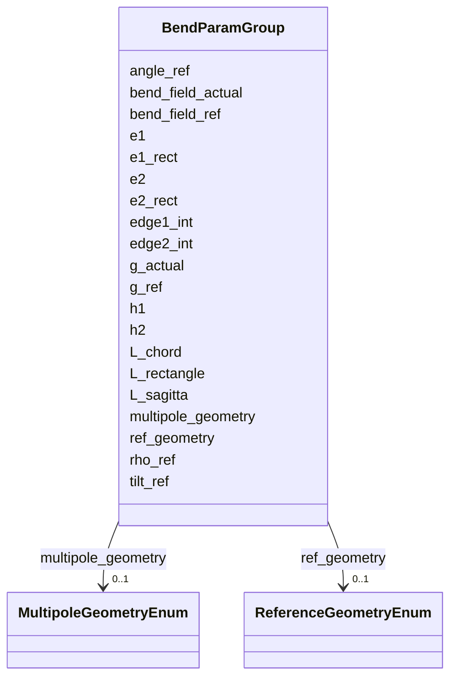

# Class: BendParamGroup 


_Mixin for bend parameters, which can be used to describe the bending properties of an accelerator element._

_This mixin is aligned with PALS BendP for interoperability with the Particle Accelerator Language Standard (PALS)._


URI: [pals:BendParamGroup](https://pals-project.readthedocs.io/BendParamGroup)





<!-- no inheritance hierarchy -->

## Slots

| Name | Cardinality and Range | Description | Inheritance |
| ---  | --- | --- | --- |
| [angle_ref](angle_ref.md) | 0..1 <br/> [Float](Float.md) | Reference bend angle | direct |
| [bend_field_ref](bend_field_ref.md) | 0..1 <br/> [Float](Float.md) | Reference bend field | direct |
| [bend_field_actual](bend_field_actual.md) | 0..1 <br/> [Float](Float.md) | Actual bend field | direct |
| [e1](e1.md) | 0..1 <br/> [Float](Float.md) | Entrance end pole face rotation with respect to a sector geometry | direct |
| [e2](e2.md) | 0..1 <br/> [Float](Float.md) | Exit end pole face rotation with respect to a sector geometry | direct |
| [e1_rect](e1_rect.md) | 0..1 <br/> [Float](Float.md) | Entrance end pole face rotation with respect to a rectangular geometry | direct |
| [e2_rect](e2_rect.md) | 0..1 <br/> [Float](Float.md) | Exit end pole face rotation with respect to a rectangular geometry | direct |
| [edge1_int](edge1_int.md) | 0..1 <br/> [Float](Float.md) | Entrance end fringe field integral | direct |
| [edge2_int](edge2_int.md) | 0..1 <br/> [Float](Float.md) | Exit end fringe field integral | direct |
| [g_ref](g_ref.md) | 0..1 <br/> [Float](Float.md) | Reference bend strength = 1/radius_ref | direct |
| [g_actual](g_actual.md) | 0..1 <br/> [Float](Float.md) | Actual bend strength = 1/radius_actual | direct |
| [h1](h1.md) | 0..1 <br/> [Float](Float.md) | Entrance end pole face curvature | direct |
| [h2](h2.md) | 0..1 <br/> [Float](Float.md) | Exit end pole face curvature | direct |
| [L_chord](L_chord.md) | 0..1 <br/> [Float](Float.md) | Chord length of the bend | direct |
| [L_sagitta](L_sagitta.md) | 0..1 <br/> [Float](Float.md) | Output parameter | direct |
| [L_rectangle](L_rectangle.md) | 0..1 <br/> [Float](Float.md) | Rectangular length | direct |
| [multipole_geometry](multipole_geometry.md) | 0..1 <br/> [MultipoleGeometryEnum](MultipoleGeometryEnum.md) | Multipole geometry type | direct |
| [ref_geometry](ref_geometry.md) | 0..1 <br/> [ReferenceGeometryEnum](ReferenceGeometryEnum.md) | Reference geometry type | direct |
| [rho_ref](rho_ref.md) | 0..1 <br/> [Float](Float.md) | Reference bend radius | direct |
| [tilt_ref](tilt_ref.md) | 0..1 <br/> [Float](Float.md) | Reference tilt of the bend | direct |


## Usages

| used by | used in | type | used |
| ---  | --- | --- | --- |
| [HasBendP](HasBendP.md) | [BendP](BendP.md) | range | [BendParamGroup](BendParamGroup.md) |
| [Bend](Bend.md) | [BendP](BendP.md) | range | [BendParamGroup](BendParamGroup.md) |


## Rules


### 

| Rule Applied | Preconditions | Postconditions | Elseconditions |
|--------------|---------------|----------------|----------------|
| slot_conditions |```{'multipole_geometry': {'value_presence': 'PRESENT'}}``` |```{'multipole_geometry': {'equals_expression': 'follows_ref_geometry'}}``` | |


### 

| Rule Applied | Preconditions | Postconditions | Elseconditions |
|--------------|---------------|----------------|----------------|
| slot_conditions |```{'ref_geometry': {'value_presence': 'PRESENT'}}``` |```{'ref_geometry': {'equals_expression': 'arc'}}``` | |


## Identifier and Mapping Information


### Schema Source


* from schema: https://w3id.org/accelerator-core


## Mappings

| Mapping Type | Mapped Value |
| ---  | ---  |
| self | pals:BendParamGroup |
| native | pals:BendParamGroup |
| exact | pals:BendP |


## LinkML Source

<!-- TODO: investigate https://stackoverflow.com/questions/37606292/how-to-create-tabbed-code-blocks-in-mkdocs-or-sphinx -->

### Direct

<details>
```yaml
name: BendParamGroup
description: 'Mixin for bend parameters, which can be used to describe the bending
  properties of an accelerator element.

  This mixin is aligned with PALS BendP for interoperability with the Particle Accelerator
  Language Standard (PALS).'
from_schema: https://w3id.org/accelerator-core
exact_mappings:
- pals:BendP
attributes:
  angle_ref:
    name: angle_ref
    description: Reference bend angle.
    from_schema: https://w3id.org/accelerator-core
    rank: 1000
    slot_uri: pals:angle_ref
    domain_of:
    - BendParamGroup
    range: float
    unit:
      ucum_code: rad
  bend_field_ref:
    name: bend_field_ref
    description: Reference bend field.
    from_schema: https://w3id.org/accelerator-core
    rank: 1000
    slot_uri: pals:bend_field_ref
    domain_of:
    - BendParamGroup
    range: float
    unit:
      ucum_code: T
  bend_field_actual:
    name: bend_field_actual
    description: Actual bend field.
    from_schema: https://w3id.org/accelerator-core
    rank: 1000
    slot_uri: pals:bend_field_actual
    domain_of:
    - BendParamGroup
    range: float
    unit:
      ucum_code: T
  e1:
    name: e1
    description: Entrance end pole face rotation with respect to a sector geometry.
    from_schema: https://w3id.org/accelerator-core
    rank: 1000
    slot_uri: pals:e1
    domain_of:
    - BendParamGroup
    range: float
    unit:
      ucum_code: rad
  e2:
    name: e2
    description: Exit end pole face rotation with respect to a sector geometry.
    from_schema: https://w3id.org/accelerator-core
    rank: 1000
    slot_uri: pals:e2
    domain_of:
    - BendParamGroup
    range: float
    unit:
      ucum_code: rad
  e1_rect:
    name: e1_rect
    description: Entrance end pole face rotation with respect to a rectangular geometry.
    from_schema: https://w3id.org/accelerator-core
    rank: 1000
    slot_uri: pals:e1_rect
    domain_of:
    - BendParamGroup
    range: float
    unit:
      ucum_code: rad
  e2_rect:
    name: e2_rect
    description: Exit end pole face rotation with respect to a rectangular geometry.
    from_schema: https://w3id.org/accelerator-core
    rank: 1000
    slot_uri: pals:e2_rect
    domain_of:
    - BendParamGroup
    range: float
    unit:
      ucum_code: rad
  edge1_int:
    name: edge1_int
    description: Entrance end fringe field integral.
    from_schema: https://w3id.org/accelerator-core
    rank: 1000
    slot_uri: pals:edge1_int
    domain_of:
    - BendParamGroup
    range: float
    unit:
      ucum_code: T.m
  edge2_int:
    name: edge2_int
    description: Exit end fringe field integral.
    from_schema: https://w3id.org/accelerator-core
    rank: 1000
    slot_uri: pals:edge2_int
    domain_of:
    - BendParamGroup
    range: float
    unit:
      ucum_code: T.m
  g_ref:
    name: g_ref
    description: Reference bend strength = 1/radius_ref
    from_schema: https://w3id.org/accelerator-core
    rank: 1000
    slot_uri: pals:g_ref
    domain_of:
    - BendParamGroup
    range: float
    unit:
      ucum_code: 1/m
  g_actual:
    name: g_actual
    description: Actual bend strength = 1/radius_actual
    from_schema: https://w3id.org/accelerator-core
    rank: 1000
    slot_uri: pals:g_actual
    domain_of:
    - BendParamGroup
    range: float
    unit:
      ucum_code: 1/m
  h1:
    name: h1
    description: Entrance end pole face curvature
    from_schema: https://w3id.org/accelerator-core
    rank: 1000
    slot_uri: pals:h1
    domain_of:
    - BendParamGroup
    range: float
    unit:
      ucum_code: 1/m
  h2:
    name: h2
    description: Exit end pole face curvature
    from_schema: https://w3id.org/accelerator-core
    rank: 1000
    slot_uri: pals:h2
    domain_of:
    - BendParamGroup
    range: float
    unit:
      ucum_code: 1/m
  L_chord:
    name: L_chord
    description: Chord length of the bend.
    from_schema: https://w3id.org/accelerator-core
    rank: 1000
    slot_uri: pals:L_chord
    domain_of:
    - BendParamGroup
    range: float
    unit:
      ucum_code: m
  L_sagitta:
    name: L_sagitta
    description: Output parameter. Sagitta length.
    from_schema: https://w3id.org/accelerator-core
    rank: 1000
    slot_uri: pals:L_sagitta
    domain_of:
    - BendParamGroup
    range: float
    unit:
      ucum_code: m
  L_rectangle:
    name: L_rectangle
    description: Rectangular length.
    from_schema: https://w3id.org/accelerator-core
    rank: 1000
    slot_uri: pals:L_rectangle
    domain_of:
    - BendParamGroup
    range: float
    unit:
      ucum_code: m
  multipole_geometry:
    name: multipole_geometry
    description: Multipole geometry type. Must be `follows_ref_geometry`.
    from_schema: https://w3id.org/accelerator-core
    rank: 1000
    slot_uri: pals:multipole_geometry
    domain_of:
    - BendParamGroup
    range: MultipoleGeometryEnum
  ref_geometry:
    name: ref_geometry
    description: Reference geometry type. Must be `arc`.
    from_schema: https://w3id.org/accelerator-core
    rank: 1000
    slot_uri: pals:ref_geometry
    domain_of:
    - BendParamGroup
    range: ReferenceGeometryEnum
  rho_ref:
    name: rho_ref
    description: Reference bend radius.
    from_schema: https://w3id.org/accelerator-core
    rank: 1000
    slot_uri: pals:rho_ref
    domain_of:
    - BendParamGroup
    range: float
    unit:
      ucum_code: m
  tilt_ref:
    name: tilt_ref
    description: Reference tilt of the bend.
    from_schema: https://w3id.org/accelerator-core
    rank: 1000
    slot_uri: pals:tilt_ref
    domain_of:
    - BendParamGroup
    range: float
    unit:
      ucum_code: rad
rules:
- preconditions:
    slot_conditions:
      multipole_geometry:
        name: multipole_geometry
        value_presence: PRESENT
  postconditions:
    slot_conditions:
      multipole_geometry:
        name: multipole_geometry
        equals_expression: follows_ref_geometry
  description: multipole_geometry must be follows_ref_geometry
- preconditions:
    slot_conditions:
      ref_geometry:
        name: ref_geometry
        value_presence: PRESENT
  postconditions:
    slot_conditions:
      ref_geometry:
        name: ref_geometry
        equals_expression: arc
  description: ref_geometry must be arc

```
</details>

### Induced

<details>
```yaml
name: BendParamGroup
description: 'Mixin for bend parameters, which can be used to describe the bending
  properties of an accelerator element.

  This mixin is aligned with PALS BendP for interoperability with the Particle Accelerator
  Language Standard (PALS).'
from_schema: https://w3id.org/accelerator-core
exact_mappings:
- pals:BendP
attributes:
  angle_ref:
    name: angle_ref
    description: Reference bend angle.
    from_schema: https://w3id.org/accelerator-core
    rank: 1000
    slot_uri: pals:angle_ref
    alias: angle_ref
    owner: BendParamGroup
    domain_of:
    - BendParamGroup
    range: float
    unit:
      ucum_code: rad
  bend_field_ref:
    name: bend_field_ref
    description: Reference bend field.
    from_schema: https://w3id.org/accelerator-core
    rank: 1000
    slot_uri: pals:bend_field_ref
    alias: bend_field_ref
    owner: BendParamGroup
    domain_of:
    - BendParamGroup
    range: float
    unit:
      ucum_code: T
  bend_field_actual:
    name: bend_field_actual
    description: Actual bend field.
    from_schema: https://w3id.org/accelerator-core
    rank: 1000
    slot_uri: pals:bend_field_actual
    alias: bend_field_actual
    owner: BendParamGroup
    domain_of:
    - BendParamGroup
    range: float
    unit:
      ucum_code: T
  e1:
    name: e1
    description: Entrance end pole face rotation with respect to a sector geometry.
    from_schema: https://w3id.org/accelerator-core
    rank: 1000
    slot_uri: pals:e1
    alias: e1
    owner: BendParamGroup
    domain_of:
    - BendParamGroup
    range: float
    unit:
      ucum_code: rad
  e2:
    name: e2
    description: Exit end pole face rotation with respect to a sector geometry.
    from_schema: https://w3id.org/accelerator-core
    rank: 1000
    slot_uri: pals:e2
    alias: e2
    owner: BendParamGroup
    domain_of:
    - BendParamGroup
    range: float
    unit:
      ucum_code: rad
  e1_rect:
    name: e1_rect
    description: Entrance end pole face rotation with respect to a rectangular geometry.
    from_schema: https://w3id.org/accelerator-core
    rank: 1000
    slot_uri: pals:e1_rect
    alias: e1_rect
    owner: BendParamGroup
    domain_of:
    - BendParamGroup
    range: float
    unit:
      ucum_code: rad
  e2_rect:
    name: e2_rect
    description: Exit end pole face rotation with respect to a rectangular geometry.
    from_schema: https://w3id.org/accelerator-core
    rank: 1000
    slot_uri: pals:e2_rect
    alias: e2_rect
    owner: BendParamGroup
    domain_of:
    - BendParamGroup
    range: float
    unit:
      ucum_code: rad
  edge1_int:
    name: edge1_int
    description: Entrance end fringe field integral.
    from_schema: https://w3id.org/accelerator-core
    rank: 1000
    slot_uri: pals:edge1_int
    alias: edge1_int
    owner: BendParamGroup
    domain_of:
    - BendParamGroup
    range: float
    unit:
      ucum_code: T.m
  edge2_int:
    name: edge2_int
    description: Exit end fringe field integral.
    from_schema: https://w3id.org/accelerator-core
    rank: 1000
    slot_uri: pals:edge2_int
    alias: edge2_int
    owner: BendParamGroup
    domain_of:
    - BendParamGroup
    range: float
    unit:
      ucum_code: T.m
  g_ref:
    name: g_ref
    description: Reference bend strength = 1/radius_ref
    from_schema: https://w3id.org/accelerator-core
    rank: 1000
    slot_uri: pals:g_ref
    alias: g_ref
    owner: BendParamGroup
    domain_of:
    - BendParamGroup
    range: float
    unit:
      ucum_code: 1/m
  g_actual:
    name: g_actual
    description: Actual bend strength = 1/radius_actual
    from_schema: https://w3id.org/accelerator-core
    rank: 1000
    slot_uri: pals:g_actual
    alias: g_actual
    owner: BendParamGroup
    domain_of:
    - BendParamGroup
    range: float
    unit:
      ucum_code: 1/m
  h1:
    name: h1
    description: Entrance end pole face curvature
    from_schema: https://w3id.org/accelerator-core
    rank: 1000
    slot_uri: pals:h1
    alias: h1
    owner: BendParamGroup
    domain_of:
    - BendParamGroup
    range: float
    unit:
      ucum_code: 1/m
  h2:
    name: h2
    description: Exit end pole face curvature
    from_schema: https://w3id.org/accelerator-core
    rank: 1000
    slot_uri: pals:h2
    alias: h2
    owner: BendParamGroup
    domain_of:
    - BendParamGroup
    range: float
    unit:
      ucum_code: 1/m
  L_chord:
    name: L_chord
    description: Chord length of the bend.
    from_schema: https://w3id.org/accelerator-core
    rank: 1000
    slot_uri: pals:L_chord
    alias: L_chord
    owner: BendParamGroup
    domain_of:
    - BendParamGroup
    range: float
    unit:
      ucum_code: m
  L_sagitta:
    name: L_sagitta
    description: Output parameter. Sagitta length.
    from_schema: https://w3id.org/accelerator-core
    rank: 1000
    slot_uri: pals:L_sagitta
    alias: L_sagitta
    owner: BendParamGroup
    domain_of:
    - BendParamGroup
    range: float
    unit:
      ucum_code: m
  L_rectangle:
    name: L_rectangle
    description: Rectangular length.
    from_schema: https://w3id.org/accelerator-core
    rank: 1000
    slot_uri: pals:L_rectangle
    alias: L_rectangle
    owner: BendParamGroup
    domain_of:
    - BendParamGroup
    range: float
    unit:
      ucum_code: m
  multipole_geometry:
    name: multipole_geometry
    description: Multipole geometry type. Must be `follows_ref_geometry`.
    from_schema: https://w3id.org/accelerator-core
    rank: 1000
    slot_uri: pals:multipole_geometry
    alias: multipole_geometry
    owner: BendParamGroup
    domain_of:
    - BendParamGroup
    range: MultipoleGeometryEnum
  ref_geometry:
    name: ref_geometry
    description: Reference geometry type. Must be `arc`.
    from_schema: https://w3id.org/accelerator-core
    rank: 1000
    slot_uri: pals:ref_geometry
    alias: ref_geometry
    owner: BendParamGroup
    domain_of:
    - BendParamGroup
    range: ReferenceGeometryEnum
  rho_ref:
    name: rho_ref
    description: Reference bend radius.
    from_schema: https://w3id.org/accelerator-core
    rank: 1000
    slot_uri: pals:rho_ref
    alias: rho_ref
    owner: BendParamGroup
    domain_of:
    - BendParamGroup
    range: float
    unit:
      ucum_code: m
  tilt_ref:
    name: tilt_ref
    description: Reference tilt of the bend.
    from_schema: https://w3id.org/accelerator-core
    rank: 1000
    slot_uri: pals:tilt_ref
    alias: tilt_ref
    owner: BendParamGroup
    domain_of:
    - BendParamGroup
    range: float
    unit:
      ucum_code: rad
rules:
- preconditions:
    slot_conditions:
      multipole_geometry:
        name: multipole_geometry
        value_presence: PRESENT
  postconditions:
    slot_conditions:
      multipole_geometry:
        name: multipole_geometry
        equals_expression: follows_ref_geometry
  description: multipole_geometry must be follows_ref_geometry
- preconditions:
    slot_conditions:
      ref_geometry:
        name: ref_geometry
        value_presence: PRESENT
  postconditions:
    slot_conditions:
      ref_geometry:
        name: ref_geometry
        equals_expression: arc
  description: ref_geometry must be arc

```
</details>