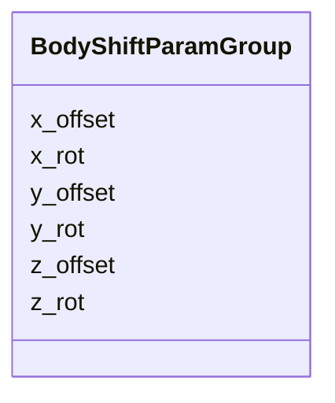

# Class: BodyShiftParamGroup 


_Mixin class for floor plan shift parameters that are aligned with PALS BodyShiftP (Floor Plan Shift Parameters)  for interoperability with the Particle Accelerator Language Standard (PALS)._


URI: [pals:BodyShiftParamGroup](https://pals-project.readthedocs.io/BodyShiftParamGroup)





<!-- no inheritance hierarchy -->


## Slots

| Name | Cardinality and Range | Description | Inheritance |
| ---  | --- | --- | --- |
| [x_offset](x_offset.md) | 0..1 <br/> [Float](Float.md) | Shift in the X direction in the facility floor plan | direct |
| [y_offset](y_offset.md) | 0..1 <br/> [Float](Float.md) | Shift in the Y direction in the facility floor plan | direct |
| [z_offset](z_offset.md) | 0..1 <br/> [Float](Float.md) | Shift in the Z direction in the facility floor plan | direct |
| [x_rot](x_rot.md) | 0..1 <br/> [Float](Float.md) | Rotation around the X-axis in the facility floor plan | direct |
| [y_rot](y_rot.md) | 0..1 <br/> [Float](Float.md) | Rotation around the Y-axis in the facility floor plan | direct |
| [z_rot](z_rot.md) | 0..1 <br/> [Float](Float.md) | Rotation around the Z-axis in the facility floor plan | direct |


## Usages

| used by | used in | type | used |
| ---  | --- | --- | --- |
| [HasBodyShiftP](HasBodyShiftP.md) | [BodyShiftP](BodyShiftP.md) | range | [BodyShiftParamGroup](BodyShiftParamGroup.md) |
| [Magnet](Magnet.md) | [BodyShiftP](BodyShiftP.md) | range | [BodyShiftParamGroup](BodyShiftParamGroup.md) |
| [Solenoid](Solenoid.md) | [BodyShiftP](BodyShiftP.md) | range | [BodyShiftParamGroup](BodyShiftParamGroup.md) |
| [Multipole](Multipole.md) | [BodyShiftP](BodyShiftP.md) | range | [BodyShiftParamGroup](BodyShiftParamGroup.md) |
| [Bend](Bend.md) | [BodyShiftP](BodyShiftP.md) | range | [BodyShiftParamGroup](BodyShiftParamGroup.md) |
| [Quadrupole](Quadrupole.md) | [BodyShiftP](BodyShiftP.md) | range | [BodyShiftParamGroup](BodyShiftParamGroup.md) |
| [Octupole](Octupole.md) | [BodyShiftP](BodyShiftP.md) | range | [BodyShiftParamGroup](BodyShiftParamGroup.md) |
| [Sextupole](Sextupole.md) | [BodyShiftP](BodyShiftP.md) | range | [BodyShiftParamGroup](BodyShiftParamGroup.md) |
| [Kicker](Kicker.md) | [BodyShiftP](BodyShiftP.md) | range | [BodyShiftParamGroup](BodyShiftParamGroup.md) |
| [ACKicker](ACKicker.md) | [BodyShiftP](BodyShiftP.md) | range | [BodyShiftParamGroup](BodyShiftParamGroup.md) |
| [BeamProfileMonitor](BeamProfileMonitor.md) | [BodyShiftP](BodyShiftP.md) | range | [BodyShiftParamGroup](BodyShiftParamGroup.md) |
| [BeamPositionMonitor](BeamPositionMonitor.md) | [BodyShiftP](BodyShiftP.md) | range | [BodyShiftParamGroup](BodyShiftParamGroup.md) |
| [RadiationMonitor](RadiationMonitor.md) | [BodyShiftP](BodyShiftP.md) | range | [BodyShiftParamGroup](BodyShiftParamGroup.md) |
| [Cavity](Cavity.md) | [BodyShiftP](BodyShiftP.md) | range | [BodyShiftParamGroup](BodyShiftParamGroup.md) |
| [CrabCavity](CrabCavity.md) | [BodyShiftP](BodyShiftP.md) | range | [BodyShiftParamGroup](BodyShiftParamGroup.md) |
| [RFCavity](RFCavity.md) | [BodyShiftP](BodyShiftP.md) | range | [BodyShiftParamGroup](BodyShiftParamGroup.md) |
| [NormalConductingRFCavity](NormalConductingRFCavity.md) | [BodyShiftP](BodyShiftP.md) | range | [BodyShiftParamGroup](BodyShiftParamGroup.md) |
| [SuperConductingRFCavity](SuperConductingRFCavity.md) | [BodyShiftP](BodyShiftP.md) | range | [BodyShiftParamGroup](BodyShiftParamGroup.md) |
| [SupportingFacilityComponent](SupportingFacilityComponent.md) | [BodyShiftP](BodyShiftP.md) | range | [BodyShiftParamGroup](BodyShiftParamGroup.md) |
| [BookkeepingComponent](BookkeepingComponent.md) | [BodyShiftP](BodyShiftP.md) | range | [BodyShiftParamGroup](BodyShiftParamGroup.md) |
| [Marker](Marker.md) | [BodyShiftP](BodyShiftP.md) | range | [BodyShiftParamGroup](BodyShiftParamGroup.md) |
| [BeamLineSection](BeamLineSection.md) | [BodyShiftP](BodyShiftP.md) | range | [BodyShiftParamGroup](BodyShiftParamGroup.md) |


## Identifier and Mapping Information


### Schema Source


* from schema: https://w3id.org/accelerator-core


## Mappings

| Mapping Type | Mapped Value |
| ---  | ---  |
| self | pals:BodyShiftParamGroup |
| native | pals:BodyShiftParamGroup |
| broad | pals:BodyShiftP |


## LinkML Source

<!-- TODO: investigate https://stackoverflow.com/questions/37606292/how-to-create-tabbed-code-blocks-in-mkdocs-or-sphinx -->

### Direct

<details>
```yaml
name: BodyShiftParamGroup
description: Mixin class for floor plan shift parameters that are aligned with PALS
  BodyShiftP (Floor Plan Shift Parameters)  for interoperability with the Particle
  Accelerator Language Standard (PALS).
from_schema: https://w3id.org/accelerator-core
broad_mappings:
- pals:BodyShiftP
attributes:
  x_offset:
    name: x_offset
    description: Shift in the X direction in the facility floor plan.
    from_schema: https://w3id.org/accelerator-core
    aliases:
    - delta_x
    - x_shift
    - GlobalOffsetX
    rank: 1000
    slot_uri: pals:x_offset
    domain_of:
    - BodyShiftParamGroup
    range: float
  y_offset:
    name: y_offset
    description: Shift in the Y direction in the facility floor plan.
    from_schema: https://w3id.org/accelerator-core
    aliases:
    - delta_y
    - y_shift
    - GlobalOffsetY
    rank: 1000
    slot_uri: pals:y_offset
    domain_of:
    - BodyShiftParamGroup
    range: float
  z_offset:
    name: z_offset
    description: Shift in the Z direction in the facility floor plan.
    from_schema: https://w3id.org/accelerator-core
    aliases:
    - delta_z
    - z_shift
    - GlobalOffsetZ
    rank: 1000
    slot_uri: pals:z_offset
    domain_of:
    - BodyShiftParamGroup
    range: float
  x_rot:
    name: x_rot
    description: Rotation around the X-axis in the facility floor plan.
    from_schema: https://w3id.org/accelerator-core
    aliases:
    - delta_phi
    - phi_shift
    - GlobalOffsetPhi
    rank: 1000
    slot_uri: pals:x_rot
    domain_of:
    - BodyShiftParamGroup
    range: float
  y_rot:
    name: y_rot
    description: Rotation around the Y-axis in the facility floor plan.
    from_schema: https://w3id.org/accelerator-core
    aliases:
    - delta_theta
    - theta_shift
    - GlobalOffsetTheta
    rank: 1000
    slot_uri: pals:y_rot
    domain_of:
    - BodyShiftParamGroup
    range: float
  z_rot:
    name: z_rot
    description: Rotation around the Z-axis in the facility floor plan.
    from_schema: https://w3id.org/accelerator-core
    aliases:
    - delta_psi
    - psi_shift
    - GlobalOffsetPsi
    rank: 1000
    slot_uri: pals:z_rot
    domain_of:
    - BodyShiftParamGroup
    range: float

```
</details>

### Induced

<details>
```yaml
name: BodyShiftParamGroup
description: Mixin class for floor plan shift parameters that are aligned with PALS
  BodyShiftP (Floor Plan Shift Parameters)  for interoperability with the Particle
  Accelerator Language Standard (PALS).
from_schema: https://w3id.org/accelerator-core
broad_mappings:
- pals:BodyShiftP
attributes:
  x_offset:
    name: x_offset
    description: Shift in the X direction in the facility floor plan.
    from_schema: https://w3id.org/accelerator-core
    aliases:
    - delta_x
    - x_shift
    - GlobalOffsetX
    rank: 1000
    slot_uri: pals:x_offset
    alias: x_offset
    owner: BodyShiftParamGroup
    domain_of:
    - BodyShiftParamGroup
    range: float
  y_offset:
    name: y_offset
    description: Shift in the Y direction in the facility floor plan.
    from_schema: https://w3id.org/accelerator-core
    aliases:
    - delta_y
    - y_shift
    - GlobalOffsetY
    rank: 1000
    slot_uri: pals:y_offset
    alias: y_offset
    owner: BodyShiftParamGroup
    domain_of:
    - BodyShiftParamGroup
    range: float
  z_offset:
    name: z_offset
    description: Shift in the Z direction in the facility floor plan.
    from_schema: https://w3id.org/accelerator-core
    aliases:
    - delta_z
    - z_shift
    - GlobalOffsetZ
    rank: 1000
    slot_uri: pals:z_offset
    alias: z_offset
    owner: BodyShiftParamGroup
    domain_of:
    - BodyShiftParamGroup
    range: float
  x_rot:
    name: x_rot
    description: Rotation around the X-axis in the facility floor plan.
    from_schema: https://w3id.org/accelerator-core
    aliases:
    - delta_phi
    - phi_shift
    - GlobalOffsetPhi
    rank: 1000
    slot_uri: pals:x_rot
    alias: x_rot
    owner: BodyShiftParamGroup
    domain_of:
    - BodyShiftParamGroup
    range: float
  y_rot:
    name: y_rot
    description: Rotation around the Y-axis in the facility floor plan.
    from_schema: https://w3id.org/accelerator-core
    aliases:
    - delta_theta
    - theta_shift
    - GlobalOffsetTheta
    rank: 1000
    slot_uri: pals:y_rot
    alias: y_rot
    owner: BodyShiftParamGroup
    domain_of:
    - BodyShiftParamGroup
    range: float
  z_rot:
    name: z_rot
    description: Rotation around the Z-axis in the facility floor plan.
    from_schema: https://w3id.org/accelerator-core
    aliases:
    - delta_psi
    - psi_shift
    - GlobalOffsetPsi
    rank: 1000
    slot_uri: pals:z_rot
    alias: z_rot
    owner: BodyShiftParamGroup
    domain_of:
    - BodyShiftParamGroup
    range: float

```
</details>