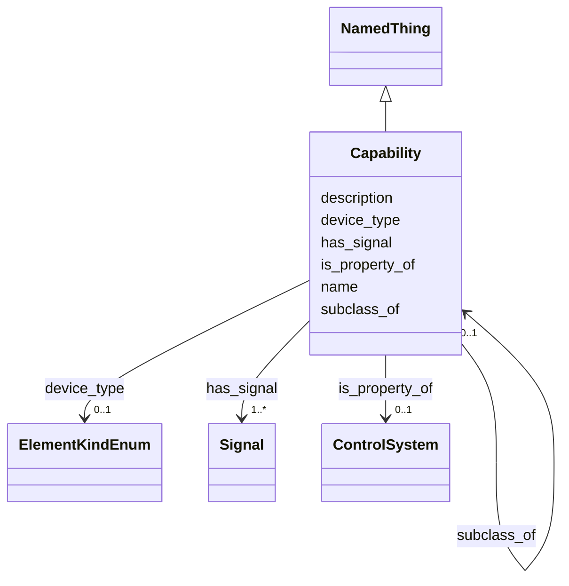

# Class: Capability 


_A reusable device-type control profile that extends a generic shared capability with type-specific signals (e.g. QuadrupoleCurrentControlProfile)._


URI: [narad:Capability](https://example.org/narad_linkml/schema/narad/Capability)





## Inheritance
* [NamedThing](NamedThing.md)
    * **Capability**


## Slots

| Name | Cardinality and Range | Description | Inheritance |
| ---  | --- | --- | --- |
| [device_type](device_type.md) | 0..1 <br/> [ElementKindEnum](ElementKindEnum.md) | Represents the generic, semantic class of the device (e | direct |
| [subclass_of](subclass_of.md) | 0..1 <br/> [Capability](Capability.md) | Links a type-specific capability to the generic capability it extends via rdf... | direct |
| [has_signal](has_signal.md) | 1..* <br/> [Signal](Signal.md) | Signals within a capability, keyed by a semantic signal name | direct |
| [is_property_of](is_property_of.md) | 0..1 <br/> [ControlSystem](ControlSystem.md) | Links the capability layer to the control systems it applies to via ssn:isPro... | direct |
| [name](name.md) | 1 <br/> [String](String.md) | Human-readable name or local string key for the entity | [NamedThing](NamedThing.md) |
| [description](description.md) | 0..1 <br/> [String](String.md) | Detailed description of the entity | [NamedThing](NamedThing.md) |


## Usages

| used by | used in | type | used |
| ---  | --- | --- | --- |
| [NaradConfig](NaradConfig.md) | [capability_layer](capability_layer.md) | range | [Capability](Capability.md) |
| [CapabilityLayer](CapabilityLayer.md) | [capabilities](capabilities.md) | range | [Capability](Capability.md) |
| [Capability](Capability.md) | [subclass_of](subclass_of.md) | range | [Capability](Capability.md) |


## Identifier and Mapping Information


### Schema Source


* from schema: https://w3id.org/narad_linkml/schema/narad/system


## Mappings

| Mapping Type | Mapped Value |
| ---  | ---  |
| self | narad:Capability |
| native | narad:Capability |


## LinkML Source

<!-- TODO: investigate https://stackoverflow.com/questions/37606292/how-to-create-tabbed-code-blocks-in-mkdocs-or-sphinx -->

### Direct

<details>
```yaml
name: Capability
description: A reusable device-type control profile that extends a generic shared
  capability with type-specific signals (e.g. QuadrupoleCurrentControlProfile).
from_schema: https://w3id.org/narad_linkml/schema/narad/system
is_a: NamedThing
slots:
- device_type
- subclass_of
- has_signal
- is_property_of
slot_usage:
  has_signal:
    name: has_signal
    required: true
  is_property_of:
    name: is_property_of
    description: Links the capability layer to the control systems it applies to via
      ssn:isPropertyOf.
    range: ControlSystem
    multivalued: false
    inlined: false
  subclass_of:
    name: subclass_of
    description: Links a type-specific capability to the generic capability it extends
      via rdfs:subClassOf.
    range: Capability
    multivalued: false
    inlined: false

```
</details>

### Induced

<details>
```yaml
name: Capability
description: A reusable device-type control profile that extends a generic shared
  capability with type-specific signals (e.g. QuadrupoleCurrentControlProfile).
from_schema: https://w3id.org/narad_linkml/schema/narad/system
is_a: NamedThing
slot_usage:
  has_signal:
    name: has_signal
    required: true
  is_property_of:
    name: is_property_of
    description: Links the capability layer to the control systems it applies to via
      ssn:isPropertyOf.
    range: ControlSystem
    multivalued: false
    inlined: false
  subclass_of:
    name: subclass_of
    description: Links a type-specific capability to the generic capability it extends
      via rdfs:subClassOf.
    range: Capability
    multivalued: false
    inlined: false
attributes:
  device_type:
    name: device_type
    description: Represents the generic, semantic class of the device (e.g., "Quadrupole",
      "BPM") and is used for capability, instrument, and signal profile matching.
    in_subset:
    - label
    from_schema: https://w3id.org/narad_linkml/schema/narad/system
    rank: 1000
    alias: device_type
    owner: Capability
    domain_of:
    - Capability
    - Device
    - SystemCapability
    range: ElementKindEnum
  subclass_of:
    name: subclass_of
    description: Links a type-specific capability to the generic capability it extends
      via rdfs:subClassOf.
    in_subset:
    - relationship
    from_schema: https://w3id.org/narad_linkml/schema/narad/system
    exact_mappings:
    - rdfs:subClassOf
    rank: 1000
    alias: subclass_of
    owner: Capability
    domain_of:
    - Capability
    - Device
    range: Capability
    multivalued: false
    inlined: false
  has_signal:
    name: has_signal
    description: Signals within a capability, keyed by a semantic signal name.
    in_subset:
    - relationship
    from_schema: https://w3id.org/narad_linkml/schema/narad/system
    rank: 1000
    alias: has_signal
    owner: Capability
    domain_of:
    - Capability
    range: Signal
    required: true
    multivalued: true
    inlined: true
  is_property_of:
    name: is_property_of
    description: Links the capability layer to the control systems it applies to via
      ssn:isPropertyOf.
    in_subset:
    - relationship
    from_schema: https://w3id.org/narad_linkml/schema/narad/system
    broad_mappings:
    - ssn:isPropertyOf
    rank: 1000
    alias: is_property_of
    owner: Capability
    domain_of:
    - Capability
    - InstanceSignalBinding
    range: ControlSystem
    multivalued: false
    inlined: false
  name:
    name: name
    description: Human-readable name or local string key for the entity.
    in_subset:
    - label
    from_schema: https://w3id.org/narad_linkml/schema/narad/system
    rank: 1000
    identifier: true
    alias: name
    owner: Capability
    domain_of:
    - NamedThing
    range: string
    required: true
  description:
    name: description
    description: Detailed description of the entity.
    in_subset:
    - label
    from_schema: https://w3id.org/narad_linkml/schema/narad/system
    rank: 1000
    alias: description
    owner: Capability
    domain_of:
    - NamedThing
    - NamingConventionExample
    - TemplateExample
    range: string

```
</details>