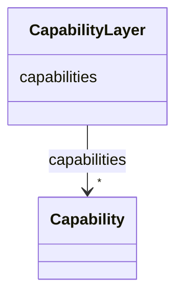

# Class: CapabilityLayer 


_Capability-layer container for control profile families._


URI: [narad:CapabilityLayer](https://example.org/narad_linkml/schema/narad/CapabilityLayer)





<!-- no inheritance hierarchy -->


## Slots

| Name | Cardinality and Range | Description | Inheritance |
| ---  | --- | --- | --- |
| [capabilities](capabilities.md) | * <br/> [Capability](Capability.md) |  | direct |


## Identifier and Mapping Information


### Schema Source


* from schema: https://w3id.org/narad_linkml/schema/narad/system


## Mappings

| Mapping Type | Mapped Value |
| ---  | ---  |
| self | narad:CapabilityLayer |
| native | narad:CapabilityLayer |


## LinkML Source

<!-- TODO: investigate https://stackoverflow.com/questions/37606292/how-to-create-tabbed-code-blocks-in-mkdocs-or-sphinx -->

### Direct

<details>
```yaml
name: CapabilityLayer
description: Capability-layer container for control profile families.
from_schema: https://w3id.org/narad_linkml/schema/narad/system
slots:
- capabilities

```
</details>

### Induced

<details>
```yaml
name: CapabilityLayer
description: Capability-layer container for control profile families.
from_schema: https://w3id.org/narad_linkml/schema/narad/system
attributes:
  capabilities:
    name: capabilities
    from_schema: https://w3id.org/narad_linkml/schema/narad/system
    rank: 1000
    alias: capabilities
    owner: CapabilityLayer
    domain_of:
    - CapabilityLayer
    range: Capability
    multivalued: true
    inlined: true

```
</details>