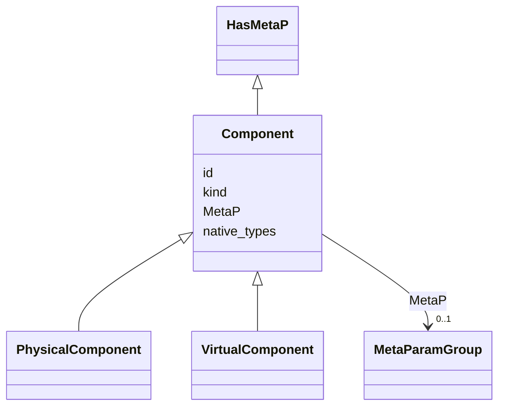

# Class: Component 


_A general class for accelerator components, which can be specialized into more specific types like AcceleratorDevice, Magnet, etc._


* __NOTE__: this is an abstract class and should not be instantiated directly


URI: [pals:Component](https://pals-project.readthedocs.io/Component)





## Inheritance
* **Component** [ [HasMetaP](HasMetaP.md)]
    * [PhysicalComponent](PhysicalComponent.md) [ [HasFloorP](HasFloorP.md) [HasLongitudinalPlacementP](HasLongitudinalPlacementP.md)]
    * [VirtualComponent](VirtualComponent.md) [ [HasFloorP](HasFloorP.md)]


## Slots

| Name | Cardinality and Range | Description | Inheritance |
| ---  | --- | --- | --- |
| [id](id.md) | 1 <br/> [String](String.md) | A unique identifier for the instance | direct |
| [kind](kind.md) | 1 <br/> [String](String.md) | The LinkML class name of this instance | direct |
| [native_types](native_types.md) | * <br/> [String](String.md) | The native type of the component in the source system, which can be used to i... | direct |
| [MetaP](MetaP.md) | 0..1 <br/> [MetaParamGroup](MetaParamGroup.md) | A mixin for metadata parameters that are aligned with PALS MetaP (Metadata Pa... | [HasMetaP](HasMetaP.md) |


## Usages

| used by | used in | type | used |
| ---  | --- | --- | --- |
| [Facility](Facility.md) | [components](components.md) | range | [Component](Component.md) |
| [ComponentRelation](ComponentRelation.md) | [subject](subject.md) | range | [Component](Component.md) |
| [ComponentRelation](ComponentRelation.md) | [object](object.md) | range | [Component](Component.md) |


## Identifier and Mapping Information


### Schema Source


* from schema: https://w3id.org/accelerator-core


## Mappings

| Mapping Type | Mapped Value |
| ---  | ---  |
| self | pals:Component |
| native | pals:Component |
| broad | pals:Element |


## LinkML Source

<!-- TODO: investigate https://stackoverflow.com/questions/37606292/how-to-create-tabbed-code-blocks-in-mkdocs-or-sphinx -->

### Direct

<details>
```yaml
name: Component
description: A general class for accelerator components, which can be specialized
  into more specific types like AcceleratorDevice, Magnet, etc.
from_schema: https://w3id.org/accelerator-core
broad_mappings:
- pals:Element
abstract: true
mixins:
- HasMetaP
slots:
- id
- kind
attributes:
  native_types:
    name: native_types
    description: The native type of the component in the source system, which can
      be used to identify the component across different source systems.
    from_schema: https://w3id.org/accelerator-core
    rank: 1000
    domain_of:
    - Component
    range: string
    multivalued: true

```
</details>

### Induced

<details>
```yaml
name: Component
description: A general class for accelerator components, which can be specialized
  into more specific types like AcceleratorDevice, Magnet, etc.
from_schema: https://w3id.org/accelerator-core
broad_mappings:
- pals:Element
abstract: true
mixins:
- HasMetaP
attributes:
  native_types:
    name: native_types
    description: The native type of the component in the source system, which can
      be used to identify the component across different source systems.
    from_schema: https://w3id.org/accelerator-core
    rank: 1000
    alias: native_types
    owner: Component
    domain_of:
    - Component
    range: string
    multivalued: true
  id:
    name: id
    description: A unique identifier for the instance.
    from_schema: https://w3id.org/accelerator-core
    rank: 1000
    slot_uri: pals:id
    identifier: true
    alias: id
    owner: Component
    domain_of:
    - Affiliation
    - Component
    - Signal
    - Relationship
    range: string
    required: true
  kind:
    name: kind
    description: The LinkML class name of this instance.
    from_schema: https://w3id.org/accelerator-core
    rank: 1000
    slot_uri: pals:kind
    designates_type: true
    alias: kind
    owner: Component
    domain_of:
    - PALSAccelerator
    - Component
    - Signal
    range: string
    required: true
  MetaP:
    name: MetaP
    description: A mixin for metadata parameters that are aligned with PALS MetaP
      (Metadata Parameters) for interoperability with the Particle Accelerator Language
      Standard (PALS).
    from_schema: https://w3id.org/accelerator-core
    rank: 1000
    alias: MetaP
    owner: Component
    domain_of:
    - HasMetaP
    range: MetaParamGroup
    inlined: true

```
</details>