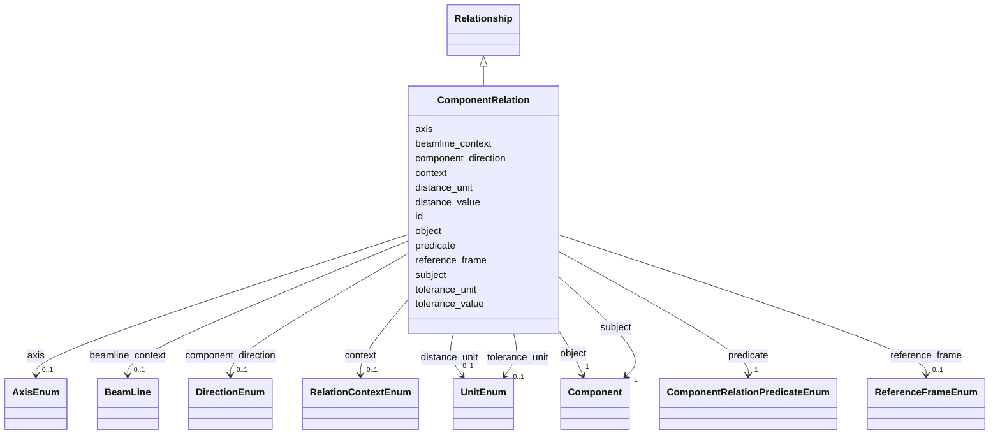

# Class: ComponentRelation 


_Association between two Components (Physical or Virtual), with supporting contextual/qualifying information about how and where the relationship holds._


URI: [pals:ComponentRelation](https://pals-project.readthedocs.io/ComponentRelation)





## Inheritance
* [Relationship](Relationship.md)
    * **ComponentRelation**


## Slots

| Name | Cardinality and Range | Description | Inheritance |
| ---  | --- | --- | --- |
| [context](context.md) | 0..1 <br/> [RelationContextEnum](RelationContextEnum.md) | The frame of reference / domain in which this relationship is asserted to hol... | direct |
| [beamline_context](beamline_context.md) | 0..1 <br/> [BeamLine](BeamLine.md) | The specific BeamLine this relationship is defined with respect to (relevant ... | direct |
| [reference_frame](reference_frame.md) | 0..1 <br/> [ReferenceFrameEnum](ReferenceFrameEnum.md) |  | direct |
| [distance_value](distance_value.md) | 0..1 <br/> [Float](Float.md) |  | direct |
| [distance_unit](distance_unit.md) | 0..1 <br/> [UnitEnum](UnitEnum.md) |  | direct |
| [axis](axis.md) | 0..1 <br/> [AxisEnum](AxisEnum.md) |  | direct |
| [component_direction](component_direction.md) | 0..1 <br/> [DirectionEnum](DirectionEnum.md) |  | direct |
| [tolerance_value](tolerance_value.md) | 0..1 <br/> [Float](Float.md) |  | direct |
| [tolerance_unit](tolerance_unit.md) | 0..1 <br/> [UnitEnum](UnitEnum.md) |  | direct |
| [id](id.md) | 1 <br/> [String](String.md) | A unique identifier for the instance | [Relationship](Relationship.md) |
| [subject](subject.md) | 1 <br/> [Component](Component.md) |  | [Relationship](Relationship.md) |
| [predicate](predicate.md) | 1 <br/> [ComponentRelationPredicateEnum](ComponentRelationPredicateEnum.md) |  | [Relationship](Relationship.md) |
| [object](object.md) | 1 <br/> [Component](Component.md) |  | [Relationship](Relationship.md) |


## Usages

| used by | used in | type | used |
| ---  | --- | --- | --- |
| [Facility](Facility.md) | [component_relations](component_relations.md) | range | [ComponentRelation](ComponentRelation.md) |


## Identifier and Mapping Information


### Schema Source


* from schema: https://w3id.org/accelerator-core


## Mappings

| Mapping Type | Mapped Value |
| ---  | ---  |
| self | pals:ComponentRelation |
| native | pals:ComponentRelation |


## LinkML Source

<!-- TODO: investigate https://stackoverflow.com/questions/37606292/how-to-create-tabbed-code-blocks-in-mkdocs-or-sphinx -->

### Direct

<details>
```yaml
name: ComponentRelation
description: Association between two Components (Physical or Virtual), with supporting
  contextual/qualifying information about how and where the relationship holds.
from_schema: https://w3id.org/accelerator-core
is_a: Relationship
slot_usage:
  subject:
    name: subject
    range: Component
  predicate:
    name: predicate
    range: ComponentRelationPredicateEnum
  object:
    name: object
    range: Component
attributes:
  context:
    name: context
    description: The frame of reference / domain in which this relationship is asserted
      to hold.
    from_schema: https://w3id.org/accelerator-core
    rank: 1000
    domain_of:
    - ComponentRelation
    range: RelationContextEnum
  beamline_context:
    name: beamline_context
    description: The specific BeamLine this relationship is defined with respect to
      (relevant when context=beamline_order).
    from_schema: https://w3id.org/accelerator-core
    rank: 1000
    domain_of:
    - ComponentRelation
    range: BeamLine
  reference_frame:
    name: reference_frame
    from_schema: https://w3id.org/accelerator-core
    rank: 1000
    domain_of:
    - ComponentRelation
    range: ReferenceFrameEnum
  distance_value:
    name: distance_value
    from_schema: https://w3id.org/accelerator-core
    rank: 1000
    domain_of:
    - ComponentRelation
    range: float
  distance_unit:
    name: distance_unit
    from_schema: https://w3id.org/accelerator-core
    rank: 1000
    domain_of:
    - ComponentRelation
    range: UnitEnum
  axis:
    name: axis
    from_schema: https://w3id.org/accelerator-core
    rank: 1000
    domain_of:
    - ComponentRelation
    range: AxisEnum
  component_direction:
    name: component_direction
    from_schema: https://w3id.org/accelerator-core
    rank: 1000
    domain_of:
    - ComponentRelation
    range: DirectionEnum
  tolerance_value:
    name: tolerance_value
    from_schema: https://w3id.org/accelerator-core
    rank: 1000
    domain_of:
    - ComponentRelation
    range: float
  tolerance_unit:
    name: tolerance_unit
    from_schema: https://w3id.org/accelerator-core
    rank: 1000
    domain_of:
    - ComponentRelation
    range: UnitEnum

```
</details>

### Induced

<details>
```yaml
name: ComponentRelation
description: Association between two Components (Physical or Virtual), with supporting
  contextual/qualifying information about how and where the relationship holds.
from_schema: https://w3id.org/accelerator-core
is_a: Relationship
slot_usage:
  subject:
    name: subject
    range: Component
  predicate:
    name: predicate
    range: ComponentRelationPredicateEnum
  object:
    name: object
    range: Component
attributes:
  context:
    name: context
    description: The frame of reference / domain in which this relationship is asserted
      to hold.
    from_schema: https://w3id.org/accelerator-core
    rank: 1000
    alias: context
    owner: ComponentRelation
    domain_of:
    - ComponentRelation
    range: RelationContextEnum
  beamline_context:
    name: beamline_context
    description: The specific BeamLine this relationship is defined with respect to
      (relevant when context=beamline_order).
    from_schema: https://w3id.org/accelerator-core
    rank: 1000
    alias: beamline_context
    owner: ComponentRelation
    domain_of:
    - ComponentRelation
    range: BeamLine
  reference_frame:
    name: reference_frame
    from_schema: https://w3id.org/accelerator-core
    rank: 1000
    alias: reference_frame
    owner: ComponentRelation
    domain_of:
    - ComponentRelation
    range: ReferenceFrameEnum
  distance_value:
    name: distance_value
    from_schema: https://w3id.org/accelerator-core
    rank: 1000
    alias: distance_value
    owner: ComponentRelation
    domain_of:
    - ComponentRelation
    range: float
  distance_unit:
    name: distance_unit
    from_schema: https://w3id.org/accelerator-core
    rank: 1000
    alias: distance_unit
    owner: ComponentRelation
    domain_of:
    - ComponentRelation
    range: UnitEnum
  axis:
    name: axis
    from_schema: https://w3id.org/accelerator-core
    rank: 1000
    alias: axis
    owner: ComponentRelation
    domain_of:
    - ComponentRelation
    range: AxisEnum
  component_direction:
    name: component_direction
    from_schema: https://w3id.org/accelerator-core
    rank: 1000
    alias: component_direction
    owner: ComponentRelation
    domain_of:
    - ComponentRelation
    range: DirectionEnum
  tolerance_value:
    name: tolerance_value
    from_schema: https://w3id.org/accelerator-core
    rank: 1000
    alias: tolerance_value
    owner: ComponentRelation
    domain_of:
    - ComponentRelation
    range: float
  tolerance_unit:
    name: tolerance_unit
    from_schema: https://w3id.org/accelerator-core
    rank: 1000
    alias: tolerance_unit
    owner: ComponentRelation
    domain_of:
    - ComponentRelation
    range: UnitEnum
  id:
    name: id
    description: A unique identifier for the instance.
    from_schema: https://w3id.org/accelerator-core
    rank: 1000
    slot_uri: pals:id
    identifier: true
    alias: id
    owner: ComponentRelation
    domain_of:
    - Affiliation
    - Component
    - Signal
    - Relationship
    range: string
    required: true
  subject:
    name: subject
    from_schema: https://w3id.org/accelerator-core
    rank: 1000
    slot_uri: rdf:subject
    alias: subject
    owner: ComponentRelation
    domain_of:
    - Relationship
    relational_role: SUBJECT
    range: Component
    required: true
  predicate:
    name: predicate
    from_schema: https://w3id.org/accelerator-core
    rank: 1000
    slot_uri: rdf:predicate
    alias: predicate
    owner: ComponentRelation
    domain_of:
    - Relationship
    relational_role: PREDICATE
    range: ComponentRelationPredicateEnum
    required: true
  object:
    name: object
    from_schema: https://w3id.org/accelerator-core
    rank: 1000
    slot_uri: rdf:object
    alias: object
    owner: ComponentRelation
    domain_of:
    - Relationship
    relational_role: OBJECT
    range: Component
    required: true

```
</details>