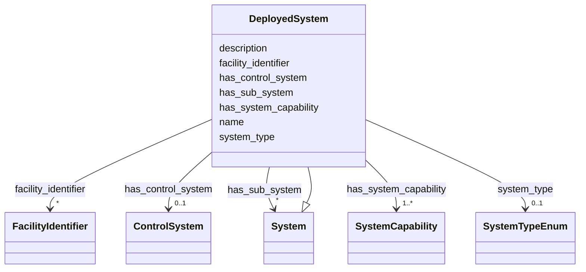

# Class: DeployedSystem 


_A deployed system, with an identified facility, that is the subject of a NARAD configuration.  This is the child of the target of the narad_config.deployed_system slot. In the SSN graph a DeployedSystem is a broad mapping to the ssn:Deployment and also is equivalent to the signal_layers.facilities entries._

__


URI: [narad:DeployedSystem](https://example.org/narad_linkml/schema/narad/DeployedSystem)





## Inheritance
* [NamedThing](NamedThing.md)
    * [System](System.md)
        * **DeployedSystem**


## Slots

| Name | Cardinality and Range | Description | Inheritance |
| ---  | --- | --- | --- |
| [facility_identifier](facility_identifier.md) | * <br/> [FacilityIdentifier](FacilityIdentifier.md) | Globally unique identifier for the facility, with specified type and value | direct |
| [has_control_system](has_control_system.md) | 0..1 <br/> [ControlSystem](ControlSystem.md) | Relates a System to one of its control systems (SSN alignment to sub system) | direct |
| [system_type](system_type.md) | 0..1 <br/> [SystemTypeEnum](SystemTypeEnum.md) | High-level system type for classification and querying - set to Facility for ... | [System](System.md) |
| [has_sub_system](has_sub_system.md) | * <br/> [System](System.md) | Relates a System to one of its subsystems (SSN alignment) | [System](System.md) |
| [has_system_capability](has_system_capability.md) | 1..* <br/> [SystemCapability](SystemCapability.md) | Relates a System to a SystemCapability it supports (SSN-System alignment) | [System](System.md) |
| [name](name.md) | 1 <br/> [String](String.md) | Human-readable name or local string key for the entity | [NamedThing](NamedThing.md) |
| [description](description.md) | 0..1 <br/> [String](String.md) | Detailed description of the entity | [NamedThing](NamedThing.md) |


## Usages

| used by | used in | type | used |
| ---  | --- | --- | --- |
| [NaradConfig](NaradConfig.md) | [deployed_system](deployed_system.md) | range | [DeployedSystem](DeployedSystem.md) |


## Identifier and Mapping Information


### Schema Source


* from schema: https://w3id.org/narad_linkml/schema/narad/system


## Mappings

| Mapping Type | Mapped Value |
| ---  | ---  |
| self | narad:DeployedSystem |
| native | narad:DeployedSystem |
| broad | ssn:Deployment, ssn-system:System |


## LinkML Source

<!-- TODO: investigate https://stackoverflow.com/questions/37606292/how-to-create-tabbed-code-blocks-in-mkdocs-or-sphinx -->

### Direct

<details>
```yaml
name: DeployedSystem
description: 'A deployed system, with an identified facility, that is the subject
  of a NARAD configuration.  This is the child of the target of the narad_config.deployed_system
  slot. In the SSN graph a DeployedSystem is a broad mapping to the ssn:Deployment
  and also is equivalent to the signal_layers.facilities entries.

  '
from_schema: https://w3id.org/narad_linkml/schema/narad/system
broad_mappings:
- ssn:Deployment
- ssn-system:System
is_a: System
slots:
- facility_identifier
- has_control_system
slot_usage:
  system_type:
    name: system_type
    description: High-level system type for classification and querying - set to Facility
      for all DeployedSystem instances.
    range: SystemTypeEnum
  has_control_system:
    name: has_control_system
    required: false
  has_system_capability:
    name: has_system_capability
    required: true
    multivalued: true

```
</details>

### Induced

<details>
```yaml
name: DeployedSystem
description: 'A deployed system, with an identified facility, that is the subject
  of a NARAD configuration.  This is the child of the target of the narad_config.deployed_system
  slot. In the SSN graph a DeployedSystem is a broad mapping to the ssn:Deployment
  and also is equivalent to the signal_layers.facilities entries.

  '
from_schema: https://w3id.org/narad_linkml/schema/narad/system
broad_mappings:
- ssn:Deployment
- ssn-system:System
is_a: System
slot_usage:
  system_type:
    name: system_type
    description: High-level system type for classification and querying - set to Facility
      for all DeployedSystem instances.
    range: SystemTypeEnum
  has_control_system:
    name: has_control_system
    required: false
  has_system_capability:
    name: has_system_capability
    required: true
    multivalued: true
attributes:
  facility_identifier:
    name: facility_identifier
    description: Globally unique identifier for the facility, with specified type
      and value.
    from_schema: https://w3id.org/narad_linkml/schema/narad/system
    rank: 1000
    alias: facility_identifier
    owner: DeployedSystem
    domain_of:
    - DeployedSystem
    range: FacilityIdentifier
    multivalued: true
    inlined: false
  has_control_system:
    name: has_control_system
    description: 'Relates a System to one of its control systems (SSN alignment to
      sub system). Use for facility → control-system, facility → device, and device
      → component decomposition.

      '
    in_subset:
    - relationship
    from_schema: https://w3id.org/narad_linkml/schema/narad/system
    broad_mappings:
    - ssn-system:hasSubSystem
    rank: 1000
    domain: System
    alias: has_control_system
    owner: DeployedSystem
    domain_of:
    - FacilitySystem
    - DeployedSystem
    range: ControlSystem
    required: false
    multivalued: false
  system_type:
    name: system_type
    description: High-level system type for classification and querying - set to Facility
      for all DeployedSystem instances.
    in_subset:
    - label
    from_schema: https://w3id.org/narad_linkml/schema/narad/system
    rank: 1000
    alias: system_type
    owner: DeployedSystem
    domain_of:
    - System
    range: SystemTypeEnum
  has_sub_system:
    name: has_sub_system
    description: 'Relates a System to one of its subsystems (SSN alignment). Use for
      facility → control-system, facility → device, and device → component decomposition.

      '
    in_subset:
    - relationship
    from_schema: https://w3id.org/narad_linkml/schema/narad/system
    exact_mappings:
    - ssn-system:hasSubSystem
    rank: 1000
    domain: System
    alias: has_sub_system
    owner: DeployedSystem
    domain_of:
    - System
    - Device
    range: System
    multivalued: true
    inlined_as_list: true
  has_system_capability:
    name: has_system_capability
    description: 'Relates a System to a SystemCapability it supports (SSN-System alignment).
      Prefer this over directly attaching signals to systems when capability context
      matters.

      '
    in_subset:
    - relationship
    from_schema: https://w3id.org/narad_linkml/schema/narad/system
    exact_mappings:
    - ssn-system:hasSystemCapability
    rank: 1000
    domain: System
    alias: has_system_capability
    owner: DeployedSystem
    domain_of:
    - System
    - Device
    range: SystemCapability
    required: true
    multivalued: true
    inlined: true
  name:
    name: name
    description: Human-readable name or local string key for the entity.
    in_subset:
    - label
    from_schema: https://w3id.org/narad_linkml/schema/narad/system
    rank: 1000
    identifier: true
    alias: name
    owner: DeployedSystem
    domain_of:
    - NamedThing
    range: string
    required: true
  description:
    name: description
    description: Detailed description of the entity.
    in_subset:
    - label
    from_schema: https://w3id.org/narad_linkml/schema/narad/system
    rank: 1000
    alias: description
    owner: DeployedSystem
    domain_of:
    - NamedThing
    - NamingConventionExample
    - TemplateExample
    range: string

```
</details>