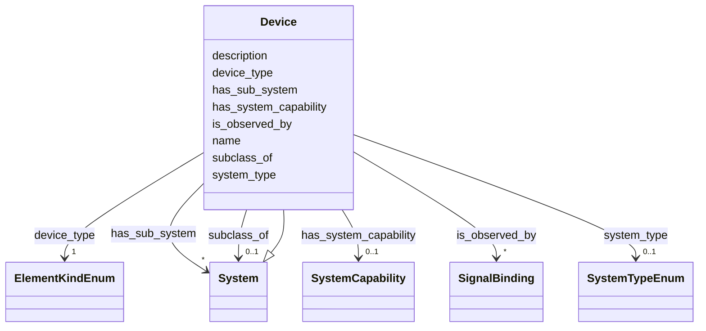

# Class: Device 


_A system representing a beam diagnostic instrument, magnet, or other non-magnet device. It represents the instrument as a whole rather than the control system for that instrument. In the SSN graph a Device is a subsystem of the Facility and a sibling to the ControlSystem. Also used in the SignalLayer to group signal bindings by device type. Aligned to ssn:System._

__


URI: [narad:Device](https://example.org/narad_linkml/schema/narad/Device)





## Inheritance
* [NamedThing](NamedThing.md)
    * [System](System.md)
        * **Device**


## Slots

| Name | Cardinality and Range | Description | Inheritance |
| ---  | --- | --- | --- |
| [device_type](device_type.md) | 1 <br/> [ElementKindEnum](ElementKindEnum.md) | Represents the generic, semantic class of the device (e | direct |
| [has_sub_system](has_sub_system.md) | * <br/> [System](System.md) | Relates a System to one of its subsystems (SSN alignment) | direct |
| [subclass_of](subclass_of.md) | 0..1 <br/> [System](System.md) | -> NARAD alias for rdfs:subClassOf | direct |
| [has_system_capability](has_system_capability.md) | 0..1 <br/> [SystemCapability](SystemCapability.md) | Relates a System to a SystemCapability it supports (SSN-System alignment) | direct |
| [is_observed_by](is_observed_by.md) | * <br/> [SignalBinding](SignalBinding.md) | Control-system-specific, e | direct |
| [system_type](system_type.md) | 0..1 <br/> [SystemTypeEnum](SystemTypeEnum.md) | High-level system type for classification and querying | [System](System.md) |
| [name](name.md) | 1 <br/> [String](String.md) | Human-readable name or local string key for the entity | [NamedThing](NamedThing.md) |
| [description](description.md) | 0..1 <br/> [String](String.md) | Detailed description of the entity | [NamedThing](NamedThing.md) |


## Usages

| used by | used in | type | used |
| ---  | --- | --- | --- |
| [NaradConfig](NaradConfig.md) | [device_layer](device_layer.md) | range | [Device](Device.md) |
| [FacilitySystem](FacilitySystem.md) | [hosts_device](hosts_device.md) | range | [Device](Device.md) |


## Identifier and Mapping Information


### Schema Source


* from schema: https://w3id.org/narad_linkml/schema/narad/system


## Mappings

| Mapping Type | Mapped Value |
| ---  | ---  |
| self | narad:Device |
| native | narad:Device |
| exact | ssn:System |
| broad | pals:Element |


## LinkML Source

<!-- TODO: investigate https://stackoverflow.com/questions/37606292/how-to-create-tabbed-code-blocks-in-mkdocs-or-sphinx -->

### Direct

<details>
```yaml
name: Device
description: 'A system representing a beam diagnostic instrument, magnet, or other
  non-magnet device. It represents the instrument as a whole rather than the control
  system for that instrument. In the SSN graph a Device is a subsystem of the Facility
  and a sibling to the ControlSystem. Also used in the SignalLayer to group signal
  bindings by device type. Aligned to ssn:System.

  '
from_schema: https://w3id.org/narad_linkml/schema/narad/system
exact_mappings:
- ssn:System
broad_mappings:
- pals:Element
is_a: System
slots:
- device_type
- has_sub_system
- subclass_of
- has_system_capability
- is_observed_by
slot_usage:
  device_type:
    name: device_type
    required: true
  is_observed_by:
    name: is_observed_by
    multivalued: true
    inlined: true
  has_sub_system:
    name: has_sub_system
    range: System
    multivalued: true
    inlined_as_list: true
  has_system_capability:
    name: has_system_capability
    range: SystemCapability
    multivalued: false
    inlined: false

```
</details>

### Induced

<details>
```yaml
name: Device
description: 'A system representing a beam diagnostic instrument, magnet, or other
  non-magnet device. It represents the instrument as a whole rather than the control
  system for that instrument. In the SSN graph a Device is a subsystem of the Facility
  and a sibling to the ControlSystem. Also used in the SignalLayer to group signal
  bindings by device type. Aligned to ssn:System.

  '
from_schema: https://w3id.org/narad_linkml/schema/narad/system
exact_mappings:
- ssn:System
broad_mappings:
- pals:Element
is_a: System
slot_usage:
  device_type:
    name: device_type
    required: true
  is_observed_by:
    name: is_observed_by
    multivalued: true
    inlined: true
  has_sub_system:
    name: has_sub_system
    range: System
    multivalued: true
    inlined_as_list: true
  has_system_capability:
    name: has_system_capability
    range: SystemCapability
    multivalued: false
    inlined: false
attributes:
  device_type:
    name: device_type
    description: Represents the generic, semantic class of the device (e.g., "Quadrupole",
      "BPM") and is used for capability, instrument, and signal profile matching.
    in_subset:
    - label
    from_schema: https://w3id.org/narad_linkml/schema/narad/system
    rank: 1000
    alias: device_type
    owner: Device
    domain_of:
    - Capability
    - Device
    - SystemCapability
    range: ElementKindEnum
    required: true
  has_sub_system:
    name: has_sub_system
    description: 'Relates a System to one of its subsystems (SSN alignment). Use for
      facility → control-system, facility → device, and device → component decomposition.

      '
    in_subset:
    - relationship
    from_schema: https://w3id.org/narad_linkml/schema/narad/system
    exact_mappings:
    - ssn-system:hasSubSystem
    rank: 1000
    domain: System
    alias: has_sub_system
    owner: Device
    domain_of:
    - System
    - Device
    range: System
    multivalued: true
    inlined_as_list: true
  subclass_of:
    name: subclass_of
    description: -> NARAD alias for rdfs:subClassOf. Links a type-specific capability
      to the generic capability it extends. In the graph this edge is labelled narad:subclassOf.
    in_subset:
    - relationship
    from_schema: https://w3id.org/narad_linkml/schema/narad/system
    exact_mappings:
    - rdfs:subClassOf
    rank: 1000
    alias: subclass_of
    owner: Device
    domain_of:
    - Capability
    - Device
    range: System
    multivalued: false
  has_system_capability:
    name: has_system_capability
    description: 'Relates a System to a SystemCapability it supports (SSN-System alignment).
      Prefer this over directly attaching signals to systems when capability context
      matters.

      '
    in_subset:
    - relationship
    from_schema: https://w3id.org/narad_linkml/schema/narad/system
    exact_mappings:
    - ssn-system:hasSystemCapability
    rank: 1000
    domain: System
    alias: has_system_capability
    owner: Device
    domain_of:
    - System
    - Device
    range: SystemCapability
    multivalued: false
    inlined: false
  is_observed_by:
    name: is_observed_by
    description: Control-system-specific, e.g. EPICS, suffix definitions keyed by
      signal name within a device/domain set. Can also be used to link a BeamlineElement
      instance to the signal bindings that observe or actuate it,  since the instance
      of the element is directly observed or controlled through a Device. Facility-specific
      bindings of signals to control-system interfaces (e.g. EPICS PVs) for a specific
      beamline element instance. These are the keyed by the semantic signal name (e.g.
      current_readback) rather than the control-system suffix, which is captured in
      the SignalBinding. The semantic signal name links the instance binding to the
      abstract Signal definition and its place in the capability profile, while the
      SignalBinding captures the concrete implementations of the abstract SignalBindings
      referenced by the element's capability profile.
    in_subset:
    - relationship
    from_schema: https://w3id.org/narad_linkml/schema/narad/system
    rank: 1000
    alias: is_observed_by
    owner: Device
    domain_of:
    - BeamlineElement
    - Device
    range: SignalBinding
    multivalued: true
    inlined: true
  system_type:
    name: system_type
    description: High-level system type for classification and querying.
    in_subset:
    - label
    from_schema: https://w3id.org/narad_linkml/schema/narad/system
    rank: 1000
    alias: system_type
    owner: Device
    domain_of:
    - System
    range: SystemTypeEnum
  name:
    name: name
    description: Human-readable name or local string key for the entity.
    in_subset:
    - label
    from_schema: https://w3id.org/narad_linkml/schema/narad/system
    rank: 1000
    identifier: true
    alias: name
    owner: Device
    domain_of:
    - NamedThing
    range: string
    required: true
  description:
    name: description
    description: Detailed description of the entity.
    in_subset:
    - label
    from_schema: https://w3id.org/narad_linkml/schema/narad/system
    rank: 1000
    alias: description
    owner: Device
    domain_of:
    - NamedThing
    - NamingConventionExample
    - TemplateExample
    range: string

```
</details>