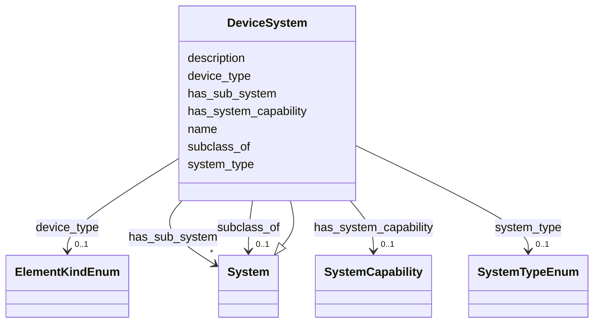

# Class: DeviceSystem 


_A system representing a beam diagnostic instrument, magnet, or other non-magnet device. It represents the instrument as a whole rather than the control system for that instrument. In the SSN graph a DeviceSystem is a subsystem of the Facility and a sibling to the ControlSystem._

__


URI: [narad:DeviceSystem](https://w3id.org/narad_linkml/schema/narad/DeviceSystem)





## Inheritance
* [NamedThing](NamedThing.md)
    * [System](System.md)
        * **DeviceSystem**


## Slots

| Name | Cardinality and Range | Description | Inheritance |
| ---  | --- | --- | --- |
| [device_type](device_type.md) | 0..1 <br/> [ElementKindEnum](ElementKindEnum.md) | Represents the generic, semantic class of the device (e | direct |
| [has_sub_system](has_sub_system.md) | * <br/> [System](System.md) | Relates a System to one of its subsystems (SSN alignment) | direct |
| [subclass_of](subclass_of.md) | 0..1 <br/> [System](System.md) | -> NARAD alias for rdfs:subClassOf | direct |
| [has_system_capability](has_system_capability.md) | 0..1 <br/> [SystemCapability](SystemCapability.md) | Relates a System to a SystemCapability it supports (SSN-System alignment) | direct |
| [system_type](system_type.md) | 0..1 <br/> [SystemTypeEnum](SystemTypeEnum.md) | High-level system type for classification and querying | [System](System.md) |
| [name](name.md) | 1 <br/> [String](String.md) | Human-readable name or local string key for the entity | [NamedThing](NamedThing.md) |
| [description](description.md) | 0..1 <br/> [String](String.md) | Detailed description of the entity | [NamedThing](NamedThing.md) |


## Usages

| used by | used in | type | used |
| ---  | --- | --- | --- |
| [NaradConfig](NaradConfig.md) | [device_layer](device_layer.md) | range | [DeviceSystem](DeviceSystem.md) |


## Identifier and Mapping Information


### Schema Source


* from schema: https://w3id.org/narad_linkml/schema/narad/system


## Mappings

| Mapping Type | Mapped Value |
| ---  | ---  |
| self | narad:DeviceSystem |
| native | narad:DeviceSystem |
| exact | ssn:System |
| broad | pals:Element |


## LinkML Source

<!-- TODO: investigate https://stackoverflow.com/questions/37606292/how-to-create-tabbed-code-blocks-in-mkdocs-or-sphinx -->

### Direct

<details>
```yaml
name: DeviceSystem
description: 'A system representing a beam diagnostic instrument, magnet, or other
  non-magnet device. It represents the instrument as a whole rather than the control
  system for that instrument. In the SSN graph a DeviceSystem is a subsystem of the
  Facility and a sibling to the ControlSystem.

  '
from_schema: https://w3id.org/narad_linkml/schema/narad/system
exact_mappings:
- ssn:System
broad_mappings:
- pals:Element
is_a: System
slots:
- device_type
- has_sub_system
- subclass_of
- has_system_capability
slot_usage:
  has_sub_system:
    name: has_sub_system
    range: System
    multivalued: true
    inlined_as_list: true
  has_system_capability:
    name: has_system_capability
    range: SystemCapability
    multivalued: false
    inlined: false

```
</details>

### Induced

<details>
```yaml
name: DeviceSystem
description: 'A system representing a beam diagnostic instrument, magnet, or other
  non-magnet device. It represents the instrument as a whole rather than the control
  system for that instrument. In the SSN graph a DeviceSystem is a subsystem of the
  Facility and a sibling to the ControlSystem.

  '
from_schema: https://w3id.org/narad_linkml/schema/narad/system
exact_mappings:
- ssn:System
broad_mappings:
- pals:Element
is_a: System
slot_usage:
  has_sub_system:
    name: has_sub_system
    range: System
    multivalued: true
    inlined_as_list: true
  has_system_capability:
    name: has_system_capability
    range: SystemCapability
    multivalued: false
    inlined: false
attributes:
  device_type:
    name: device_type
    description: Represents the generic, semantic class of the device (e.g., "Quadrupole",
      "BPM") and is used for capability, instrument, and signal profile matching.
    from_schema: https://w3id.org/narad_linkml/schema/narad/system
    rank: 1000
    alias: device_type
    owner: DeviceSystem
    domain_of:
    - ControlCapability
    - SignalDefinitions
    - DeviceSystem
    - SystemCapability
    range: ElementKindEnum
  has_sub_system:
    name: has_sub_system
    description: 'Relates a System to one of its subsystems (SSN alignment). Use for
      facility → control-system, facility → device, and device → component decomposition.

      '
    from_schema: https://w3id.org/narad_linkml/schema/narad/system
    exact_mappings:
    - ssn-system:hasSubSystem
    rank: 1000
    domain: System
    alias: has_sub_system
    owner: DeviceSystem
    domain_of:
    - NaradConfig
    - System
    - DeviceSystem
    range: System
    multivalued: true
    inlined_as_list: true
  subclass_of:
    name: subclass_of
    description: -> NARAD alias for rdfs:subClassOf. Links a type-specific capability
      to the generic capability it extends. In the graph this edge is labelled narad:subclassOf.
    from_schema: https://w3id.org/narad_linkml/schema/narad/system
    exact_mappings:
    - rdfs:subClassOf
    rank: 1000
    alias: subclass_of
    owner: DeviceSystem
    domain_of:
    - ControlCapability
    - DeviceSystem
    range: System
    multivalued: false
  has_system_capability:
    name: has_system_capability
    description: 'Relates a System to a SystemCapability it supports (SSN-System alignment).
      Prefer this over directly attaching signals to systems when capability context
      matters.

      '
    from_schema: https://w3id.org/narad_linkml/schema/narad/system
    exact_mappings:
    - ssn-system:hasSystemCapability
    rank: 1000
    domain: System
    alias: has_system_capability
    owner: DeviceSystem
    domain_of:
    - System
    - DeviceSystem
    range: SystemCapability
    multivalued: false
    inlined: false
  system_type:
    name: system_type
    description: High-level system type for classification and querying.
    from_schema: https://w3id.org/narad_linkml/schema/narad/system
    rank: 1000
    alias: system_type
    owner: DeviceSystem
    domain_of:
    - System
    range: SystemTypeEnum
  name:
    name: name
    description: Human-readable name or local string key for the entity.
    from_schema: https://w3id.org/narad_linkml/schema/narad/system
    rank: 1000
    identifier: true
    alias: name
    owner: DeviceSystem
    domain_of:
    - NamedThing
    range: string
    required: true
  description:
    name: description
    description: Detailed description of the entity.
    from_schema: https://w3id.org/narad_linkml/schema/narad/system
    rank: 1000
    alias: description
    owner: DeviceSystem
    domain_of:
    - NamedThing
    range: string

```
</details>