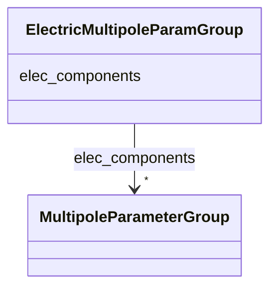

# Class: ElectricMultipoleParamGroup 


_Mixin for electric multipole parameters, _

_which can be used to describe the electric field components of an accelerator element._

_This mixin is aligned with PALS ElectricMultipoleP for interoperability with the Particle Accelerator Language Standard (PALS)._

_Example with three multipole components (N=0,1,2): ```yaml elec_components: - order: 7_

_  tilt: 0.7_

_- order: 3_

_  En: 27.3_

_- order: 2_

_  EnL: 3.47e1_

_```_


URI: [pals:ElectricMultipoleParamGroup](https://pals-project.readthedocs.io/ElectricMultipoleParamGroup)





<!-- no inheritance hierarchy -->


## Slots

| Name | Cardinality and Range | Description | Inheritance |
| ---  | --- | --- | --- |
| [elec_components](elec_components.md) | * <br/> [MultipoleParameterGroup](MultipoleParameterGroup.md) | Electric multipole components, one per order N | direct |


## Usages

| used by | used in | type | used |
| ---  | --- | --- | --- |
| [HasElectricMultipoleP](HasElectricMultipoleP.md) | [ElectricMultipoleP](ElectricMultipoleP.md) | range | [ElectricMultipoleParamGroup](ElectricMultipoleParamGroup.md) |
| [Multipole](Multipole.md) | [ElectricMultipoleP](ElectricMultipoleP.md) | range | [ElectricMultipoleParamGroup](ElectricMultipoleParamGroup.md) |
| [Bend](Bend.md) | [ElectricMultipoleP](ElectricMultipoleP.md) | range | [ElectricMultipoleParamGroup](ElectricMultipoleParamGroup.md) |
| [Quadrupole](Quadrupole.md) | [ElectricMultipoleP](ElectricMultipoleP.md) | range | [ElectricMultipoleParamGroup](ElectricMultipoleParamGroup.md) |
| [Octupole](Octupole.md) | [ElectricMultipoleP](ElectricMultipoleP.md) | range | [ElectricMultipoleParamGroup](ElectricMultipoleParamGroup.md) |
| [Sextupole](Sextupole.md) | [ElectricMultipoleP](ElectricMultipoleP.md) | range | [ElectricMultipoleParamGroup](ElectricMultipoleParamGroup.md) |
| [Kicker](Kicker.md) | [ElectricMultipoleP](ElectricMultipoleP.md) | range | [ElectricMultipoleParamGroup](ElectricMultipoleParamGroup.md) |
| [ACKicker](ACKicker.md) | [ElectricMultipoleP](ElectricMultipoleP.md) | range | [ElectricMultipoleParamGroup](ElectricMultipoleParamGroup.md) |
| [Cavity](Cavity.md) | [ElectricMultipoleP](ElectricMultipoleP.md) | range | [ElectricMultipoleParamGroup](ElectricMultipoleParamGroup.md) |
| [CrabCavity](CrabCavity.md) | [ElectricMultipoleP](ElectricMultipoleP.md) | range | [ElectricMultipoleParamGroup](ElectricMultipoleParamGroup.md) |
| [RFCavity](RFCavity.md) | [ElectricMultipoleP](ElectricMultipoleP.md) | range | [ElectricMultipoleParamGroup](ElectricMultipoleParamGroup.md) |
| [NormalConductingRFCavity](NormalConductingRFCavity.md) | [ElectricMultipoleP](ElectricMultipoleP.md) | range | [ElectricMultipoleParamGroup](ElectricMultipoleParamGroup.md) |
| [SuperConductingRFCavity](SuperConductingRFCavity.md) | [ElectricMultipoleP](ElectricMultipoleP.md) | range | [ElectricMultipoleParamGroup](ElectricMultipoleParamGroup.md) |


## Identifier and Mapping Information


### Schema Source


* from schema: https://w3id.org/accelerator-core


## Mappings

| Mapping Type | Mapped Value |
| ---  | ---  |
| self | pals:ElectricMultipoleParamGroup |
| native | pals:ElectricMultipoleParamGroup |
| exact | pals:ElectricMultipoleP |
| broad | pals:ElectricMultipoleP |


## LinkML Source

<!-- TODO: investigate https://stackoverflow.com/questions/37606292/how-to-create-tabbed-code-blocks-in-mkdocs-or-sphinx -->

### Direct

<details>
```yaml
name: ElectricMultipoleParamGroup
description: "Mixin for electric multipole parameters, \nwhich can be used to describe\
  \ the electric field components of an accelerator element.\nThis mixin is aligned\
  \ with PALS ElectricMultipoleP for interoperability with the Particle Accelerator\
  \ Language Standard (PALS).\nExample with three multipole components (N=0,1,2):\
  \ ```yaml elec_components: - order: 7\n  tilt: 0.7\n- order: 3\n  En: 27.3\n- order:\
  \ 2\n  EnL: 3.47e1\n```"
from_schema: https://w3id.org/accelerator-core
exact_mappings:
- pals:ElectricMultipoleP
broad_mappings:
- pals:ElectricMultipoleP
attributes:
  elec_components:
    name: elec_components
    description: Electric multipole components, one per order N.
    from_schema: https://w3id.org/accelerator-core
    rank: 1000
    domain_of:
    - ElectricMultipoleParamGroup
    range: MultipoleParameterGroup
    multivalued: true
    inlined: true
    inlined_as_list: true

```
</details>

### Induced

<details>
```yaml
name: ElectricMultipoleParamGroup
description: "Mixin for electric multipole parameters, \nwhich can be used to describe\
  \ the electric field components of an accelerator element.\nThis mixin is aligned\
  \ with PALS ElectricMultipoleP for interoperability with the Particle Accelerator\
  \ Language Standard (PALS).\nExample with three multipole components (N=0,1,2):\
  \ ```yaml elec_components: - order: 7\n  tilt: 0.7\n- order: 3\n  En: 27.3\n- order:\
  \ 2\n  EnL: 3.47e1\n```"
from_schema: https://w3id.org/accelerator-core
exact_mappings:
- pals:ElectricMultipoleP
broad_mappings:
- pals:ElectricMultipoleP
attributes:
  elec_components:
    name: elec_components
    description: Electric multipole components, one per order N.
    from_schema: https://w3id.org/accelerator-core
    rank: 1000
    alias: elec_components
    owner: ElectricMultipoleParamGroup
    domain_of:
    - ElectricMultipoleParamGroup
    range: MultipoleParameterGroup
    multivalued: true
    inlined: true
    inlined_as_list: true

```
</details>