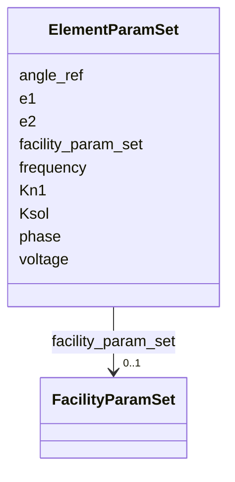

# Class: ElementParamSet 


_Named physics-parameter block for a beamline element. The name identifies the block type (e.g. RFP, BendP, MagneticMultipoleP, SolenoidP)._


URI: [narad:ElementParamSet](https://w3id.org/narad_linkml/schema/narad/ElementParamSet)





<!-- no inheritance hierarchy -->


## Slots

| Name | Cardinality and Range | Description | Inheritance |
| ---  | --- | --- | --- |
| [frequency](frequency.md) | 0..1 <br/> [Float](Float.md) | RF frequency in Hz | direct |
| [voltage](voltage.md) | 0..1 <br/> [Float](Float.md) | RF voltage in volts | direct |
| [phase](phase.md) | 0..1 <br/> [Float](Float.md) | RF phase in degrees | direct |
| [angle_ref](angle_ref.md) | 0..1 <br/> [Float](Float.md) | Reference bend angle in radians | direct |
| [e1](e1.md) | 0..1 <br/> [Float](Float.md) | Entry edge angle in radians | direct |
| [e2](e2.md) | 0..1 <br/> [Float](Float.md) | Exit edge angle in radians | direct |
| [Kn1](Kn1.md) | 0..1 <br/> [Float](Float.md) | First-order magnetic multipole coefficient (quadrupole strength) | direct |
| [Ksol](Ksol.md) | 0..1 <br/> [Float](Float.md) | Solenoid integrated field strength | direct |
| [facility_param_set](facility_param_set.md) | 0..1 <br/> [FacilityParamSet](FacilityParamSet.md) | Facility-specific element parameters (type designation, model name, open prop... | direct |


## Usages

| used by | used in | type | used |
| ---  | --- | --- | --- |
| [BeamlineElement](BeamlineElement.md) | [param_set](param_set.md) | range | [ElementParamSet](ElementParamSet.md) |


## Identifier and Mapping Information


### Schema Source


* from schema: https://w3id.org/narad_linkml/schema/narad/system


## Mappings

| Mapping Type | Mapped Value |
| ---  | ---  |
| self | narad:ElementParamSet |
| native | narad:ElementParamSet |


## LinkML Source

<!-- TODO: investigate https://stackoverflow.com/questions/37606292/how-to-create-tabbed-code-blocks-in-mkdocs-or-sphinx -->

### Direct

<details>
```yaml
name: ElementParamSet
description: Named physics-parameter block for a beamline element. The name identifies
  the block type (e.g. RFP, BendP, MagneticMultipoleP, SolenoidP).
from_schema: https://w3id.org/narad_linkml/schema/narad/system
slots:
- frequency
- voltage
- phase
- angle_ref
- e1
- e2
- Kn1
- Ksol
- facility_param_set

```
</details>

### Induced

<details>
```yaml
name: ElementParamSet
description: Named physics-parameter block for a beamline element. The name identifies
  the block type (e.g. RFP, BendP, MagneticMultipoleP, SolenoidP).
from_schema: https://w3id.org/narad_linkml/schema/narad/system
attributes:
  frequency:
    name: frequency
    description: RF frequency in Hz.
    from_schema: https://w3id.org/narad_linkml/schema/narad/system
    rank: 1000
    alias: frequency
    owner: ElementParamSet
    domain_of:
    - ElementParamSet
    range: float
  voltage:
    name: voltage
    description: RF voltage in volts.
    from_schema: https://w3id.org/narad_linkml/schema/narad/system
    rank: 1000
    alias: voltage
    owner: ElementParamSet
    domain_of:
    - ElementParamSet
    range: float
  phase:
    name: phase
    description: RF phase in degrees.
    from_schema: https://w3id.org/narad_linkml/schema/narad/system
    rank: 1000
    alias: phase
    owner: ElementParamSet
    domain_of:
    - ElementParamSet
    range: float
  angle_ref:
    name: angle_ref
    description: Reference bend angle in radians.
    from_schema: https://w3id.org/narad_linkml/schema/narad/system
    rank: 1000
    alias: angle_ref
    owner: ElementParamSet
    domain_of:
    - ElementParamSet
    range: float
  e1:
    name: e1
    description: Entry edge angle in radians.
    from_schema: https://w3id.org/narad_linkml/schema/narad/system
    rank: 1000
    alias: e1
    owner: ElementParamSet
    domain_of:
    - ElementParamSet
    range: float
  e2:
    name: e2
    description: Exit edge angle in radians.
    from_schema: https://w3id.org/narad_linkml/schema/narad/system
    rank: 1000
    alias: e2
    owner: ElementParamSet
    domain_of:
    - ElementParamSet
    range: float
  Kn1:
    name: Kn1
    description: First-order magnetic multipole coefficient (quadrupole strength).
    from_schema: https://w3id.org/narad_linkml/schema/narad/system
    rank: 1000
    alias: Kn1
    owner: ElementParamSet
    domain_of:
    - ElementParamSet
    range: float
  Ksol:
    name: Ksol
    description: Solenoid integrated field strength.
    from_schema: https://w3id.org/narad_linkml/schema/narad/system
    rank: 1000
    alias: Ksol
    owner: ElementParamSet
    domain_of:
    - ElementParamSet
    range: float
  facility_param_set:
    name: facility_param_set
    description: Facility-specific element parameters (type designation, model name,
      open property map).
    from_schema: https://w3id.org/narad_linkml/schema/narad/system
    rank: 1000
    alias: facility_param_set
    owner: ElementParamSet
    domain_of:
    - ElementParamSet
    range: FacilityParamSet
    inlined: true

```
</details>