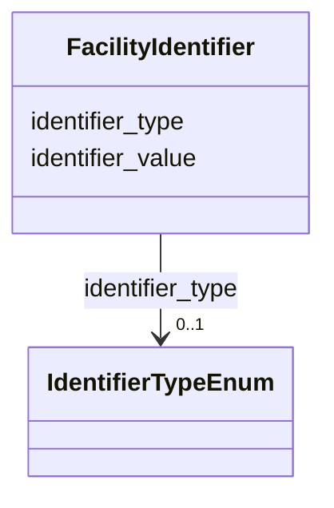

# Class: FacilityIdentifier 


_A globally unique identifier for an entity (e.g., facility), with a specified type (e.g. DOI, ROR, ARK, local)._


URI: [narad:FacilityIdentifier](https://example.org/narad_linkml/schema/narad/FacilityIdentifier)





<!-- no inheritance hierarchy -->


## Slots

| Name | Cardinality and Range | Description | Inheritance |
| ---  | --- | --- | --- |
| [identifier_type](identifier_type.md) | 0..1 <br/> [IdentifierTypeEnum](IdentifierTypeEnum.md) | The type of identifier used in the identifier slot (e | direct |
| [identifier_value](identifier_value.md) | 0..1 <br/> [String](String.md) | The value of the identifier (e | direct |


## Usages

| used by | used in | type | used |
| ---  | --- | --- | --- |
| [DeployedSystem](DeployedSystem.md) | [facility_identifier](facility_identifier.md) | range | [FacilityIdentifier](FacilityIdentifier.md) |


## Identifier and Mapping Information


### Schema Source


* from schema: https://w3id.org/narad_linkml/schema/narad/system


## Mappings

| Mapping Type | Mapped Value |
| ---  | ---  |
| self | narad:FacilityIdentifier |
| native | narad:FacilityIdentifier |


## LinkML Source

<!-- TODO: investigate https://stackoverflow.com/questions/37606292/how-to-create-tabbed-code-blocks-in-mkdocs-or-sphinx -->

### Direct

<details>
```yaml
name: FacilityIdentifier
description: A globally unique identifier for an entity (e.g., facility), with a specified
  type (e.g. DOI, ROR, ARK, local).
from_schema: https://w3id.org/narad_linkml/schema/narad/system
slots:
- identifier_type
- identifier_value

```
</details>

### Induced

<details>
```yaml
name: FacilityIdentifier
description: A globally unique identifier for an entity (e.g., facility), with a specified
  type (e.g. DOI, ROR, ARK, local).
from_schema: https://w3id.org/narad_linkml/schema/narad/system
attributes:
  identifier_type:
    name: identifier_type
    description: The type of identifier used in the identifier slot (e.g. DOI, ARK,
      URL, local).
    in_subset:
    - label
    from_schema: https://w3id.org/narad_linkml/schema/narad/system
    rank: 1000
    alias: identifier_type
    owner: FacilityIdentifier
    domain_of:
    - FacilityIdentifier
    range: IdentifierTypeEnum
  identifier_value:
    name: identifier_value
    description: The value of the identifier (e.g. the DOI string, ARK string, URL
      string, or local ID).
    in_subset:
    - label
    from_schema: https://w3id.org/narad_linkml/schema/narad/system
    rank: 1000
    alias: identifier_value
    owner: FacilityIdentifier
    domain_of:
    - FacilityIdentifier
    range: string

```
</details>