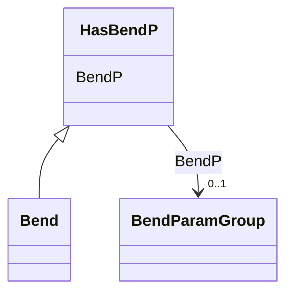

# Class: HasBendP 


URI: [pals:HasBendP](https://pals-project.readthedocs.io/HasBendP)





<!-- no inheritance hierarchy -->

## Class Properties

| Property | Value |
| --- | --- |
| Mixin | Yes |


## Slots

| Name | Cardinality and Range | Description | Inheritance |
| ---  | --- | --- | --- |
| [BendP](BendP.md) | 0..1 <br/> [BendParamGroup](BendParamGroup.md) | A mixin for bend parameters that are aligned with PALS BendP (Bend Parameters... | direct |


## Mixin Usage

| mixed into | description |
| --- | --- |
| [Bend](Bend.md) | Dipole magnet used to bend the beam |


## Identifier and Mapping Information


### Schema Source


* from schema: https://w3id.org/accelerator-core


## Mappings

| Mapping Type | Mapped Value |
| ---  | ---  |
| self | pals:HasBendP |
| native | pals:HasBendP |


## LinkML Source

<!-- TODO: investigate https://stackoverflow.com/questions/37606292/how-to-create-tabbed-code-blocks-in-mkdocs-or-sphinx -->

### Direct

<details>
```yaml
name: HasBendP
from_schema: https://w3id.org/accelerator-core
mixin: true
attributes:
  BendP:
    name: BendP
    description: A mixin for bend parameters that are aligned with PALS BendP (Bend
      Parameters) for interoperability with the Particle Accelerator Language Standard
      (PALS).
    from_schema: https://w3id.org/accelerator-core
    rank: 1000
    domain_of:
    - HasBendP
    range: BendParamGroup
    inlined: true

```
</details>

### Induced

<details>
```yaml
name: HasBendP
from_schema: https://w3id.org/accelerator-core
mixin: true
attributes:
  BendP:
    name: BendP
    description: A mixin for bend parameters that are aligned with PALS BendP (Bend
      Parameters) for interoperability with the Particle Accelerator Language Standard
      (PALS).
    from_schema: https://w3id.org/accelerator-core
    rank: 1000
    alias: BendP
    owner: HasBendP
    domain_of:
    - HasBendP
    range: BendParamGroup
    inlined: true

```
</details>