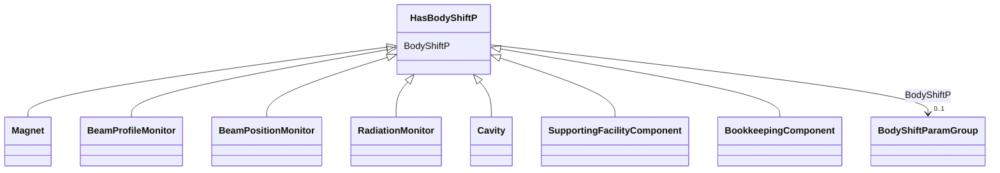

# Class: HasBodyShiftP 


URI: [pals:HasBodyShiftP](https://pals-project.readthedocs.io/HasBodyShiftP)





<!-- no inheritance hierarchy -->


## Slots

| Name | Cardinality and Range | Description | Inheritance |
| ---  | --- | --- | --- |
| [BodyShiftP](BodyShiftP.md) | 0..1 <br/> [BodyShiftParamGroup](BodyShiftParamGroup.md) | A mixin for floor plan shift parameters that are aligned with PALS BodyShiftP... | direct |


## Mixin Usage

| mixed into | description |
| --- | --- |
| [Magnet](Magnet.md) | An accelerator device that produces a magnetic field for beam control |
| [BeamProfileMonitor](BeamProfileMonitor.md) | A diagnostic device used to measure transverse beam profile |
| [BeamPositionMonitor](BeamPositionMonitor.md) | A diagnostic device used to measure transverse beam position |
| [RadiationMonitor](RadiationMonitor.md) | A diagnostic device used to monitor radiation dose or dose rate |
| [Cavity](Cavity.md) | A cavity used for beam acceleration or manipulation |
| [SupportingFacilityComponent](SupportingFacilityComponent.md) | A physical component that supports accelerator operation  without a specific ... |
| [BookkeepingComponent](BookkeepingComponent.md) | A virtual component that represents a bookkeeping or organizational role in t... |


## Identifier and Mapping Information


### Schema Source


* from schema: https://w3id.org/accelerator-core


## Mappings

| Mapping Type | Mapped Value |
| ---  | ---  |
| self | pals:HasBodyShiftP |
| native | pals:HasBodyShiftP |


## LinkML Source

<!-- TODO: investigate https://stackoverflow.com/questions/37606292/how-to-create-tabbed-code-blocks-in-mkdocs-or-sphinx -->

### Direct

<details>
```yaml
name: HasBodyShiftP
from_schema: https://w3id.org/accelerator-core
mixin: true
attributes:
  BodyShiftP:
    name: BodyShiftP
    description: A mixin for floor plan shift parameters that are aligned with PALS
      BodyShiftP (Floor Plan Shift Parameters) for interoperability with the Particle
      Accelerator Language Standard (PALS).
    from_schema: https://w3id.org/accelerator-core
    rank: 1000
    domain_of:
    - HasBodyShiftP
    range: BodyShiftParamGroup
    inlined: true

```
</details>

### Induced

<details>
```yaml
name: HasBodyShiftP
from_schema: https://w3id.org/accelerator-core
mixin: true
attributes:
  BodyShiftP:
    name: BodyShiftP
    description: A mixin for floor plan shift parameters that are aligned with PALS
      BodyShiftP (Floor Plan Shift Parameters) for interoperability with the Particle
      Accelerator Language Standard (PALS).
    from_schema: https://w3id.org/accelerator-core
    rank: 1000
    alias: BodyShiftP
    owner: HasBodyShiftP
    domain_of:
    - HasBodyShiftP
    range: BodyShiftParamGroup
    inlined: true

```
</details>