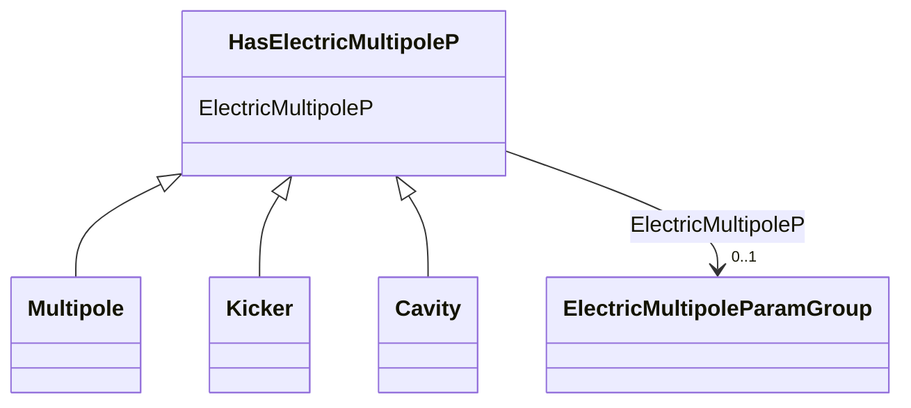

# Class: HasElectricMultipoleP 


URI: [pals:HasElectricMultipoleP](https://pals-project.readthedocs.io/HasElectricMultipoleP)





<!-- no inheritance hierarchy -->


## Slots

| Name | Cardinality and Range | Description | Inheritance |
| ---  | --- | --- | --- |
| [ElectricMultipoleP](ElectricMultipoleP.md) | 0..1 <br/> [ElectricMultipoleParamGroup](ElectricMultipoleParamGroup.md) | A mixin for electric multipole parameters that are aligned with PALS Electric... | direct |


## Mixin Usage

| mixed into | description |
| --- | --- |
| [Multipole](Multipole.md) | A general magnet with a higher-order multipole field, such as a sextupole or ... |
| [Kicker](Kicker.md) | A magnet primarily used to steer the beam |
| [Cavity](Cavity.md) | A cavity used for beam acceleration or manipulation |


## Identifier and Mapping Information


### Schema Source


* from schema: https://w3id.org/accelerator-core


## Mappings

| Mapping Type | Mapped Value |
| ---  | ---  |
| self | pals:HasElectricMultipoleP |
| native | pals:HasElectricMultipoleP |


## LinkML Source

<!-- TODO: investigate https://stackoverflow.com/questions/37606292/how-to-create-tabbed-code-blocks-in-mkdocs-or-sphinx -->

### Direct

<details>
```yaml
name: HasElectricMultipoleP
from_schema: https://w3id.org/accelerator-core
mixin: true
attributes:
  ElectricMultipoleP:
    name: ElectricMultipoleP
    description: A mixin for electric multipole parameters that are aligned with PALS
      ElectricMultipoleP (Electric Multipole Parameters) for interoperability with
      the Particle Accelerator Language Standard (PALS).
    from_schema: https://w3id.org/accelerator-core
    rank: 1000
    domain_of:
    - HasElectricMultipoleP
    range: ElectricMultipoleParamGroup
    inlined: true

```
</details>

### Induced

<details>
```yaml
name: HasElectricMultipoleP
from_schema: https://w3id.org/accelerator-core
mixin: true
attributes:
  ElectricMultipoleP:
    name: ElectricMultipoleP
    description: A mixin for electric multipole parameters that are aligned with PALS
      ElectricMultipoleP (Electric Multipole Parameters) for interoperability with
      the Particle Accelerator Language Standard (PALS).
    from_schema: https://w3id.org/accelerator-core
    rank: 1000
    alias: ElectricMultipoleP
    owner: HasElectricMultipoleP
    domain_of:
    - HasElectricMultipoleP
    range: ElectricMultipoleParamGroup
    inlined: true

```
</details>