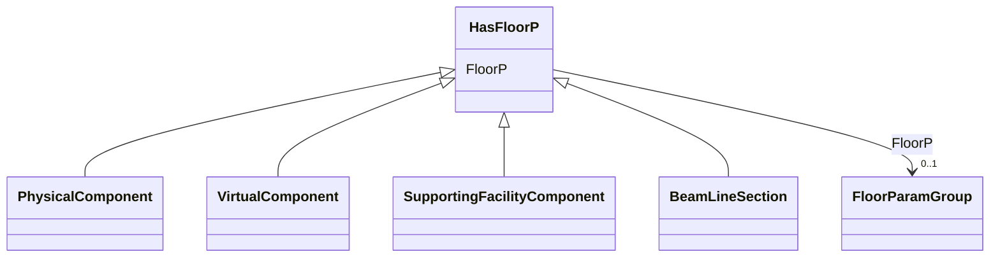

# Class: HasFloorP 


URI: [pals:HasFloorP](https://pals-project.readthedocs.io/HasFloorP)





<!-- no inheritance hierarchy -->


## Slots

| Name | Cardinality and Range | Description | Inheritance |
| ---  | --- | --- | --- |
| [FloorP](FloorP.md) | 0..1 <br/> [FloorParamGroup](FloorParamGroup.md) | A mixin for floor plan parameters that are aligned with PALS FloorP (Floor Pl... | direct |


## Mixin Usage

| mixed into | description |
| --- | --- |
| [PhysicalComponent](PhysicalComponent.md) | A physical item that participates in or supports accelerator operation |
| [VirtualComponent](VirtualComponent.md) | A virtual or logical component that represents a concept, function, or role i... |
| [SupportingFacilityComponent](SupportingFacilityComponent.md) | A physical component that supports accelerator operation  without a specific ... |
| [BeamLineSection](BeamLineSection.md) | A virtual component used to represent a section of the BeamLine for organizat... |


## Identifier and Mapping Information


### Schema Source


* from schema: https://w3id.org/accelerator-core


## Mappings

| Mapping Type | Mapped Value |
| ---  | ---  |
| self | pals:HasFloorP |
| native | pals:HasFloorP |


## LinkML Source

<!-- TODO: investigate https://stackoverflow.com/questions/37606292/how-to-create-tabbed-code-blocks-in-mkdocs-or-sphinx -->

### Direct

<details>
```yaml
name: HasFloorP
from_schema: https://w3id.org/accelerator-core
mixin: true
attributes:
  FloorP:
    name: FloorP
    description: A mixin for floor plan parameters that are aligned with PALS FloorP
      (Floor Plan Parameters) for interoperability with the Particle Accelerator Language
      Standard (PALS).
    from_schema: https://w3id.org/accelerator-core
    rank: 1000
    domain_of:
    - HasFloorP
    range: FloorParamGroup
    inlined: true

```
</details>

### Induced

<details>
```yaml
name: HasFloorP
from_schema: https://w3id.org/accelerator-core
mixin: true
attributes:
  FloorP:
    name: FloorP
    description: A mixin for floor plan parameters that are aligned with PALS FloorP
      (Floor Plan Parameters) for interoperability with the Particle Accelerator Language
      Standard (PALS).
    from_schema: https://w3id.org/accelerator-core
    rank: 1000
    alias: FloorP
    owner: HasFloorP
    domain_of:
    - HasFloorP
    range: FloorParamGroup
    inlined: true

```
</details>