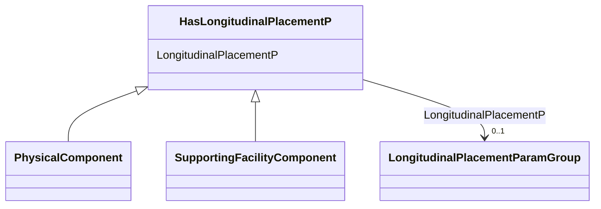

# Class: HasLongitudinalPlacementP 


URI: [pals:HasLongitudinalPlacementP](https://pals-project.readthedocs.io/HasLongitudinalPlacementP)





<!-- no inheritance hierarchy -->

## Class Properties

| Property | Value |
| --- | --- |
| Mixin | Yes |


## Slots

| Name | Cardinality and Range | Description | Inheritance |
| ---  | --- | --- | --- |
| [LongitudinalPlacementP](LongitudinalPlacementP.md) | 0..1 <br/> [LongitudinalPlacementParamGroup](LongitudinalPlacementParamGroup.md) | A mixin for an element's extent and position along the longitudinal (beam-dir... | direct |


## Mixin Usage

| mixed into | description |
| --- | --- |
| [PhysicalComponent](PhysicalComponent.md) | A physical item that participates in or supports accelerator operation |
| [SupportingFacilityComponent](SupportingFacilityComponent.md) | A physical component that supports accelerator operation  without a specific ... |


## Identifier and Mapping Information


### Schema Source


* from schema: https://w3id.org/accelerator-core


## Mappings

| Mapping Type | Mapped Value |
| ---  | ---  |
| self | pals:HasLongitudinalPlacementP |
| native | pals:HasLongitudinalPlacementP |


## LinkML Source

<!-- TODO: investigate https://stackoverflow.com/questions/37606292/how-to-create-tabbed-code-blocks-in-mkdocs-or-sphinx -->

### Direct

<details>
```yaml
name: HasLongitudinalPlacementP
from_schema: https://w3id.org/accelerator-core
mixin: true
attributes:
  LongitudinalPlacementP:
    name: LongitudinalPlacementP
    description: A mixin for an element's extent and position along the longitudinal
      (beam-direction, "s") axis that are aligned with PALS LongitudinalPlacementP
      (Longitudinal Placement Parameters) for interoperability with the Particle Accelerator
      Language Standard (PALS).
    from_schema: https://w3id.org/accelerator-core
    rank: 1000
    domain_of:
    - HasLongitudinalPlacementP
    range: LongitudinalPlacementParamGroup
    inlined: true

```
</details>

### Induced

<details>
```yaml
name: HasLongitudinalPlacementP
from_schema: https://w3id.org/accelerator-core
mixin: true
attributes:
  LongitudinalPlacementP:
    name: LongitudinalPlacementP
    description: A mixin for an element's extent and position along the longitudinal
      (beam-direction, "s") axis that are aligned with PALS LongitudinalPlacementP
      (Longitudinal Placement Parameters) for interoperability with the Particle Accelerator
      Language Standard (PALS).
    from_schema: https://w3id.org/accelerator-core
    rank: 1000
    alias: LongitudinalPlacementP
    owner: HasLongitudinalPlacementP
    domain_of:
    - HasLongitudinalPlacementP
    range: LongitudinalPlacementParamGroup
    inlined: true

```
</details>