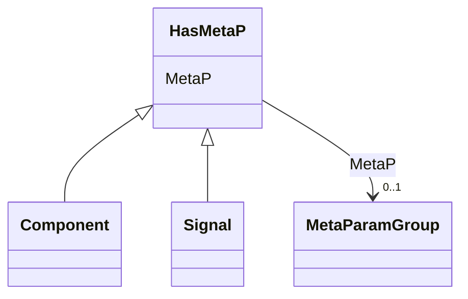

# Class: HasMetaP 


URI: [pals:HasMetaP](https://pals-project.readthedocs.io/HasMetaP)





<!-- no inheritance hierarchy -->


## Slots

| Name | Cardinality and Range | Description | Inheritance |
| ---  | --- | --- | --- |
| [MetaP](MetaP.md) | 0..1 <br/> [MetaParamGroup](MetaParamGroup.md) | A mixin for metadata parameters that are aligned with PALS MetaP (Metadata Pa... | direct |


## Mixin Usage

| mixed into | description |
| --- | --- |
| [Component](Component.md) | A general class for accelerator components, which can be specialized into mor... |
| [Signal](Signal.md) | Semantic meaning of a control-system signal associated with a component |


## Identifier and Mapping Information


### Schema Source


* from schema: https://w3id.org/accelerator-core


## Mappings

| Mapping Type | Mapped Value |
| ---  | ---  |
| self | pals:HasMetaP |
| native | pals:HasMetaP |


## LinkML Source

<!-- TODO: investigate https://stackoverflow.com/questions/37606292/how-to-create-tabbed-code-blocks-in-mkdocs-or-sphinx -->

### Direct

<details>
```yaml
name: HasMetaP
from_schema: https://w3id.org/accelerator-core
mixin: true
attributes:
  MetaP:
    name: MetaP
    description: A mixin for metadata parameters that are aligned with PALS MetaP
      (Metadata Parameters) for interoperability with the Particle Accelerator Language
      Standard (PALS).
    from_schema: https://w3id.org/accelerator-core
    rank: 1000
    domain_of:
    - HasMetaP
    range: MetaParamGroup
    inlined: true

```
</details>

### Induced

<details>
```yaml
name: HasMetaP
from_schema: https://w3id.org/accelerator-core
mixin: true
attributes:
  MetaP:
    name: MetaP
    description: A mixin for metadata parameters that are aligned with PALS MetaP
      (Metadata Parameters) for interoperability with the Particle Accelerator Language
      Standard (PALS).
    from_schema: https://w3id.org/accelerator-core
    rank: 1000
    alias: MetaP
    owner: HasMetaP
    domain_of:
    - HasMetaP
    range: MetaParamGroup
    inlined: true

```
</details>