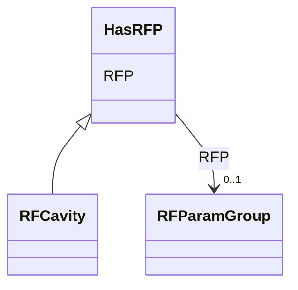

# Class: HasRFP 


URI: [pals:HasRFP](https://pals-project.readthedocs.io/HasRFP)





<!-- no inheritance hierarchy -->

## Class Properties

| Property | Value |
| --- | --- |
| Mixin | Yes |


## Slots

| Name | Cardinality and Range | Description | Inheritance |
| ---  | --- | --- | --- |
| [RFP](RFP.md) | 0..1 <br/> [RFParamGroup](RFParamGroup.md) | A mixin for RF parameters that are aligned with PALS RFP (RF Parameters) for ... | direct |


## Mixin Usage

| mixed into | description |
| --- | --- |
| [RFCavity](RFCavity.md) | A cavity used for RF acceleration or longitudinal manipulation |


## Identifier and Mapping Information


### Schema Source


* from schema: https://w3id.org/accelerator-core


## Mappings

| Mapping Type | Mapped Value |
| ---  | ---  |
| self | pals:HasRFP |
| native | pals:HasRFP |


## LinkML Source

<!-- TODO: investigate https://stackoverflow.com/questions/37606292/how-to-create-tabbed-code-blocks-in-mkdocs-or-sphinx -->

### Direct

<details>
```yaml
name: HasRFP
from_schema: https://w3id.org/accelerator-core
mixin: true
attributes:
  RFP:
    name: RFP
    description: A mixin for RF parameters that are aligned with PALS RFP (RF Parameters)
      for interoperability with the Particle Accelerator Language Standard (PALS).
    from_schema: https://w3id.org/accelerator-core
    rank: 1000
    domain_of:
    - HasRFP
    range: RFParamGroup
    inlined: true

```
</details>

### Induced

<details>
```yaml
name: HasRFP
from_schema: https://w3id.org/accelerator-core
mixin: true
attributes:
  RFP:
    name: RFP
    description: A mixin for RF parameters that are aligned with PALS RFP (RF Parameters)
      for interoperability with the Particle Accelerator Language Standard (PALS).
    from_schema: https://w3id.org/accelerator-core
    rank: 1000
    alias: RFP
    owner: HasRFP
    domain_of:
    - HasRFP
    range: RFParamGroup
    inlined: true

```
</details>