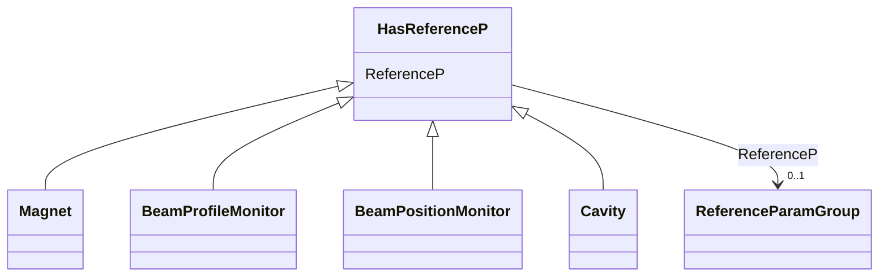

# Class: HasReferenceP 


URI: [pals:HasReferenceP](https://pals-project.readthedocs.io/HasReferenceP)





<!-- no inheritance hierarchy -->


## Slots

| Name | Cardinality and Range | Description | Inheritance |
| ---  | --- | --- | --- |
| [ReferenceP](ReferenceP.md) | 0..1 <br/> [ReferenceParamGroup](ReferenceParamGroup.md) | A mixin for reference parameters that are aligned with PALS ReferenceP (Refer... | direct |


## Mixin Usage

| mixed into | description |
| --- | --- |
| [Magnet](Magnet.md) | An accelerator device that produces a magnetic field for beam control |
| [BeamProfileMonitor](BeamProfileMonitor.md) | A diagnostic device used to measure transverse beam profile |
| [BeamPositionMonitor](BeamPositionMonitor.md) | A diagnostic device used to measure transverse beam position |
| [Cavity](Cavity.md) | A cavity used for beam acceleration or manipulation |


## Identifier and Mapping Information


### Schema Source


* from schema: https://w3id.org/accelerator-core


## Mappings

| Mapping Type | Mapped Value |
| ---  | ---  |
| self | pals:HasReferenceP |
| native | pals:HasReferenceP |


## LinkML Source

<!-- TODO: investigate https://stackoverflow.com/questions/37606292/how-to-create-tabbed-code-blocks-in-mkdocs-or-sphinx -->

### Direct

<details>
```yaml
name: HasReferenceP
from_schema: https://w3id.org/accelerator-core
mixin: true
attributes:
  ReferenceP:
    name: ReferenceP
    description: A mixin for reference parameters that are aligned with PALS ReferenceP
      (Reference Parameters) for interoperability with the Particle Accelerator Language
      Standard (PALS).
    from_schema: https://w3id.org/accelerator-core
    rank: 1000
    domain_of:
    - HasReferenceP
    range: ReferenceParamGroup
    inlined: true

```
</details>

### Induced

<details>
```yaml
name: HasReferenceP
from_schema: https://w3id.org/accelerator-core
mixin: true
attributes:
  ReferenceP:
    name: ReferenceP
    description: A mixin for reference parameters that are aligned with PALS ReferenceP
      (Reference Parameters) for interoperability with the Particle Accelerator Language
      Standard (PALS).
    from_schema: https://w3id.org/accelerator-core
    rank: 1000
    alias: ReferenceP
    owner: HasReferenceP
    domain_of:
    - HasReferenceP
    range: ReferenceParamGroup
    inlined: true

```
</details>