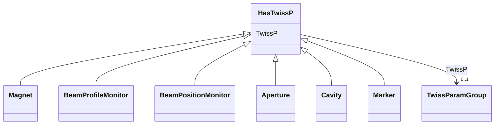

# Class: HasTwissP 


URI: [pals:HasTwissP](https://pals-project.readthedocs.io/HasTwissP)





<!-- no inheritance hierarchy -->

## Class Properties

| Property | Value |
| --- | --- |
| Mixin | Yes |


## Slots

| Name | Cardinality and Range | Description | Inheritance |
| ---  | --- | --- | --- |
| [TwissP](TwissP.md) | 0..1 <br/> [TwissParamGroup](TwissParamGroup.md) | A mixin for Twiss parameters that are aligned with PALS TwissP (Twiss Paramet... | direct |


## Mixin Usage

| mixed into | description |
| --- | --- |
| [Magnet](Magnet.md) | An accelerator device that produces a magnetic field for beam control |
| [BeamProfileMonitor](BeamProfileMonitor.md) | A diagnostic device used to measure transverse beam profile |
| [BeamPositionMonitor](BeamPositionMonitor.md) | A diagnostic device used to measure transverse beam position |
| [Aperture](Aperture.md) | A diagnostic or limiting aperture element used to constrain or characterize b... |
| [Cavity](Cavity.md) | A cavity used for beam acceleration or manipulation |
| [Marker](Marker.md) | A virtual component used as a reference point or marker in the beamline struc... |


## Identifier and Mapping Information


### Schema Source


* from schema: https://w3id.org/accelerator-core


## Mappings

| Mapping Type | Mapped Value |
| ---  | ---  |
| self | pals:HasTwissP |
| native | pals:HasTwissP |


## LinkML Source

<!-- TODO: investigate https://stackoverflow.com/questions/37606292/how-to-create-tabbed-code-blocks-in-mkdocs-or-sphinx -->

### Direct

<details>
```yaml
name: HasTwissP
from_schema: https://w3id.org/accelerator-core
mixin: true
attributes:
  TwissP:
    name: TwissP
    description: A mixin for Twiss parameters that are aligned with PALS TwissP (Twiss
      Parameters) for interoperability with the Particle Accelerator Language Standard
      (PALS).
    from_schema: https://w3id.org/accelerator-core
    rank: 1000
    domain_of:
    - HasTwissP
    range: TwissParamGroup
    inlined: true

```
</details>

### Induced

<details>
```yaml
name: HasTwissP
from_schema: https://w3id.org/accelerator-core
mixin: true
attributes:
  TwissP:
    name: TwissP
    description: A mixin for Twiss parameters that are aligned with PALS TwissP (Twiss
      Parameters) for interoperability with the Particle Accelerator Language Standard
      (PALS).
    from_schema: https://w3id.org/accelerator-core
    rank: 1000
    alias: TwissP
    owner: HasTwissP
    domain_of:
    - HasTwissP
    range: TwissParamGroup
    inlined: true

```
</details>