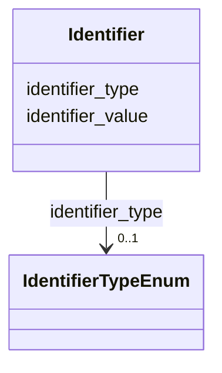

# Class: Identifier 


_A unique, and ideally persistent, identifier for a facility, such as a DOI or ROR._


URI: [pals:Identifier](https://pals-project.readthedocs.io/Identifier)





<!-- no inheritance hierarchy -->


## Slots

| Name | Cardinality and Range | Description | Inheritance |
| ---  | --- | --- | --- |
| [identifier_type](identifier_type.md) | 0..1 <br/> [IdentifierTypeEnum](IdentifierTypeEnum.md) | The type of identifier, such as DOI | PURL | ROR | LOCAL | URL | ARK | direct |
| [identifier_value](identifier_value.md) | 0..1 <br/> [String](String.md) | The value of the identifier | direct |


## Usages

| used by | used in | type | used |
| ---  | --- | --- | --- |
| [Facility](Facility.md) | [identifiers](identifiers.md) | range | [Identifier](Identifier.md) |
| [Affiliation](Affiliation.md) | [identifiers](identifiers.md) | range | [Identifier](Identifier.md) |


## Identifier and Mapping Information


### Schema Source


* from schema: https://w3id.org/accelerator-core


## Mappings

| Mapping Type | Mapped Value |
| ---  | ---  |
| self | pals:Identifier |
| native | pals:Identifier |


## LinkML Source

<!-- TODO: investigate https://stackoverflow.com/questions/37606292/how-to-create-tabbed-code-blocks-in-mkdocs-or-sphinx -->

### Direct

<details>
```yaml
name: Identifier
description: A unique, and ideally persistent, identifier for a facility, such as
  a DOI or ROR.
from_schema: https://w3id.org/accelerator-core
attributes:
  identifier_type:
    name: identifier_type
    description: The type of identifier, such as DOI | PURL | ROR | LOCAL | URL |
      ARK.
    from_schema: https://w3id.org/accelerator-core
    rank: 1000
    domain_of:
    - Identifier
    range: IdentifierTypeEnum
  identifier_value:
    name: identifier_value
    description: The value of the identifier.
    from_schema: https://w3id.org/accelerator-core
    rank: 1000
    domain_of:
    - Identifier
    range: string

```
</details>

### Induced

<details>
```yaml
name: Identifier
description: A unique, and ideally persistent, identifier for a facility, such as
  a DOI or ROR.
from_schema: https://w3id.org/accelerator-core
attributes:
  identifier_type:
    name: identifier_type
    description: The type of identifier, such as DOI | PURL | ROR | LOCAL | URL |
      ARK.
    from_schema: https://w3id.org/accelerator-core
    rank: 1000
    alias: identifier_type
    owner: Identifier
    domain_of:
    - Identifier
    range: IdentifierTypeEnum
  identifier_value:
    name: identifier_value
    description: The value of the identifier.
    from_schema: https://w3id.org/accelerator-core
    rank: 1000
    alias: identifier_value
    owner: Identifier
    domain_of:
    - Identifier
    range: string

```
</details>