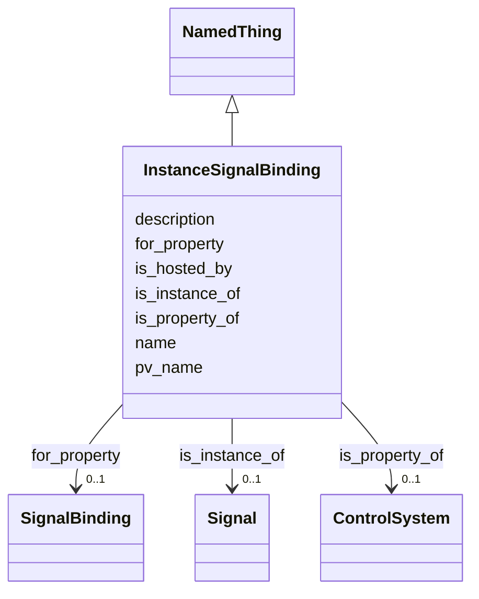

# Class: InstanceSignalBinding 


_A facility-specific binding between a NARAD Signal and an implementation interface (e.g. an EPICS process variable). Modeled as sosa:Sensor because it describes how a signal is observed, monitored, or actuated. ssn:forProperty → Signal; narad:isInstanceOf → the capability class._

__


URI: [narad:InstanceSignalBinding](https://example.org/narad_linkml/schema/narad/InstanceSignalBinding)





## Inheritance
* [NamedThing](NamedThing.md)
    * **InstanceSignalBinding**


## Slots

| Name | Cardinality and Range | Description | Inheritance |
| ---  | --- | --- | --- |
| [pv_name](pv_name.md) | 0..1 <br/> [String](String.md) | Fully-resolved facility-specific process variable name, e | direct |
| [is_instance_of](is_instance_of.md) | 0..1 <br/> [Signal](Signal.md) | NARAD alias for rdf:type | direct |
| [for_property](for_property.md) | 0..1 <br/> [SignalBinding](SignalBinding.md) | SystemCapability → Signal: the capability can expose, monitor, control, or ac... | direct |
| [is_hosted_by](is_hosted_by.md) | 0..1 <br/> [String](String.md) | Links an InstanceSignalBinding to the FacilitySystem it belongs to | direct |
| [is_property_of](is_property_of.md) | 0..1 <br/> [ControlSystem](ControlSystem.md) | Inverse of for_property: links the Class Signal to the Class of SignalBinding... | direct |
| [name](name.md) | 1 <br/> [String](String.md) | Human-readable name or local string key for the entity | [NamedThing](NamedThing.md) |
| [description](description.md) | 0..1 <br/> [String](String.md) | Detailed description of the entity | [NamedThing](NamedThing.md) |


## Usages

| used by | used in | type | used |
| ---  | --- | --- | --- |
| [BeamlineElement](BeamlineElement.md) | [is_observed_by](is_observed_by.md) | range | [InstanceSignalBinding](InstanceSignalBinding.md) |


## Identifier and Mapping Information


### Schema Source


* from schema: https://w3id.org/narad_linkml/schema/narad/system


## Mappings

| Mapping Type | Mapped Value |
| ---  | ---  |
| self | narad:InstanceSignalBinding |
| native | narad:InstanceSignalBinding |
| broad | rdf:type, sosa:Sensor |


## LinkML Source

<!-- TODO: investigate https://stackoverflow.com/questions/37606292/how-to-create-tabbed-code-blocks-in-mkdocs-or-sphinx -->

### Direct

<details>
```yaml
name: InstanceSignalBinding
description: 'A facility-specific binding between a NARAD Signal and an implementation
  interface (e.g. an EPICS process variable). Modeled as sosa:Sensor because it describes
  how a signal is observed, monitored, or actuated. ssn:forProperty → Signal; narad:isInstanceOf
  → the capability class.

  '
from_schema: https://w3id.org/narad_linkml/schema/narad/system
broad_mappings:
- rdf:type
- sosa:Sensor
is_a: NamedThing
slots:
- pv_name
- is_instance_of
- for_property
- is_hosted_by
- is_property_of
slot_usage:
  is_instance_of:
    name: is_instance_of
    range: Signal
    multivalued: false
  is_hosted_by:
    name: is_hosted_by
    range: string
    multivalued: false
  is_property_of:
    name: is_property_of
    range: ControlSystem
    multivalued: false
  for_property:
    name: for_property
    range: SignalBinding
    multivalued: false

```
</details>

### Induced

<details>
```yaml
name: InstanceSignalBinding
description: 'A facility-specific binding between a NARAD Signal and an implementation
  interface (e.g. an EPICS process variable). Modeled as sosa:Sensor because it describes
  how a signal is observed, monitored, or actuated. ssn:forProperty → Signal; narad:isInstanceOf
  → the capability class.

  '
from_schema: https://w3id.org/narad_linkml/schema/narad/system
broad_mappings:
- rdf:type
- sosa:Sensor
is_a: NamedThing
slot_usage:
  is_instance_of:
    name: is_instance_of
    range: Signal
    multivalued: false
  is_hosted_by:
    name: is_hosted_by
    range: string
    multivalued: false
  is_property_of:
    name: is_property_of
    range: ControlSystem
    multivalued: false
  for_property:
    name: for_property
    range: SignalBinding
    multivalued: false
attributes:
  pv_name:
    name: pv_name
    description: 'Fully-resolved facility-specific process variable name, e.g. MQWK202:STAT
      or MQWK202:BDL.

      '
    in_subset:
    - label
    from_schema: https://w3id.org/narad_linkml/schema/narad/system
    rank: 1000
    alias: pv_name
    owner: InstanceSignalBinding
    domain_of:
    - InstanceSignalBinding
    range: string
  is_instance_of:
    name: is_instance_of
    description: 'NARAD alias for rdf:type. Links a facility-specific instance node
      to the LinkML class or semantic class it instantiates. In the graph this edge
      is labelled narad:isInstanceOf. Values are typically the rdf:type of the Class
      that implements the signal binding.

      '
    in_subset:
    - relationship
    from_schema: https://w3id.org/narad_linkml/schema/narad/system
    exact_mappings:
    - rdf:type
    rank: 1000
    alias: is_instance_of
    owner: InstanceSignalBinding
    domain_of:
    - BeamlineElement
    - InstanceSignalBinding
    range: Signal
    multivalued: false
  for_property:
    name: for_property
    description: 'SystemCapability → Signal: the capability can expose, monitor, control,
      or actuate that signal.

      '
    in_subset:
    - relationship
    from_schema: https://w3id.org/narad_linkml/schema/narad/system
    exact_mappings:
    - ssn:forProperty
    rank: 1000
    alias: for_property
    owner: InstanceSignalBinding
    domain_of:
    - SystemCapability
    - InstanceSignalBinding
    range: SignalBinding
    multivalued: false
  is_hosted_by:
    name: is_hosted_by
    description: 'Links an InstanceSignalBinding to the FacilitySystem it belongs
      to. This is the edge that connects the facility-specific bindings to the Facility
      node in the graph.

      '
    in_subset:
    - relationship
    from_schema: https://w3id.org/narad_linkml/schema/narad/system
    broad_mappings:
    - ssn-system:hasSubSystem
    - ssn:isHostedBy
    rank: 1000
    alias: is_hosted_by
    owner: InstanceSignalBinding
    domain_of:
    - InstanceSignalBinding
    range: string
    multivalued: false
  is_property_of:
    name: is_property_of
    description: 'Inverse of for_property: links the Class Signal to the Class of
      SignalBinding Procedure that implements it. This can also link the Instance
      of a SignalBinding to the ControlSystem that implements it. This is the edge
      that connects the signal definitions to the facility-specific bindings in the
      graph. Values are typically the ControlSystem that implements this binding,
      e.g. narad:epics (for EPICS control system). NOTE: The value of this slot must
      match one of the values in narad_config.has_sub_system.

      '
    in_subset:
    - relationship
    from_schema: https://w3id.org/narad_linkml/schema/narad/system
    broad_mappings:
    - ssn:isPropertyOf
    rank: 1000
    alias: is_property_of
    owner: InstanceSignalBinding
    domain_of:
    - Capability
    - InstanceSignalBinding
    range: ControlSystem
    multivalued: false
  name:
    name: name
    description: Human-readable name or local string key for the entity.
    in_subset:
    - label
    from_schema: https://w3id.org/narad_linkml/schema/narad/system
    rank: 1000
    identifier: true
    alias: name
    owner: InstanceSignalBinding
    domain_of:
    - NamedThing
    range: string
    required: true
  description:
    name: description
    description: Detailed description of the entity.
    in_subset:
    - label
    from_schema: https://w3id.org/narad_linkml/schema/narad/system
    rank: 1000
    alias: description
    owner: InstanceSignalBinding
    domain_of:
    - NamedThing
    - NamingConventionExample
    - TemplateExample
    range: string

```
</details>