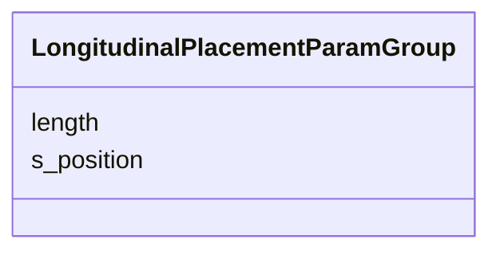

# Class: LongitudinalPlacementParamGroup 


_Mixin for an element's extent and position along the longitudinal (beam-direction, "s") axis. _

_Corresponds to PALS's ungrouped element parameters `length` and `s_position`._

_One (or both) `length` or `s_position` must be present._


URI: [pals:LongitudinalPlacementParamGroup](https://pals-project.readthedocs.io/LongitudinalPlacementParamGroup)





<!-- no inheritance hierarchy -->


## Slots

| Name | Cardinality and Range | Description | Inheritance |
| ---  | --- | --- | --- |
| [length](length.md) | 0..1 <br/> [Float](Float.md) | Length of the element (arc length for bends) | direct |
| [s_position](s_position.md) | 0..1 <br/> [Float](Float.md) | Longitudinal position of the element along the beamline | direct |


## Usages

| used by | used in | type | used |
| ---  | --- | --- | --- |
| [HasLongitudinalPlacementP](HasLongitudinalPlacementP.md) | [LongitudinalPlacementP](LongitudinalPlacementP.md) | range | [LongitudinalPlacementParamGroup](LongitudinalPlacementParamGroup.md) |
| [PhysicalComponent](PhysicalComponent.md) | [LongitudinalPlacementP](LongitudinalPlacementP.md) | range | [LongitudinalPlacementParamGroup](LongitudinalPlacementParamGroup.md) |
| [Magnet](Magnet.md) | [LongitudinalPlacementP](LongitudinalPlacementP.md) | range | [LongitudinalPlacementParamGroup](LongitudinalPlacementParamGroup.md) |
| [Solenoid](Solenoid.md) | [LongitudinalPlacementP](LongitudinalPlacementP.md) | range | [LongitudinalPlacementParamGroup](LongitudinalPlacementParamGroup.md) |
| [Multipole](Multipole.md) | [LongitudinalPlacementP](LongitudinalPlacementP.md) | range | [LongitudinalPlacementParamGroup](LongitudinalPlacementParamGroup.md) |
| [Bend](Bend.md) | [LongitudinalPlacementP](LongitudinalPlacementP.md) | range | [LongitudinalPlacementParamGroup](LongitudinalPlacementParamGroup.md) |
| [Quadrupole](Quadrupole.md) | [LongitudinalPlacementP](LongitudinalPlacementP.md) | range | [LongitudinalPlacementParamGroup](LongitudinalPlacementParamGroup.md) |
| [Octupole](Octupole.md) | [LongitudinalPlacementP](LongitudinalPlacementP.md) | range | [LongitudinalPlacementParamGroup](LongitudinalPlacementParamGroup.md) |
| [Sextupole](Sextupole.md) | [LongitudinalPlacementP](LongitudinalPlacementP.md) | range | [LongitudinalPlacementParamGroup](LongitudinalPlacementParamGroup.md) |
| [Kicker](Kicker.md) | [LongitudinalPlacementP](LongitudinalPlacementP.md) | range | [LongitudinalPlacementParamGroup](LongitudinalPlacementParamGroup.md) |
| [ACKicker](ACKicker.md) | [LongitudinalPlacementP](LongitudinalPlacementP.md) | range | [LongitudinalPlacementParamGroup](LongitudinalPlacementParamGroup.md) |
| [DiagnosticDevice](DiagnosticDevice.md) | [LongitudinalPlacementP](LongitudinalPlacementP.md) | range | [LongitudinalPlacementParamGroup](LongitudinalPlacementParamGroup.md) |
| [BeamProfileMonitor](BeamProfileMonitor.md) | [LongitudinalPlacementP](LongitudinalPlacementP.md) | range | [LongitudinalPlacementParamGroup](LongitudinalPlacementParamGroup.md) |
| [BeamPositionMonitor](BeamPositionMonitor.md) | [LongitudinalPlacementP](LongitudinalPlacementP.md) | range | [LongitudinalPlacementParamGroup](LongitudinalPlacementParamGroup.md) |
| [RadiationMonitor](RadiationMonitor.md) | [LongitudinalPlacementP](LongitudinalPlacementP.md) | range | [LongitudinalPlacementParamGroup](LongitudinalPlacementParamGroup.md) |
| [Cavity](Cavity.md) | [LongitudinalPlacementP](LongitudinalPlacementP.md) | range | [LongitudinalPlacementParamGroup](LongitudinalPlacementParamGroup.md) |
| [CrabCavity](CrabCavity.md) | [LongitudinalPlacementP](LongitudinalPlacementP.md) | range | [LongitudinalPlacementParamGroup](LongitudinalPlacementParamGroup.md) |
| [RFCavity](RFCavity.md) | [LongitudinalPlacementP](LongitudinalPlacementP.md) | range | [LongitudinalPlacementParamGroup](LongitudinalPlacementParamGroup.md) |
| [NormalConductingRFCavity](NormalConductingRFCavity.md) | [LongitudinalPlacementP](LongitudinalPlacementP.md) | range | [LongitudinalPlacementParamGroup](LongitudinalPlacementParamGroup.md) |
| [SuperConductingRFCavity](SuperConductingRFCavity.md) | [LongitudinalPlacementP](LongitudinalPlacementP.md) | range | [LongitudinalPlacementParamGroup](LongitudinalPlacementParamGroup.md) |
| [SupportingFacilityComponent](SupportingFacilityComponent.md) | [LongitudinalPlacementP](LongitudinalPlacementP.md) | range | [LongitudinalPlacementParamGroup](LongitudinalPlacementParamGroup.md) |


## Rules


### 

| Rule Applied | Preconditions | Postconditions | Elseconditions |
|--------------|---------------|----------------|----------------|
| slot_conditions |```{'id': {'value_presence': 'PRESENT'}}``` | | |


## Identifier and Mapping Information


### Schema Source


* from schema: https://w3id.org/accelerator-core


## Mappings

| Mapping Type | Mapped Value |
| ---  | ---  |
| self | pals:LongitudinalPlacementParamGroup |
| native | pals:LongitudinalPlacementParamGroup |


## LinkML Source

<!-- TODO: investigate https://stackoverflow.com/questions/37606292/how-to-create-tabbed-code-blocks-in-mkdocs-or-sphinx -->

### Direct

<details>
```yaml
name: LongitudinalPlacementParamGroup
description: "Mixin for an element's extent and position along the longitudinal (beam-direction,\
  \ \"s\") axis. \nCorresponds to PALS's ungrouped element parameters `length` and\
  \ `s_position`.\nOne (or both) `length` or `s_position` must be present."
from_schema: https://w3id.org/accelerator-core
slots:
- length
attributes:
  s_position:
    name: s_position
    description: Longitudinal position of the element along the beamline.
    from_schema: https://w3id.org/accelerator-core
    rank: 1000
    slot_uri: pals:s_position
    domain_of:
    - LongitudinalPlacementParamGroup
    range: float
    unit:
      ucum_code: m
rules:
- preconditions:
    slot_conditions:
      id:
        name: id
        value_presence: PRESENT
  postconditions:
    any_of:
    - slot_conditions:
        length:
          name: length
          value_presence: PRESENT
    - slot_conditions:
        s_position:
          name: s_position
          value_presence: PRESENT
  description: An element must have a length and/or a position along the beamline.

```
</details>

### Induced

<details>
```yaml
name: LongitudinalPlacementParamGroup
description: "Mixin for an element's extent and position along the longitudinal (beam-direction,\
  \ \"s\") axis. \nCorresponds to PALS's ungrouped element parameters `length` and\
  \ `s_position`.\nOne (or both) `length` or `s_position` must be present."
from_schema: https://w3id.org/accelerator-core
attributes:
  s_position:
    name: s_position
    description: Longitudinal position of the element along the beamline.
    from_schema: https://w3id.org/accelerator-core
    rank: 1000
    slot_uri: pals:s_position
    alias: s_position
    owner: LongitudinalPlacementParamGroup
    domain_of:
    - LongitudinalPlacementParamGroup
    range: float
    unit:
      ucum_code: m
  length:
    name: length
    description: Length of the element (arc length for bends).
    from_schema: https://w3id.org/accelerator-core
    rank: 1000
    slot_uri: pals:length
    alias: length
    owner: LongitudinalPlacementParamGroup
    domain_of:
    - LongitudinalPlacementParamGroup
    - BeamLine
    range: float
rules:
- preconditions:
    slot_conditions:
      id:
        name: id
        value_presence: PRESENT
  postconditions:
    any_of:
    - slot_conditions:
        length:
          name: length
          value_presence: PRESENT
    - slot_conditions:
        s_position:
          name: s_position
          value_presence: PRESENT
  description: An element must have a length and/or a position along the beamline.

```
</details>