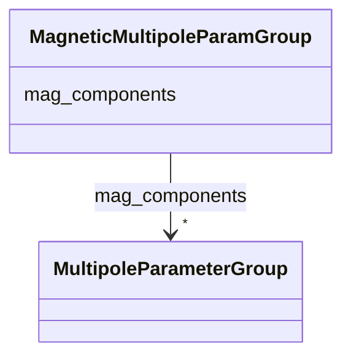

# Class: MagneticMultipoleParamGroup 


_Mixin for magnetic multipole parameters,  which can be used to describe the magnetic field components of an accelerator element. This mixin is aligned with PALS MagneticMultipoleP for interoperability with the Particle Accelerator Language Standard (PALS). Example with three multipole components (N=0,1,2): ```yaml mag_components: - order: 7_

_  tilt: 0.7_

_- order: 3_

_  Bn: 27.3_

_- order: 2_

_  BnL: 3.47e1_

_- order: 1_

_  Kn: 0.85     # normalized form, e.g. a quadrupole's k1-like strength_

_```_


URI: [pals:MagneticMultipoleParamGroup](https://pals-project.readthedocs.io/MagneticMultipoleParamGroup)





<!-- no inheritance hierarchy -->


## Slots

| Name | Cardinality and Range | Description | Inheritance |
| ---  | --- | --- | --- |
| [mag_components](mag_components.md) | * <br/> [MultipoleParameterGroup](MultipoleParameterGroup.md) | Magnetic multipole components, one per order N | direct |


## Usages

| used by | used in | type | used |
| ---  | --- | --- | --- |
| [HasMagneticMultipoleP](HasMagneticMultipoleP.md) | [MagneticMultipoleP](MagneticMultipoleP.md) | range | [MagneticMultipoleParamGroup](MagneticMultipoleParamGroup.md) |
| [Multipole](Multipole.md) | [MagneticMultipoleP](MagneticMultipoleP.md) | range | [MagneticMultipoleParamGroup](MagneticMultipoleParamGroup.md) |
| [Bend](Bend.md) | [MagneticMultipoleP](MagneticMultipoleP.md) | range | [MagneticMultipoleParamGroup](MagneticMultipoleParamGroup.md) |
| [Quadrupole](Quadrupole.md) | [MagneticMultipoleP](MagneticMultipoleP.md) | range | [MagneticMultipoleParamGroup](MagneticMultipoleParamGroup.md) |
| [Octupole](Octupole.md) | [MagneticMultipoleP](MagneticMultipoleP.md) | range | [MagneticMultipoleParamGroup](MagneticMultipoleParamGroup.md) |
| [Sextupole](Sextupole.md) | [MagneticMultipoleP](MagneticMultipoleP.md) | range | [MagneticMultipoleParamGroup](MagneticMultipoleParamGroup.md) |
| [Kicker](Kicker.md) | [MagneticMultipoleP](MagneticMultipoleP.md) | range | [MagneticMultipoleParamGroup](MagneticMultipoleParamGroup.md) |
| [ACKicker](ACKicker.md) | [MagneticMultipoleP](MagneticMultipoleP.md) | range | [MagneticMultipoleParamGroup](MagneticMultipoleParamGroup.md) |
| [Cavity](Cavity.md) | [MagneticMultipoleP](MagneticMultipoleP.md) | range | [MagneticMultipoleParamGroup](MagneticMultipoleParamGroup.md) |
| [CrabCavity](CrabCavity.md) | [MagneticMultipoleP](MagneticMultipoleP.md) | range | [MagneticMultipoleParamGroup](MagneticMultipoleParamGroup.md) |
| [RFCavity](RFCavity.md) | [MagneticMultipoleP](MagneticMultipoleP.md) | range | [MagneticMultipoleParamGroup](MagneticMultipoleParamGroup.md) |
| [NormalConductingRFCavity](NormalConductingRFCavity.md) | [MagneticMultipoleP](MagneticMultipoleP.md) | range | [MagneticMultipoleParamGroup](MagneticMultipoleParamGroup.md) |
| [SuperConductingRFCavity](SuperConductingRFCavity.md) | [MagneticMultipoleP](MagneticMultipoleP.md) | range | [MagneticMultipoleParamGroup](MagneticMultipoleParamGroup.md) |


## Identifier and Mapping Information


### Schema Source


* from schema: https://w3id.org/accelerator-core


## Mappings

| Mapping Type | Mapped Value |
| ---  | ---  |
| self | pals:MagneticMultipoleParamGroup |
| native | pals:MagneticMultipoleParamGroup |
| broad | pals:MagneticMultipoleP |


## LinkML Source

<!-- TODO: investigate https://stackoverflow.com/questions/37606292/how-to-create-tabbed-code-blocks-in-mkdocs-or-sphinx -->

### Direct

<details>
```yaml
name: MagneticMultipoleParamGroup
description: "Mixin for magnetic multipole parameters,  which can be used to describe\
  \ the magnetic field components of an accelerator element. This mixin is aligned\
  \ with PALS MagneticMultipoleP for interoperability with the Particle Accelerator\
  \ Language Standard (PALS). Example with three multipole components (N=0,1,2): ```yaml\
  \ mag_components: - order: 7\n  tilt: 0.7\n- order: 3\n  Bn: 27.3\n- order: 2\n\
  \  BnL: 3.47e1\n- order: 1\n  Kn: 0.85     # normalized form, e.g. a quadrupole's\
  \ k1-like strength\n```"
from_schema: https://w3id.org/accelerator-core
broad_mappings:
- pals:MagneticMultipoleP
attributes:
  mag_components:
    name: mag_components
    description: Magnetic multipole components, one per order N.
    from_schema: https://w3id.org/accelerator-core
    rank: 1000
    domain_of:
    - MagneticMultipoleParamGroup
    range: MultipoleParameterGroup
    multivalued: true
    inlined: true
    inlined_as_list: true

```
</details>

### Induced

<details>
```yaml
name: MagneticMultipoleParamGroup
description: "Mixin for magnetic multipole parameters,  which can be used to describe\
  \ the magnetic field components of an accelerator element. This mixin is aligned\
  \ with PALS MagneticMultipoleP for interoperability with the Particle Accelerator\
  \ Language Standard (PALS). Example with three multipole components (N=0,1,2): ```yaml\
  \ mag_components: - order: 7\n  tilt: 0.7\n- order: 3\n  Bn: 27.3\n- order: 2\n\
  \  BnL: 3.47e1\n- order: 1\n  Kn: 0.85     # normalized form, e.g. a quadrupole's\
  \ k1-like strength\n```"
from_schema: https://w3id.org/accelerator-core
broad_mappings:
- pals:MagneticMultipoleP
attributes:
  mag_components:
    name: mag_components
    description: Magnetic multipole components, one per order N.
    from_schema: https://w3id.org/accelerator-core
    rank: 1000
    alias: mag_components
    owner: MagneticMultipoleParamGroup
    domain_of:
    - MagneticMultipoleParamGroup
    range: MultipoleParameterGroup
    multivalued: true
    inlined: true
    inlined_as_list: true

```
</details>