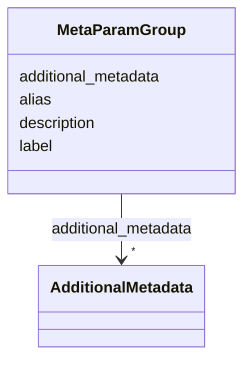

# Class: MetaParamGroup 


_Mixin class for metadata parameters that are aligned with PALS MetaP (Metadata Parameters) for interoperability with the Particle Accelerator Language Standard (PALS)._


URI: [pals:MetaParamGroup](https://pals-project.readthedocs.io/MetaParamGroup)





<!-- no inheritance hierarchy -->

## Slots

| Name | Cardinality and Range | Description | Inheritance |
| ---  | --- | --- | --- |
| [description](description.md) | 0..1 <br/> [String](String.md) | A human-readable description of the instance | direct |
| [alias](alias.md) | 0..1 <br/> [String](String.md) | An alternative name or identifier for the instance | direct |
| [label](label.md) | 0..1 <br/> [String](String.md) | A label string | direct |
| [additional_metadata](additional_metadata.md) | * <br/> [AdditionalMetadata](AdditionalMetadata.md) | Additional metadata or annotations for the instance | direct |


## Usages

| used by | used in | type | used |
| ---  | --- | --- | --- |
| [HasMetaP](HasMetaP.md) | [MetaP](MetaP.md) | range | [MetaParamGroup](MetaParamGroup.md) |
| [Component](Component.md) | [MetaP](MetaP.md) | range | [MetaParamGroup](MetaParamGroup.md) |
| [PhysicalComponent](PhysicalComponent.md) | [MetaP](MetaP.md) | range | [MetaParamGroup](MetaParamGroup.md) |
| [VirtualComponent](VirtualComponent.md) | [MetaP](MetaP.md) | range | [MetaParamGroup](MetaParamGroup.md) |
| [BeamLine](BeamLine.md) | [MetaP](MetaP.md) | range | [MetaParamGroup](MetaParamGroup.md) |
| [Signal](Signal.md) | [MetaP](MetaP.md) | range | [MetaParamGroup](MetaParamGroup.md) |
| [Magnet](Magnet.md) | [MetaP](MetaP.md) | range | [MetaParamGroup](MetaParamGroup.md) |
| [Solenoid](Solenoid.md) | [MetaP](MetaP.md) | range | [MetaParamGroup](MetaParamGroup.md) |
| [Multipole](Multipole.md) | [MetaP](MetaP.md) | range | [MetaParamGroup](MetaParamGroup.md) |
| [Bend](Bend.md) | [MetaP](MetaP.md) | range | [MetaParamGroup](MetaParamGroup.md) |
| [Quadrupole](Quadrupole.md) | [MetaP](MetaP.md) | range | [MetaParamGroup](MetaParamGroup.md) |
| [Octupole](Octupole.md) | [MetaP](MetaP.md) | range | [MetaParamGroup](MetaParamGroup.md) |
| [Sextupole](Sextupole.md) | [MetaP](MetaP.md) | range | [MetaParamGroup](MetaParamGroup.md) |
| [Kicker](Kicker.md) | [MetaP](MetaP.md) | range | [MetaParamGroup](MetaParamGroup.md) |
| [ACKicker](ACKicker.md) | [MetaP](MetaP.md) | range | [MetaParamGroup](MetaParamGroup.md) |
| [DiagnosticDevice](DiagnosticDevice.md) | [MetaP](MetaP.md) | range | [MetaParamGroup](MetaParamGroup.md) |
| [BeamProfileMonitor](BeamProfileMonitor.md) | [MetaP](MetaP.md) | range | [MetaParamGroup](MetaParamGroup.md) |
| [BeamPositionMonitor](BeamPositionMonitor.md) | [MetaP](MetaP.md) | range | [MetaParamGroup](MetaParamGroup.md) |
| [Aperture](Aperture.md) | [MetaP](MetaP.md) | range | [MetaParamGroup](MetaParamGroup.md) |
| [RadiationMonitor](RadiationMonitor.md) | [MetaP](MetaP.md) | range | [MetaParamGroup](MetaParamGroup.md) |
| [Cavity](Cavity.md) | [MetaP](MetaP.md) | range | [MetaParamGroup](MetaParamGroup.md) |
| [CrabCavity](CrabCavity.md) | [MetaP](MetaP.md) | range | [MetaParamGroup](MetaParamGroup.md) |
| [RFCavity](RFCavity.md) | [MetaP](MetaP.md) | range | [MetaParamGroup](MetaParamGroup.md) |
| [NormalConductingRFCavity](NormalConductingRFCavity.md) | [MetaP](MetaP.md) | range | [MetaParamGroup](MetaParamGroup.md) |
| [SuperConductingRFCavity](SuperConductingRFCavity.md) | [MetaP](MetaP.md) | range | [MetaParamGroup](MetaParamGroup.md) |
| [SupportingFacilityComponent](SupportingFacilityComponent.md) | [MetaP](MetaP.md) | range | [MetaParamGroup](MetaParamGroup.md) |
| [BookkeepingComponent](BookkeepingComponent.md) | [MetaP](MetaP.md) | range | [MetaParamGroup](MetaParamGroup.md) |
| [Marker](Marker.md) | [MetaP](MetaP.md) | range | [MetaParamGroup](MetaParamGroup.md) |
| [BeamLineSection](BeamLineSection.md) | [MetaP](MetaP.md) | range | [MetaParamGroup](MetaParamGroup.md) |


## Identifier and Mapping Information


### Schema Source


* from schema: https://w3id.org/accelerator-core


## Mappings

| Mapping Type | Mapped Value |
| ---  | ---  |
| self | pals:MetaParamGroup |
| native | pals:MetaParamGroup |
| broad | pals:MetaP |


## LinkML Source

<!-- TODO: investigate https://stackoverflow.com/questions/37606292/how-to-create-tabbed-code-blocks-in-mkdocs-or-sphinx -->

### Direct

<details>
```yaml
name: MetaParamGroup
description: Mixin class for metadata parameters that are aligned with PALS MetaP
  (Metadata Parameters) for interoperability with the Particle Accelerator Language
  Standard (PALS).
from_schema: https://w3id.org/accelerator-core
broad_mappings:
- pals:MetaP
slots:
- description
- alias
attributes:
  label:
    name: label
    description: A label string.
    from_schema: https://w3id.org/accelerator-core
    rank: 1000
    slot_uri: pals:label
    domain_of:
    - MetaParamGroup
    range: string
  additional_metadata:
    name: additional_metadata
    description: Additional metadata or annotations for the instance.
    from_schema: https://w3id.org/accelerator-core
    rank: 1000
    domain_of:
    - MetaParamGroup
    range: AdditionalMetadata
    multivalued: true
    inlined: true
    inlined_as_list: true

```
</details>

### Induced

<details>
```yaml
name: MetaParamGroup
description: Mixin class for metadata parameters that are aligned with PALS MetaP
  (Metadata Parameters) for interoperability with the Particle Accelerator Language
  Standard (PALS).
from_schema: https://w3id.org/accelerator-core
broad_mappings:
- pals:MetaP
attributes:
  label:
    name: label
    description: A label string.
    from_schema: https://w3id.org/accelerator-core
    rank: 1000
    slot_uri: pals:label
    alias: label
    owner: MetaParamGroup
    domain_of:
    - MetaParamGroup
    range: string
  additional_metadata:
    name: additional_metadata
    description: Additional metadata or annotations for the instance.
    from_schema: https://w3id.org/accelerator-core
    rank: 1000
    alias: additional_metadata
    owner: MetaParamGroup
    domain_of:
    - MetaParamGroup
    range: AdditionalMetadata
    multivalued: true
    inlined: true
    inlined_as_list: true
  description:
    name: description
    description: A human-readable description of the instance.
    from_schema: https://w3id.org/accelerator-core
    rank: 1000
    alias: description
    owner: MetaParamGroup
    domain_of:
    - PALSAccelerator
    - MetaParamGroup
    - BeamLine
    range: string
  alias:
    name: alias
    description: An alternative name or identifier for the instance.
    from_schema: https://w3id.org/accelerator-core
    rank: 1000
    slot_uri: pals:alias
    alias: alias
    owner: MetaParamGroup
    domain_of:
    - MetaParamGroup
    - Signal
    range: string

```
</details>