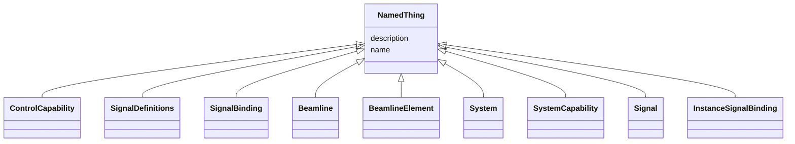

# Class: NamedThing 


_Abstract base class providing identity and human-readable metadata._


* __NOTE__: this is an abstract class and should not be instantiated directly


URI: [narad:NamedThing](https://w3id.org/narad_linkml/schema/narad/NamedThing)





## Inheritance
* **NamedThing**
    * [ControlCapability](ControlCapability.md)
    * [SignalDefinitions](SignalDefinitions.md)
    * [SignalBinding](SignalBinding.md)
    * [Beamline](Beamline.md)
    * [BeamlineElement](BeamlineElement.md)
    * [System](System.md)
    * [SystemCapability](SystemCapability.md)
    * [Signal](Signal.md)
    * [InstanceSignalBinding](InstanceSignalBinding.md)


## Slots

| Name | Cardinality and Range | Description | Inheritance |
| ---  | --- | --- | --- |
| [name](name.md) | 1 <br/> [String](String.md) | Human-readable name or local string key for the entity | direct |
| [description](description.md) | 0..1 <br/> [String](String.md) | Detailed description of the entity | direct |


## Identifier and Mapping Information


### Schema Source


* from schema: https://w3id.org/narad_linkml/schema/narad/system


## Mappings

| Mapping Type | Mapped Value |
| ---  | ---  |
| self | narad:NamedThing |
| native | narad:NamedThing |


## LinkML Source

<!-- TODO: investigate https://stackoverflow.com/questions/37606292/how-to-create-tabbed-code-blocks-in-mkdocs-or-sphinx -->

### Direct

<details>
```yaml
name: NamedThing
description: Abstract base class providing identity and human-readable metadata.
from_schema: https://w3id.org/narad_linkml/schema/narad/system
abstract: true
slots:
- name
- description

```
</details>

### Induced

<details>
```yaml
name: NamedThing
description: Abstract base class providing identity and human-readable metadata.
from_schema: https://w3id.org/narad_linkml/schema/narad/system
abstract: true
attributes:
  name:
    name: name
    description: Human-readable name or local string key for the entity.
    from_schema: https://w3id.org/narad_linkml/schema/narad/system
    rank: 1000
    identifier: true
    alias: name
    owner: NamedThing
    domain_of:
    - NamedThing
    range: string
    required: true
  description:
    name: description
    description: Detailed description of the entity.
    from_schema: https://w3id.org/narad_linkml/schema/narad/system
    rank: 1000
    alias: description
    owner: NamedThing
    domain_of:
    - NamedThing
    range: string

```
</details>