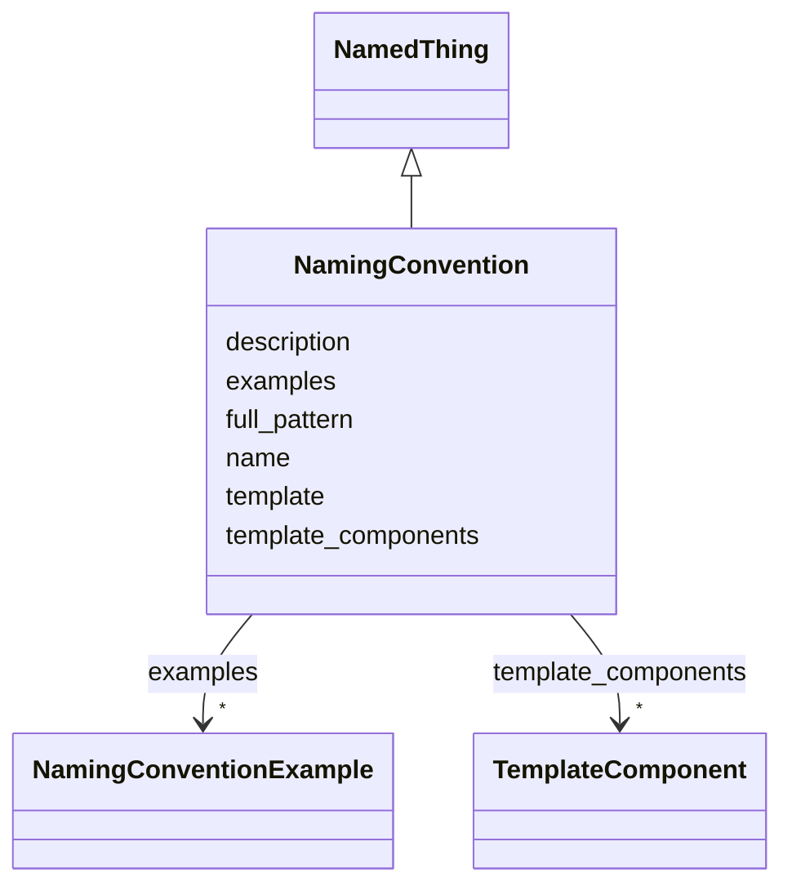

# Class: NamingConvention 


_A template for constructing facility-specific signal names from a semantic signal name and a control-system-specific suffix.  The template is used to generate the full control system PV name for a given device instance and semantic signal by substituting the device name and signal code suffix into the template._

__


URI: [narad:NamingConvention](https://example.org/narad_linkml/schema/narad/NamingConvention)





## Inheritance
* [NamedThing](NamedThing.md)
    * **NamingConvention**


## Slots

| Name | Cardinality and Range | Description | Inheritance |
| ---  | --- | --- | --- |
| [template](template.md) | 0..1 <br/> [String](String.md) | A template string for constructing control system PV names based on the seman... | direct |
| [template_components](template_components.md) | * <br/> [TemplateComponent](TemplateComponent.md) | Structured components of the naming convention template, for capturing the te... | direct |
| [full_pattern](full_pattern.md) | 0..1 <br/> [String](String.md) | A regex pattern that the full resolved value (e | direct |
| [examples](examples.md) | * <br/> [NamingConventionExample](NamingConventionExample.md) | Examples of how this naming convention is applied to specific device instance... | direct |
| [name](name.md) | 1 <br/> [String](String.md) | Human-readable name or local string key for the entity | [NamedThing](NamedThing.md) |
| [description](description.md) | 0..1 <br/> [String](String.md) | Detailed description of the entity | [NamedThing](NamedThing.md) |


## Usages

| used by | used in | type | used |
| ---  | --- | --- | --- |
| [ControlSystem](ControlSystem.md) | [has_naming_convention](has_naming_convention.md) | range | [NamingConvention](NamingConvention.md) |


## Identifier and Mapping Information


### Schema Source


* from schema: https://w3id.org/narad_linkml/schema/narad/system


## Mappings

| Mapping Type | Mapped Value |
| ---  | ---  |
| self | narad:NamingConvention |
| native | narad:NamingConvention |


## LinkML Source

<!-- TODO: investigate https://stackoverflow.com/questions/37606292/how-to-create-tabbed-code-blocks-in-mkdocs-or-sphinx -->

### Direct

<details>
```yaml
name: NamingConvention
description: 'A template for constructing facility-specific signal names from a semantic
  signal name and a control-system-specific suffix.  The template is used to generate
  the full control system PV name for a given device instance and semantic signal
  by substituting the device name and signal code suffix into the template.

  '
from_schema: https://w3id.org/narad_linkml/schema/narad/system
is_a: NamedThing
slots:
- template
- template_components
- full_pattern
- examples

```
</details>

### Induced

<details>
```yaml
name: NamingConvention
description: 'A template for constructing facility-specific signal names from a semantic
  signal name and a control-system-specific suffix.  The template is used to generate
  the full control system PV name for a given device instance and semantic signal
  by substituting the device name and signal code suffix into the template.

  '
from_schema: https://w3id.org/narad_linkml/schema/narad/system
is_a: NamedThing
attributes:
  template:
    name: template
    description: A template string for constructing control system PV names based
      on the semantic signal name and device instance. This can include placeholders
      for the device name and signal suffix, e.g. {device_name}{signal_suffix}.
    in_subset:
    - label
    from_schema: https://w3id.org/narad_linkml/schema/narad/system
    rank: 1000
    alias: template
    owner: NamingConvention
    domain_of:
    - NamingConvention
    range: string
  template_components:
    name: template_components
    description: Structured components of the naming convention template, for capturing
      the template in a more machine-actionable way than a raw string.  For example,
      you could have components for the device name, signal suffix, and any fixed
      parts of the naming convention.
    from_schema: https://w3id.org/narad_linkml/schema/narad/system
    rank: 1000
    alias: template_components
    owner: NamingConvention
    domain_of:
    - NamingConvention
    range: TemplateComponent
    multivalued: true
    inlined: true
    inlined_as_list: true
  full_pattern:
    name: full_pattern
    description: A regex pattern that the full resolved value (e.g. after template
      substitution) must match for validation.
    in_subset:
    - label
    from_schema: https://w3id.org/narad_linkml/schema/narad/system
    rank: 1000
    alias: full_pattern
    owner: NamingConvention
    domain_of:
    - NamingConvention
    range: string
  examples:
    name: examples
    description: Examples of how this naming convention is applied to specific device
      instances and signals.
    from_schema: https://w3id.org/narad_linkml/schema/narad/system
    rank: 1000
    alias: examples
    owner: NamingConvention
    domain_of:
    - NamingConvention
    range: NamingConventionExample
    multivalued: true
    inlined: true
    inlined_as_list: true
  name:
    name: name
    description: Human-readable name or local string key for the entity.
    in_subset:
    - label
    from_schema: https://w3id.org/narad_linkml/schema/narad/system
    rank: 1000
    identifier: true
    alias: name
    owner: NamingConvention
    domain_of:
    - NamedThing
    range: string
    required: true
  description:
    name: description
    description: Detailed description of the entity.
    in_subset:
    - label
    from_schema: https://w3id.org/narad_linkml/schema/narad/system
    rank: 1000
    alias: description
    owner: NamingConvention
    domain_of:
    - NamedThing
    - NamingConventionExample
    - TemplateExample
    range: string

```
</details>