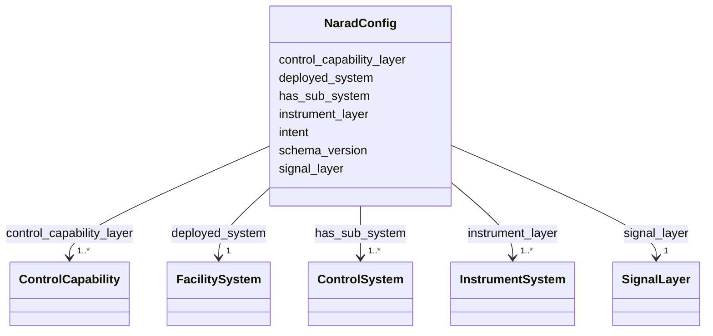

# Class: NaradConfig 


_A top-level NARAD-system container for the: capability layer + signal layer._


URI: [narad:NaradConfig](https://w3id.org/narad_linkml/schema/narad/NaradConfig)





<!-- no inheritance hierarchy -->


## Slots

| Name | Cardinality and Range | Description | Inheritance |
| ---  | --- | --- | --- |
| [schema_version](schema_version.md) | 1 <br/> [String](String.md) | Version of the NARAD schema used in this document | direct |
| [intent](intent.md) | 0..1 <br/> [String](String.md) | A human-readable statement of the intended use or purpose of this NARAD confi... | direct |
| [deployed_system](deployed_system.md) | 1 <br/> [FacilitySystem](FacilitySystem.md) | Identifier of the deployed system this configuration describes | direct |
| [has_sub_system](has_sub_system.md) | 1..* <br/> [ControlSystem](ControlSystem.md) | Identifier of the control system (e | direct |
| [control_capability_layer](control_capability_layer.md) | 1..* <br/> [ControlCapability](ControlCapability.md) | Control Capability definitions for this facility | direct |
| [instrument_layer](instrument_layer.md) | 1..* <br/> [InstrumentSystem](InstrumentSystem.md) | Instrument Capability definitions keyed by capability name | direct |
| [signal_layer](signal_layer.md) | 1 <br/> [SignalLayer](SignalLayer.md) | Signal-layer container for facility-specific signal bindings | direct |


## Usages

| used by | used in | type | used |
| ---  | --- | --- | --- |
| [NaradModel](NaradModel.md) | [narad_config](narad_config.md) | range | [NaradConfig](NaradConfig.md) |


## Identifier and Mapping Information


### Schema Source


* from schema: https://w3id.org/narad_linkml/schema/narad/system


## Mappings

| Mapping Type | Mapped Value |
| ---  | ---  |
| self | narad:NaradConfig |
| native | narad:NaradConfig |
| broad | ssn:Deployment |


## LinkML Source

<!-- TODO: investigate https://stackoverflow.com/questions/37606292/how-to-create-tabbed-code-blocks-in-mkdocs-or-sphinx -->

### Direct

<details>
```yaml
name: NaradConfig
description: 'A top-level NARAD-system container for the: capability layer + signal
  layer.'
from_schema: https://w3id.org/narad_linkml/schema/narad/system
broad_mappings:
- ssn:Deployment
slots:
- schema_version
- intent
- deployed_system
- has_sub_system
- control_capability_layer
- instrument_layer
- signal_layer
slot_usage:
  schema_version:
    name: schema_version
    description: Version of the NARAD schema used in this document.
    range: string
    required: true
  deployed_system:
    name: deployed_system
    description: Identifier of the deployed system this configuration describes.
    range: FacilitySystem
    required: true
    multivalued: false
  has_sub_system:
    name: has_sub_system
    description: Identifier of the control system (e.g. epics) this configuration
      describes.
    range: ControlSystem
    required: true
    multivalued: true
  instrument_layer:
    name: instrument_layer
    description: Instrument Capability definitions keyed by capability name.
    range: InstrumentSystem
    required: true
    multivalued: true
    inlined: true
  signal_layer:
    name: signal_layer
    description: Signal-layer container for facility-specific signal bindings.
    range: SignalLayer
    required: true
    inlined: false

```
</details>

### Induced

<details>
```yaml
name: NaradConfig
description: 'A top-level NARAD-system container for the: capability layer + signal
  layer.'
from_schema: https://w3id.org/narad_linkml/schema/narad/system
broad_mappings:
- ssn:Deployment
slot_usage:
  schema_version:
    name: schema_version
    description: Version of the NARAD schema used in this document.
    range: string
    required: true
  deployed_system:
    name: deployed_system
    description: Identifier of the deployed system this configuration describes.
    range: FacilitySystem
    required: true
    multivalued: false
  has_sub_system:
    name: has_sub_system
    description: Identifier of the control system (e.g. epics) this configuration
      describes.
    range: ControlSystem
    required: true
    multivalued: true
  instrument_layer:
    name: instrument_layer
    description: Instrument Capability definitions keyed by capability name.
    range: InstrumentSystem
    required: true
    multivalued: true
    inlined: true
  signal_layer:
    name: signal_layer
    description: Signal-layer container for facility-specific signal bindings.
    range: SignalLayer
    required: true
    inlined: false
attributes:
  schema_version:
    name: schema_version
    description: Version of the NARAD schema used in this document.
    from_schema: https://w3id.org/narad_linkml/schema/narad/system
    rank: 1000
    alias: schema_version
    owner: NaradConfig
    domain_of:
    - NaradConfig
    range: string
    required: true
  intent:
    name: intent
    description: A human-readable statement of the intended use or purpose of this
      NARAD configuration.
    from_schema: https://w3id.org/narad_linkml/schema/narad/system
    rank: 1000
    alias: intent
    owner: NaradConfig
    domain_of:
    - NaradConfig
    range: string
  deployed_system:
    name: deployed_system
    description: Identifier of the deployed system this configuration describes.
    from_schema: https://w3id.org/narad_linkml/schema/narad/system
    rank: 1000
    alias: deployed_system
    owner: NaradConfig
    domain_of:
    - NaradConfig
    range: FacilitySystem
    required: true
    multivalued: false
  has_sub_system:
    name: has_sub_system
    description: Identifier of the control system (e.g. epics) this configuration
      describes.
    from_schema: https://w3id.org/narad_linkml/schema/narad/system
    exact_mappings:
    - ssn-system:hasSubSystem
    rank: 1000
    domain: System
    alias: has_sub_system
    owner: NaradConfig
    domain_of:
    - NaradConfig
    - System
    - InstrumentSystem
    range: ControlSystem
    required: true
    multivalued: true
  control_capability_layer:
    name: control_capability_layer
    description: Control Capability definitions for this facility.
    from_schema: https://w3id.org/narad_linkml/schema/narad/system
    rank: 1000
    alias: control_capability_layer
    owner: NaradConfig
    domain_of:
    - NaradConfig
    range: ControlCapability
    required: true
    multivalued: true
    inlined: true
  instrument_layer:
    name: instrument_layer
    description: Instrument Capability definitions keyed by capability name.
    from_schema: https://w3id.org/narad_linkml/schema/narad/system
    rank: 1000
    alias: instrument_layer
    owner: NaradConfig
    domain_of:
    - NaradConfig
    range: InstrumentSystem
    required: true
    multivalued: true
    inlined: true
  signal_layer:
    name: signal_layer
    description: Signal-layer container for facility-specific signal bindings.
    from_schema: https://w3id.org/narad_linkml/schema/narad/system
    rank: 1000
    alias: signal_layer
    owner: NaradConfig
    domain_of:
    - NaradConfig
    range: SignalLayer
    required: true
    inlined: false

```
</details>