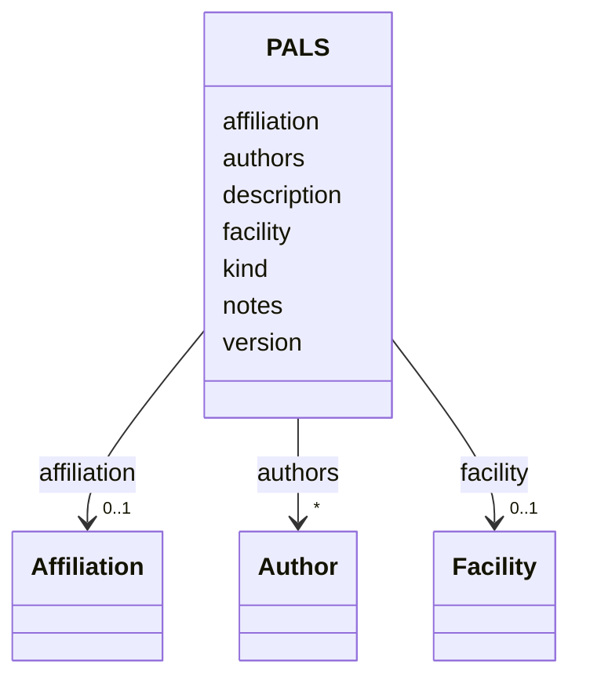

# Class: PALS 


_Root container for accelerator core components, semantic signals, and local bindings._


URI: [pals:PALS](https://pals-project.readthedocs.io/PALS)





<!-- no inheritance hierarchy -->


## Slots

| Name | Cardinality and Range | Description | Inheritance |
| ---  | --- | --- | --- |
| [kind](kind.md) | 1 <br/> [String](String.md) | The LinkML class name of this instance | direct |
| [description](description.md) | 0..1 <br/> [String](String.md) | A human-readable description of the instance | direct |
| [affiliation](affiliation.md) | 0..1 <br/> [Affiliation](Affiliation.md) | The affiliation of the author or component, as a ROR | direct |
| [version](version.md) | 0..1 <br/> [String](String.md) | Version of the representation of a particle accelerator and its operations | direct |
| [authors](authors.md) | * <br/> [Author](Author.md) | Contains the authorship information for this representation of an accelerator... | direct |
| [notes](notes.md) | * <br/> [String](String.md) | Additional notes or comments about the representation of a particle accelerat... | direct |
| [facility](facility.md) | 0..1 <br/> [Facility](Facility.md) | A facility that contains lattice elements (physical and virtual), beamlines, ... | direct |


## Identifier and Mapping Information


### Schema Source


* from schema: https://w3id.org/accelerator-core


## Mappings

| Mapping Type | Mapped Value |
| ---  | ---  |
| self | pals:PALS |
| native | pals:PALS |


## LinkML Source

<!-- TODO: investigate https://stackoverflow.com/questions/37606292/how-to-create-tabbed-code-blocks-in-mkdocs-or-sphinx -->

### Direct

<details>
```yaml
name: PALS
description: Root container for accelerator core components, semantic signals, and
  local bindings.
from_schema: https://w3id.org/accelerator-core
slots:
- kind
- description
- affiliation
attributes:
  version:
    name: version
    description: Version of the representation of a particle accelerator and its operations.
    from_schema: https://w3id.org/accelerator-core
    rank: 1000
    domain_of:
    - PALS
    range: string
    pattern: ^(0|[1-9][0-9]*)\.(0|[1-9][0-9]*)\.(0|[1-9][0-9]*)$
  authors:
    name: authors
    description: Contains the authorship information for this representation of an
      accelerator facility and its operations.
    from_schema: https://w3id.org/accelerator-core
    rank: 1000
    domain_of:
    - PALS
    range: Author
    multivalued: true
    inlined: true
    inlined_as_list: true
  notes:
    name: notes
    description: Additional notes or comments about the representation of a particle
      accelerator and its operations.
    from_schema: https://w3id.org/accelerator-core
    rank: 1000
    domain_of:
    - PALS
    range: string
    multivalued: true
    inlined: true
    inlined_as_list: true
  facility:
    name: facility
    description: A facility that contains lattice elements (physical and virtual),
      beamlines, parameter set commands, signals, etc.
    from_schema: https://w3id.org/accelerator-core
    rank: 1000
    domain_of:
    - PALS
    range: Facility
tree_root: true

```
</details>

### Induced

<details>
```yaml
name: PALS
description: Root container for accelerator core components, semantic signals, and
  local bindings.
from_schema: https://w3id.org/accelerator-core
attributes:
  version:
    name: version
    description: Version of the representation of a particle accelerator and its operations.
    from_schema: https://w3id.org/accelerator-core
    rank: 1000
    alias: version
    owner: PALS
    domain_of:
    - PALS
    range: string
    pattern: ^(0|[1-9][0-9]*)\.(0|[1-9][0-9]*)\.(0|[1-9][0-9]*)$
  authors:
    name: authors
    description: Contains the authorship information for this representation of an
      accelerator facility and its operations.
    from_schema: https://w3id.org/accelerator-core
    rank: 1000
    alias: authors
    owner: PALS
    domain_of:
    - PALS
    range: Author
    multivalued: true
    inlined_as_list: true
  notes:
    name: notes
    description: Additional notes or comments about the representation of a particle
      accelerator and its operations.
    from_schema: https://w3id.org/accelerator-core
    rank: 1000
    alias: notes
    owner: PALS
    domain_of:
    - PALS
    range: string
    multivalued: true
    inlined_as_list: true
  facility:
    name: facility
    description: A facility that contains lattice elements (physical and virtual),
      beamlines, parameter set commands, signals, etc.
    from_schema: https://w3id.org/accelerator-core
    rank: 1000
    alias: facility
    owner: PALS
    domain_of:
    - PALS
    range: Facility
  kind:
    name: kind
    description: The LinkML class name of this instance.
    from_schema: https://w3id.org/accelerator-core
    rank: 1000
    slot_uri: pals:kind
    alias: kind
    owner: PALS
    domain_of:
    - PALS
    - Component
    - Signal
    range: string
    required: true
  description:
    name: description
    description: A human-readable description of the instance.
    from_schema: https://w3id.org/accelerator-core
    rank: 1000
    alias: description
    owner: PALS
    domain_of:
    - PALS
    - MetaParamGroup
    - BeamLine
    range: string
  affiliation:
    name: affiliation
    description: The affiliation of the author or component, as a ROR.
    from_schema: https://w3id.org/accelerator-core
    rank: 1000
    alias: affiliation
    owner: PALS
    domain_of:
    - PALS
    - Author
    range: Affiliation
    inlined: true
tree_root: true

```
</details>