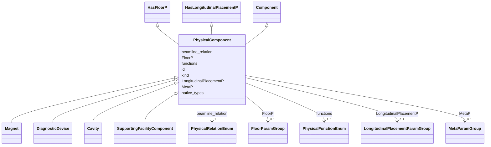

# Class: PhysicalComponent 


_A physical item that participates in or supports accelerator operation.  This can be used to capture physical components, such as magnets, cavities, diagnostics, vacuum devices, and racks that are important for understanding the structure and function of the accelerator system._


URI: [pals:PhysicalComponent](https://pals-project.readthedocs.io/PhysicalComponent)





## Inheritance
* [Component](Component.md) [ [HasMetaP](HasMetaP.md)]
    * **PhysicalComponent** [ [HasFloorP](HasFloorP.md) [HasLongitudinalPlacementP](HasLongitudinalPlacementP.md)]
        * [Magnet](Magnet.md) [ [HasReferenceP](HasReferenceP.md) [HasBodyShiftP](HasBodyShiftP.md) [HasTwissP](HasTwissP.md)]
        * [DiagnosticDevice](DiagnosticDevice.md)
        * [Cavity](Cavity.md) [ [HasReferenceP](HasReferenceP.md) [HasElectricMultipoleP](HasElectricMultipoleP.md) [HasMagneticMultipoleP](HasMagneticMultipoleP.md) [HasBodyShiftP](HasBodyShiftP.md) [HasTwissP](HasTwissP.md)]
        * [SupportingFacilityComponent](SupportingFacilityComponent.md) [ [HasFloorP](HasFloorP.md) [HasLongitudinalPlacementP](HasLongitudinalPlacementP.md) [HasBodyShiftP](HasBodyShiftP.md)]


## Slots

| Name | Cardinality and Range | Description | Inheritance |
| ---  | --- | --- | --- |
| [functions](functions.md) | 1..* <br/> [PhysicalFunctionEnum](PhysicalFunctionEnum.md) | The function of the physical component,  which can be used to identify the co... | direct |
| [beamline_relation](beamline_relation.md) | 1 <br/> [PhysicalRelationEnum](PhysicalRelationEnum.md) | The relationship of the physical component to the beamline,  which can be use... | direct |
| [FloorP](FloorP.md) | 0..1 <br/> [FloorParamGroup](FloorParamGroup.md) | A mixin for floor plan parameters that are aligned with PALS FloorP (Floor Pl... | [HasFloorP](HasFloorP.md) |
| [LongitudinalPlacementP](LongitudinalPlacementP.md) | 0..1 <br/> [LongitudinalPlacementParamGroup](LongitudinalPlacementParamGroup.md) | A mixin for an element's extent and position along the longitudinal (beam-dir... | [HasLongitudinalPlacementP](HasLongitudinalPlacementP.md) |
| [id](id.md) | 1 <br/> [String](String.md) | A unique identifier for the instance | [Component](Component.md) |
| [kind](kind.md) | 1 <br/> [String](String.md) | The LinkML class name of this instance | [Component](Component.md) |
| [native_types](native_types.md) | * <br/> [String](String.md) | The native type of the component in the source system, which can be used to i... | [Component](Component.md) |
| [MetaP](MetaP.md) | 0..1 <br/> [MetaParamGroup](MetaParamGroup.md) | A mixin for metadata parameters that are aligned with PALS MetaP (Metadata Pa... | [HasMetaP](HasMetaP.md) |


## Usages

| used by | used in | type | used |
| ---  | --- | --- | --- |
| [SignalBinding](SignalBinding.md) | [subject](subject.md) | range | [PhysicalComponent](PhysicalComponent.md) |


## Identifier and Mapping Information


### Schema Source


* from schema: https://w3id.org/accelerator-core


## Mappings

| Mapping Type | Mapped Value |
| ---  | ---  |
| self | pals:PhysicalComponent |
| native | pals:PhysicalComponent |
| broad | pals:Element |


## LinkML Source

<!-- TODO: investigate https://stackoverflow.com/questions/37606292/how-to-create-tabbed-code-blocks-in-mkdocs-or-sphinx -->

### Direct

<details>
```yaml
name: PhysicalComponent
description: A physical item that participates in or supports accelerator operation.  This
  can be used to capture physical components, such as magnets, cavities, diagnostics,
  vacuum devices, and racks that are important for understanding the structure and
  function of the accelerator system.
from_schema: https://w3id.org/accelerator-core
broad_mappings:
- pals:Element
is_a: Component
mixins:
- HasFloorP
- HasLongitudinalPlacementP
attributes:
  functions:
    name: functions
    description: The function of the physical component,  which can be used to identify
      the component across different source systems.
    from_schema: https://w3id.org/accelerator-core
    rank: 1000
    slot_uri: pals:physical_function
    domain_of:
    - PhysicalComponent
    - VirtualComponent
    - SupportingFacilityComponent
    range: PhysicalFunctionEnum
    required: true
    multivalued: true
  beamline_relation:
    name: beamline_relation
    description: The relationship of the physical component to the beamline,  which
      can be used to identify the component across different source systems.
    from_schema: https://w3id.org/accelerator-core
    rank: 1000
    slot_uri: pals:physical_beamline_relation
    domain_of:
    - PhysicalComponent
    - VirtualComponent
    range: PhysicalRelationEnum
    required: true

```
</details>

### Induced

<details>
```yaml
name: PhysicalComponent
description: A physical item that participates in or supports accelerator operation.  This
  can be used to capture physical components, such as magnets, cavities, diagnostics,
  vacuum devices, and racks that are important for understanding the structure and
  function of the accelerator system.
from_schema: https://w3id.org/accelerator-core
broad_mappings:
- pals:Element
is_a: Component
mixins:
- HasFloorP
- HasLongitudinalPlacementP
attributes:
  functions:
    name: functions
    description: The function of the physical component,  which can be used to identify
      the component across different source systems.
    from_schema: https://w3id.org/accelerator-core
    rank: 1000
    slot_uri: pals:physical_function
    alias: functions
    owner: PhysicalComponent
    domain_of:
    - PhysicalComponent
    - VirtualComponent
    - SupportingFacilityComponent
    range: PhysicalFunctionEnum
    required: true
    multivalued: true
  beamline_relation:
    name: beamline_relation
    description: The relationship of the physical component to the beamline,  which
      can be used to identify the component across different source systems.
    from_schema: https://w3id.org/accelerator-core
    rank: 1000
    slot_uri: pals:physical_beamline_relation
    alias: beamline_relation
    owner: PhysicalComponent
    domain_of:
    - PhysicalComponent
    - VirtualComponent
    range: PhysicalRelationEnum
    required: true
  FloorP:
    name: FloorP
    description: A mixin for floor plan parameters that are aligned with PALS FloorP
      (Floor Plan Parameters) for interoperability with the Particle Accelerator Language
      Standard (PALS).
    from_schema: https://w3id.org/accelerator-core
    rank: 1000
    alias: FloorP
    owner: PhysicalComponent
    domain_of:
    - HasFloorP
    range: FloorParamGroup
    inlined: true
  LongitudinalPlacementP:
    name: LongitudinalPlacementP
    description: A mixin for an element's extent and position along the longitudinal
      (beam-direction, "s") axis that are aligned with PALS LongitudinalPlacementP
      (Longitudinal Placement Parameters) for interoperability with the Particle Accelerator
      Language Standard (PALS).
    from_schema: https://w3id.org/accelerator-core
    rank: 1000
    alias: LongitudinalPlacementP
    owner: PhysicalComponent
    domain_of:
    - HasLongitudinalPlacementP
    range: LongitudinalPlacementParamGroup
    inlined: true
  id:
    name: id
    description: A unique identifier for the instance.
    from_schema: https://w3id.org/accelerator-core
    rank: 1000
    slot_uri: pals:id
    identifier: true
    alias: id
    owner: PhysicalComponent
    domain_of:
    - Affiliation
    - Component
    - Signal
    - Relationship
    range: string
    required: true
  kind:
    name: kind
    description: The LinkML class name of this instance.
    from_schema: https://w3id.org/accelerator-core
    rank: 1000
    slot_uri: pals:kind
    designates_type: true
    alias: kind
    owner: PhysicalComponent
    domain_of:
    - PALSAccelerator
    - Component
    - Signal
    range: string
    required: true
  native_types:
    name: native_types
    description: The native type of the component in the source system, which can
      be used to identify the component across different source systems.
    from_schema: https://w3id.org/accelerator-core
    rank: 1000
    alias: native_types
    owner: PhysicalComponent
    domain_of:
    - Component
    range: string
    multivalued: true
  MetaP:
    name: MetaP
    description: A mixin for metadata parameters that are aligned with PALS MetaP
      (Metadata Parameters) for interoperability with the Particle Accelerator Language
      Standard (PALS).
    from_schema: https://w3id.org/accelerator-core
    rank: 1000
    alias: MetaP
    owner: PhysicalComponent
    domain_of:
    - HasMetaP
    range: MetaParamGroup
    inlined: true

```
</details>