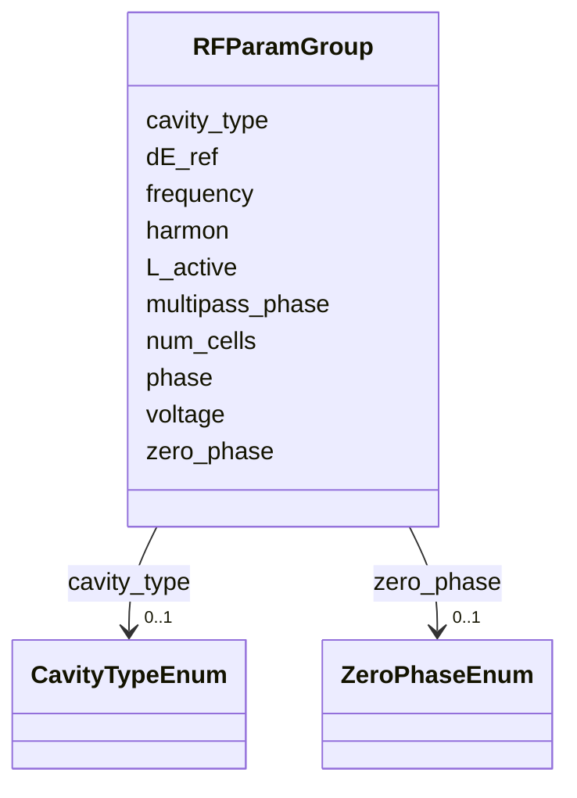

# Class: RFParamGroup 


_Mixin for RF parameters, which can be used to describe the RF properties of an accelerator element. This mixin is aligned with PALS RFP for interoperability with the Particle Accelerator Language Standard (PALS)._


URI: [pals:RFParamGroup](https://pals-project.readthedocs.io/RFParamGroup)





<!-- no inheritance hierarchy -->


## Slots

| Name | Cardinality and Range | Description | Inheritance |
| ---  | --- | --- | --- |
| [frequency](frequency.md) | 0..1 <br/> [Float](Float.md) | RF frequency | direct |
| [harmon](harmon.md) | 0..1 <br/> [Integer](Integer.md) | RF harmonic number | direct |
| [voltage](voltage.md) | 0..1 <br/> [Float](Float.md) | RF voltage | direct |
| [phase](phase.md) | 0..1 <br/> [Float](Float.md) | RF phase | direct |
| [multipass_phase](multipass_phase.md) | 0..1 <br/> [Float](Float.md) | rad/2pi RF Phase added to multipass elements | direct |
| [cavity_type](cavity_type.md) | 0..1 <br/> [CavityTypeEnum](CavityTypeEnum.md) | Cavity type | direct |
| [num_cells](num_cells.md) | 0..1 <br/> [Integer](Integer.md) | Number of cells in the cavity | direct |
| [zero_phase](zero_phase.md) | 0..1 <br/> [ZeroPhaseEnum](ZeroPhaseEnum.md) | Sets what phase = 0 means | direct |
| [L_active](L_active.md) | 0..1 <br/> [Float](Float.md) | Active acceleration length | direct |
| [dE_ref](dE_ref.md) | 0..1 <br/> [Float](Float.md) | Reference energy gain | direct |


## Usages

| used by | used in | type | used |
| ---  | --- | --- | --- |
| [HasRFP](HasRFP.md) | [RFP](RFP.md) | range | [RFParamGroup](RFParamGroup.md) |
| [RFCavity](RFCavity.md) | [RFP](RFP.md) | range | [RFParamGroup](RFParamGroup.md) |
| [NormalConductingRFCavity](NormalConductingRFCavity.md) | [RFP](RFP.md) | range | [RFParamGroup](RFParamGroup.md) |
| [SuperConductingRFCavity](SuperConductingRFCavity.md) | [RFP](RFP.md) | range | [RFParamGroup](RFParamGroup.md) |


## Identifier and Mapping Information


### Schema Source


* from schema: https://w3id.org/accelerator-core


## Mappings

| Mapping Type | Mapped Value |
| ---  | ---  |
| self | pals:RFParamGroup |
| native | pals:RFParamGroup |
| broad | pals:RFP |


## LinkML Source

<!-- TODO: investigate https://stackoverflow.com/questions/37606292/how-to-create-tabbed-code-blocks-in-mkdocs-or-sphinx -->

### Direct

<details>
```yaml
name: RFParamGroup
description: Mixin for RF parameters, which can be used to describe the RF properties
  of an accelerator element. This mixin is aligned with PALS RFP for interoperability
  with the Particle Accelerator Language Standard (PALS).
from_schema: https://w3id.org/accelerator-core
broad_mappings:
- pals:RFP
attributes:
  frequency:
    name: frequency
    description: RF frequency.
    from_schema: https://w3id.org/accelerator-core
    rank: 1000
    slot_uri: pals:frequency
    domain_of:
    - RFParamGroup
    range: float
    unit:
      ucum_code: Hz
  harmon:
    name: harmon
    description: RF harmonic number.
    from_schema: https://w3id.org/accelerator-core
    rank: 1000
    slot_uri: pals:harmon
    domain_of:
    - RFParamGroup
    range: integer
  voltage:
    name: voltage
    description: RF voltage.
    from_schema: https://w3id.org/accelerator-core
    rank: 1000
    slot_uri: pals:voltage
    domain_of:
    - RFParamGroup
    range: float
    unit:
      ucum_code: V
  phase:
    name: phase
    description: RF phase. rad/2pi RF phase in 0 to 2*pi
    from_schema: https://w3id.org/accelerator-core
    rank: 1000
    slot_uri: pals:phase
    domain_of:
    - RFParamGroup
    range: float
  multipass_phase:
    name: multipass_phase
    description: rad/2pi RF Phase added to multipass elements
    from_schema: https://w3id.org/accelerator-core
    rank: 1000
    slot_uri: pals:multipass_phase
    domain_of:
    - RFParamGroup
    range: float
  cavity_type:
    name: cavity_type
    description: Cavity type
    from_schema: https://w3id.org/accelerator-core
    rank: 1000
    slot_uri: pals:cavity_type
    domain_of:
    - RFParamGroup
    range: CavityTypeEnum
  num_cells:
    name: num_cells
    description: Number of cells in the cavity
    from_schema: https://w3id.org/accelerator-core
    rank: 1000
    slot_uri: pals:num_cells
    domain_of:
    - RFParamGroup
    range: integer
  zero_phase:
    name: zero_phase
    description: Sets what phase = 0 means.
    from_schema: https://w3id.org/accelerator-core
    rank: 1000
    slot_uri: pals:zero_phase
    domain_of:
    - RFParamGroup
    range: ZeroPhaseEnum
  L_active:
    name: L_active
    description: Active acceleration length.
    from_schema: https://w3id.org/accelerator-core
    rank: 1000
    slot_uri: pals:L_active
    domain_of:
    - RFParamGroup
    range: float
    unit:
      ucum_code: m
  dE_ref:
    name: dE_ref
    description: Reference energy gain.
    from_schema: https://w3id.org/accelerator-core
    rank: 1000
    slot_uri: pals:dE_ref
    domain_of:
    - RFParamGroup
    range: float
    unit:
      ucum_code: eV

```
</details>

### Induced

<details>
```yaml
name: RFParamGroup
description: Mixin for RF parameters, which can be used to describe the RF properties
  of an accelerator element. This mixin is aligned with PALS RFP for interoperability
  with the Particle Accelerator Language Standard (PALS).
from_schema: https://w3id.org/accelerator-core
broad_mappings:
- pals:RFP
attributes:
  frequency:
    name: frequency
    description: RF frequency.
    from_schema: https://w3id.org/accelerator-core
    rank: 1000
    slot_uri: pals:frequency
    alias: frequency
    owner: RFParamGroup
    domain_of:
    - RFParamGroup
    range: float
    unit:
      ucum_code: Hz
  harmon:
    name: harmon
    description: RF harmonic number.
    from_schema: https://w3id.org/accelerator-core
    rank: 1000
    slot_uri: pals:harmon
    alias: harmon
    owner: RFParamGroup
    domain_of:
    - RFParamGroup
    range: integer
  voltage:
    name: voltage
    description: RF voltage.
    from_schema: https://w3id.org/accelerator-core
    rank: 1000
    slot_uri: pals:voltage
    alias: voltage
    owner: RFParamGroup
    domain_of:
    - RFParamGroup
    range: float
    unit:
      ucum_code: V
  phase:
    name: phase
    description: RF phase. rad/2pi RF phase in 0 to 2*pi
    from_schema: https://w3id.org/accelerator-core
    rank: 1000
    slot_uri: pals:phase
    alias: phase
    owner: RFParamGroup
    domain_of:
    - RFParamGroup
    range: float
  multipass_phase:
    name: multipass_phase
    description: rad/2pi RF Phase added to multipass elements
    from_schema: https://w3id.org/accelerator-core
    rank: 1000
    slot_uri: pals:multipass_phase
    alias: multipass_phase
    owner: RFParamGroup
    domain_of:
    - RFParamGroup
    range: float
  cavity_type:
    name: cavity_type
    description: Cavity type
    from_schema: https://w3id.org/accelerator-core
    rank: 1000
    slot_uri: pals:cavity_type
    alias: cavity_type
    owner: RFParamGroup
    domain_of:
    - RFParamGroup
    range: CavityTypeEnum
  num_cells:
    name: num_cells
    description: Number of cells in the cavity
    from_schema: https://w3id.org/accelerator-core
    rank: 1000
    slot_uri: pals:num_cells
    alias: num_cells
    owner: RFParamGroup
    domain_of:
    - RFParamGroup
    range: integer
  zero_phase:
    name: zero_phase
    description: Sets what phase = 0 means.
    from_schema: https://w3id.org/accelerator-core
    rank: 1000
    slot_uri: pals:zero_phase
    alias: zero_phase
    owner: RFParamGroup
    domain_of:
    - RFParamGroup
    range: ZeroPhaseEnum
  L_active:
    name: L_active
    description: Active acceleration length.
    from_schema: https://w3id.org/accelerator-core
    rank: 1000
    slot_uri: pals:L_active
    alias: L_active
    owner: RFParamGroup
    domain_of:
    - RFParamGroup
    range: float
    unit:
      ucum_code: m
  dE_ref:
    name: dE_ref
    description: Reference energy gain.
    from_schema: https://w3id.org/accelerator-core
    rank: 1000
    slot_uri: pals:dE_ref
    alias: dE_ref
    owner: RFParamGroup
    domain_of:
    - RFParamGroup
    range: float
    unit:
      ucum_code: eV

```
</details>