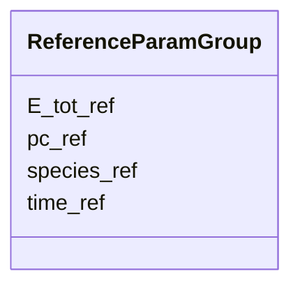

# Class: ReferenceParamGroup 


_Mixin for reference parameters that are aligned with PALS ReferenceP (Reference Parameters)  for interoperability with the Particle Accelerator Language Standard (PALS)._


URI: [pals:ReferenceParamGroup](https://pals-project.readthedocs.io/ReferenceParamGroup)





<!-- no inheritance hierarchy -->


## Slots

| Name | Cardinality and Range | Description | Inheritance |
| ---  | --- | --- | --- |
| [species_ref](species_ref.md) | 0..1 <br/> [String](String.md) | A reference to a species or particle type, such as an ion, electron, or proto... | direct |
| [pc_ref](pc_ref.md) | 0..1 <br/> [Float](Float.md) | [momentum*c] Reference momentum times speed of light | direct |
| [E_tot_ref](E_tot_ref.md) | 0..1 <br/> [Float](Float.md) | [eV] Reference total energy | direct |
| [time_ref](time_ref.md) | 0..1 <br/> [Float](Float.md) | [s] Reference time | direct |


## Usages

| used by | used in | type | used |
| ---  | --- | --- | --- |
| [HasReferenceP](HasReferenceP.md) | [ReferenceP](ReferenceP.md) | range | [ReferenceParamGroup](ReferenceParamGroup.md) |
| [Magnet](Magnet.md) | [ReferenceP](ReferenceP.md) | range | [ReferenceParamGroup](ReferenceParamGroup.md) |
| [Solenoid](Solenoid.md) | [ReferenceP](ReferenceP.md) | range | [ReferenceParamGroup](ReferenceParamGroup.md) |
| [Multipole](Multipole.md) | [ReferenceP](ReferenceP.md) | range | [ReferenceParamGroup](ReferenceParamGroup.md) |
| [Bend](Bend.md) | [ReferenceP](ReferenceP.md) | range | [ReferenceParamGroup](ReferenceParamGroup.md) |
| [Quadrupole](Quadrupole.md) | [ReferenceP](ReferenceP.md) | range | [ReferenceParamGroup](ReferenceParamGroup.md) |
| [Octupole](Octupole.md) | [ReferenceP](ReferenceP.md) | range | [ReferenceParamGroup](ReferenceParamGroup.md) |
| [Sextupole](Sextupole.md) | [ReferenceP](ReferenceP.md) | range | [ReferenceParamGroup](ReferenceParamGroup.md) |
| [Kicker](Kicker.md) | [ReferenceP](ReferenceP.md) | range | [ReferenceParamGroup](ReferenceParamGroup.md) |
| [ACKicker](ACKicker.md) | [ReferenceP](ReferenceP.md) | range | [ReferenceParamGroup](ReferenceParamGroup.md) |
| [BeamProfileMonitor](BeamProfileMonitor.md) | [ReferenceP](ReferenceP.md) | range | [ReferenceParamGroup](ReferenceParamGroup.md) |
| [BeamPositionMonitor](BeamPositionMonitor.md) | [ReferenceP](ReferenceP.md) | range | [ReferenceParamGroup](ReferenceParamGroup.md) |
| [Cavity](Cavity.md) | [ReferenceP](ReferenceP.md) | range | [ReferenceParamGroup](ReferenceParamGroup.md) |
| [CrabCavity](CrabCavity.md) | [ReferenceP](ReferenceP.md) | range | [ReferenceParamGroup](ReferenceParamGroup.md) |
| [RFCavity](RFCavity.md) | [ReferenceP](ReferenceP.md) | range | [ReferenceParamGroup](ReferenceParamGroup.md) |
| [NormalConductingRFCavity](NormalConductingRFCavity.md) | [ReferenceP](ReferenceP.md) | range | [ReferenceParamGroup](ReferenceParamGroup.md) |
| [SuperConductingRFCavity](SuperConductingRFCavity.md) | [ReferenceP](ReferenceP.md) | range | [ReferenceParamGroup](ReferenceParamGroup.md) |


## Identifier and Mapping Information


### Schema Source


* from schema: https://w3id.org/accelerator-core


## Mappings

| Mapping Type | Mapped Value |
| ---  | ---  |
| self | pals:ReferenceParamGroup |
| native | pals:ReferenceParamGroup |
| broad | pals:ReferenceP |


## LinkML Source

<!-- TODO: investigate https://stackoverflow.com/questions/37606292/how-to-create-tabbed-code-blocks-in-mkdocs-or-sphinx -->

### Direct

<details>
```yaml
name: ReferenceParamGroup
description: Mixin for reference parameters that are aligned with PALS ReferenceP
  (Reference Parameters)  for interoperability with the Particle Accelerator Language
  Standard (PALS).
from_schema: https://w3id.org/accelerator-core
broad_mappings:
- pals:ReferenceP
attributes:
  species_ref:
    name: species_ref
    description: A reference to a species or particle type, such as an ion, electron,
      or proton.
    from_schema: https://w3id.org/accelerator-core
    rank: 1000
    slot_uri: pals:species_ref
    domain_of:
    - ReferenceParamGroup
    range: string
  pc_ref:
    name: pc_ref
    description: '[momentum*c] Reference momentum times speed of light.'
    from_schema: https://w3id.org/accelerator-core
    aliases:
    - pCentral
    rank: 1000
    slot_uri: pals:pc_ref
    domain_of:
    - ReferenceParamGroup
    range: float
  E_tot_ref:
    name: E_tot_ref
    description: '[eV] Reference total energy'
    from_schema: https://w3id.org/accelerator-core
    aliases:
    - ETotal
    rank: 1000
    slot_uri: pals:E_tot_ref
    domain_of:
    - ReferenceParamGroup
    range: float
    unit:
      ucum_code: eV
  time_ref:
    name: time_ref
    description: '[s] Reference time'
    from_schema: https://w3id.org/accelerator-core
    aliases:
    - tRef
    rank: 1000
    slot_uri: pals:time_ref
    domain_of:
    - ReferenceParamGroup
    range: float
    unit:
      ucum_code: s

```
</details>

### Induced

<details>
```yaml
name: ReferenceParamGroup
description: Mixin for reference parameters that are aligned with PALS ReferenceP
  (Reference Parameters)  for interoperability with the Particle Accelerator Language
  Standard (PALS).
from_schema: https://w3id.org/accelerator-core
broad_mappings:
- pals:ReferenceP
attributes:
  species_ref:
    name: species_ref
    description: A reference to a species or particle type, such as an ion, electron,
      or proton.
    from_schema: https://w3id.org/accelerator-core
    rank: 1000
    slot_uri: pals:species_ref
    alias: species_ref
    owner: ReferenceParamGroup
    domain_of:
    - ReferenceParamGroup
    range: string
  pc_ref:
    name: pc_ref
    description: '[momentum*c] Reference momentum times speed of light.'
    from_schema: https://w3id.org/accelerator-core
    aliases:
    - pCentral
    rank: 1000
    slot_uri: pals:pc_ref
    alias: pc_ref
    owner: ReferenceParamGroup
    domain_of:
    - ReferenceParamGroup
    range: float
  E_tot_ref:
    name: E_tot_ref
    description: '[eV] Reference total energy'
    from_schema: https://w3id.org/accelerator-core
    aliases:
    - ETotal
    rank: 1000
    slot_uri: pals:E_tot_ref
    alias: E_tot_ref
    owner: ReferenceParamGroup
    domain_of:
    - ReferenceParamGroup
    range: float
    unit:
      ucum_code: eV
  time_ref:
    name: time_ref
    description: '[s] Reference time'
    from_schema: https://w3id.org/accelerator-core
    aliases:
    - tRef
    rank: 1000
    slot_uri: pals:time_ref
    alias: time_ref
    owner: ReferenceParamGroup
    domain_of:
    - ReferenceParamGroup
    range: float
    unit:
      ucum_code: s

```
</details>