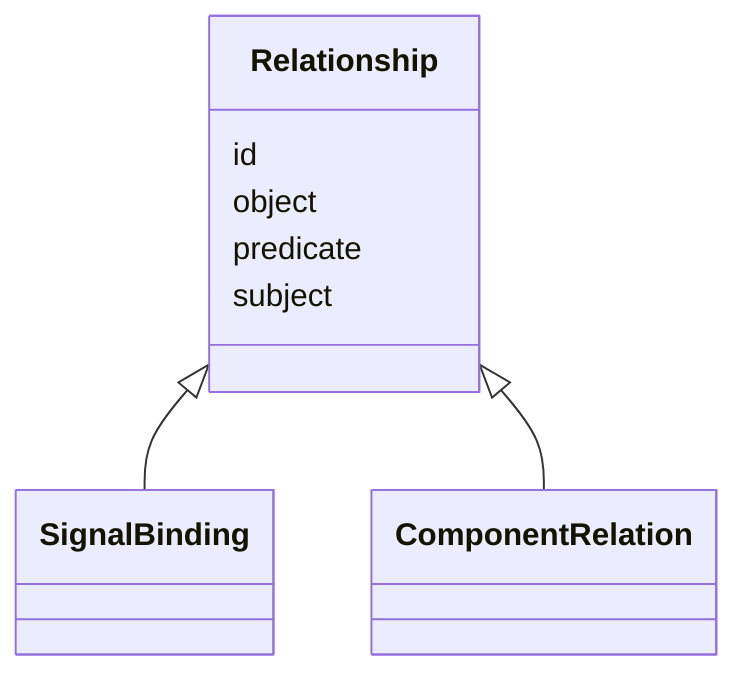

# Class: Relationship 


_Abstract base for subject-predicate-object associations._


* __NOTE__: this is an abstract class and should not be instantiated directly


URI: [pals:Relationship](https://pals-project.readthedocs.io/Relationship)





## Inheritance
* **Relationship**
    * [SignalBinding](SignalBinding.md)
    * [ComponentRelation](ComponentRelation.md)


## Slots

| Name | Cardinality and Range | Description | Inheritance |
| ---  | --- | --- | --- |
| [id](id.md) | 1 <br/> [String](String.md) | A unique identifier for the instance | direct |
| [subject](subject.md) | 1 <br/> [String](String.md) |  | direct |
| [predicate](predicate.md) | 1 <br/> [String](String.md) |  | direct |
| [object](object.md) | 1 <br/> [String](String.md) |  | direct |


## Identifier and Mapping Information


### Schema Source


* from schema: https://w3id.org/accelerator-core


## Mappings

| Mapping Type | Mapped Value |
| ---  | ---  |
| self | pals:Relationship |
| native | pals:Relationship |


## LinkML Source

<!-- TODO: investigate https://stackoverflow.com/questions/37606292/how-to-create-tabbed-code-blocks-in-mkdocs-or-sphinx -->

### Direct

<details>
```yaml
name: Relationship
description: Abstract base for subject-predicate-object associations.
from_schema: https://w3id.org/accelerator-core
abstract: true
slots:
- id
- subject
- predicate
- object
represents_relationship: true

```
</details>

### Induced

<details>
```yaml
name: Relationship
description: Abstract base for subject-predicate-object associations.
from_schema: https://w3id.org/accelerator-core
abstract: true
attributes:
  id:
    name: id
    description: A unique identifier for the instance.
    from_schema: https://w3id.org/accelerator-core
    rank: 1000
    slot_uri: pals:id
    identifier: true
    alias: id
    owner: Relationship
    domain_of:
    - Affiliation
    - Component
    - Signal
    - Relationship
    range: string
    required: true
  subject:
    name: subject
    from_schema: https://w3id.org/accelerator-core
    rank: 1000
    slot_uri: rdf:subject
    alias: subject
    owner: Relationship
    domain_of:
    - Relationship
    relational_role: SUBJECT
    range: string
    required: true
  predicate:
    name: predicate
    from_schema: https://w3id.org/accelerator-core
    rank: 1000
    slot_uri: rdf:predicate
    alias: predicate
    owner: Relationship
    domain_of:
    - Relationship
    relational_role: PREDICATE
    range: string
    required: true
  object:
    name: object
    from_schema: https://w3id.org/accelerator-core
    rank: 1000
    slot_uri: rdf:object
    alias: object
    owner: Relationship
    domain_of:
    - Relationship
    relational_role: OBJECT
    range: string
    required: true
represents_relationship: true

```
</details>