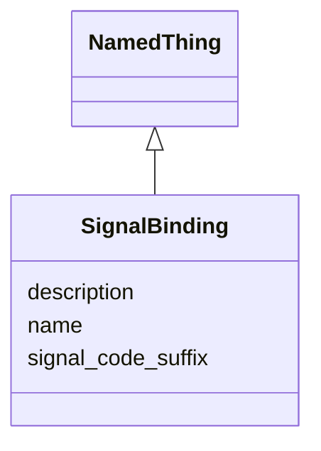

# Class: SignalBinding 


_A named control system suffix definition for one semantic signal. The suffix is used within in a template naming convention to construct the full control system PV name for a given device instance._


URI: [narad:SignalBinding](https://example.org/narad_linkml/schema/narad/SignalBinding)





## Inheritance
* [NamedThing](NamedThing.md)
    * **SignalBinding**


## Slots

| Name | Cardinality and Range | Description | Inheritance |
| ---  | --- | --- | --- |
| [signal_code_suffix](signal_code_suffix.md) | 0..1 <br/> [String](String.md) | Facility-specific control-system (e | direct |
| [name](name.md) | 1 <br/> [String](String.md) | Human-readable name or local string key for the entity | [NamedThing](NamedThing.md) |
| [description](description.md) | 0..1 <br/> [String](String.md) | Detailed description of the entity | [NamedThing](NamedThing.md) |


## Usages

| used by | used in | type | used |
| ---  | --- | --- | --- |
| [Device](Device.md) | [is_observed_by](is_observed_by.md) | range | [SignalBinding](SignalBinding.md) |
| [InstanceSignalBinding](InstanceSignalBinding.md) | [for_property](for_property.md) | range | [SignalBinding](SignalBinding.md) |


## Identifier and Mapping Information


### Schema Source


* from schema: https://w3id.org/narad_linkml/schema/narad/system


## Mappings

| Mapping Type | Mapped Value |
| ---  | ---  |
| self | narad:SignalBinding |
| native | narad:SignalBinding |


## LinkML Source

<!-- TODO: investigate https://stackoverflow.com/questions/37606292/how-to-create-tabbed-code-blocks-in-mkdocs-or-sphinx -->

### Direct

<details>
```yaml
name: SignalBinding
description: A named control system suffix definition for one semantic signal. The
  suffix is used within in a template naming convention to construct the full control
  system PV name for a given device instance.
from_schema: https://w3id.org/narad_linkml/schema/narad/system
is_a: NamedThing
slots:
- signal_code_suffix

```
</details>

### Induced

<details>
```yaml
name: SignalBinding
description: A named control system suffix definition for one semantic signal. The
  suffix is used within in a template naming convention to construct the full control
  system PV name for a given device instance.
from_schema: https://w3id.org/narad_linkml/schema/narad/system
is_a: NamedThing
attributes:
  signal_code_suffix:
    name: signal_code_suffix
    description: 'Facility-specific control-system (e.g. EPICS) naming suffix used
      to derive or interpret the signal binding, e.g. .S, M, :GSET.

      '
    in_subset:
    - label
    from_schema: https://w3id.org/narad_linkml/schema/narad/system
    rank: 1000
    alias: signal_code_suffix
    owner: SignalBinding
    domain_of:
    - SignalBinding
    range: string
  name:
    name: name
    description: Human-readable name or local string key for the entity.
    in_subset:
    - label
    from_schema: https://w3id.org/narad_linkml/schema/narad/system
    rank: 1000
    identifier: true
    alias: name
    owner: SignalBinding
    domain_of:
    - NamedThing
    range: string
    required: true
  description:
    name: description
    description: Detailed description of the entity.
    in_subset:
    - label
    from_schema: https://w3id.org/narad_linkml/schema/narad/system
    rank: 1000
    alias: description
    owner: SignalBinding
    domain_of:
    - NamedThing
    - NamingConventionExample
    - TemplateExample
    range: string

```
</details>