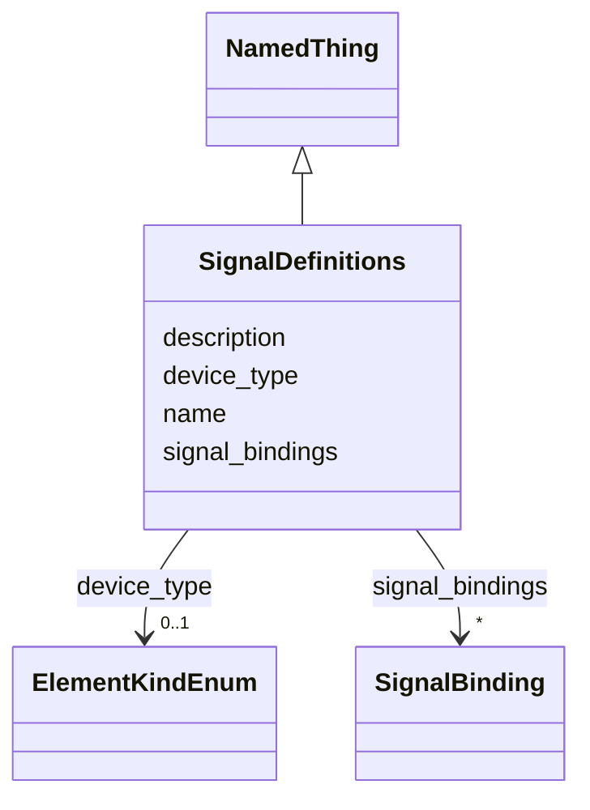

# Class: SignalDefinitions 


_Signal binding set scoped to a device type or device domain._


URI: [narad:SignalDefinitions](https://w3id.org/narad_linkml/schema/narad/SignalDefinitions)





## Inheritance
* [NamedThing](NamedThing.md)
    * **SignalDefinitions**


## Slots

| Name | Cardinality and Range | Description | Inheritance |
| ---  | --- | --- | --- |
| [device_type](device_type.md) | 0..1 <br/> [ElementKindEnum](ElementKindEnum.md) | Represents the generic, semantic class of the device (e | direct |
| [signal_bindings](signal_bindings.md) | * <br/> [SignalBinding](SignalBinding.md) | Control-system-specific, e | direct |
| [name](name.md) | 1 <br/> [String](String.md) | Human-readable name or local string key for the entity | [NamedThing](NamedThing.md) |
| [description](description.md) | 0..1 <br/> [String](String.md) | Detailed description of the entity | [NamedThing](NamedThing.md) |


## Usages

| used by | used in | type | used |
| ---  | --- | --- | --- |
| [FacilitySystem](FacilitySystem.md) | [signal_definitions](signal_definitions.md) | range | [SignalDefinitions](SignalDefinitions.md) |


## Identifier and Mapping Information


### Schema Source


* from schema: https://w3id.org/narad_linkml/schema/narad/system


## Mappings

| Mapping Type | Mapped Value |
| ---  | ---  |
| self | narad:SignalDefinitions |
| native | narad:SignalDefinitions |


## LinkML Source

<!-- TODO: investigate https://stackoverflow.com/questions/37606292/how-to-create-tabbed-code-blocks-in-mkdocs-or-sphinx -->

### Direct

<details>
```yaml
name: SignalDefinitions
description: Signal binding set scoped to a device type or device domain.
from_schema: https://w3id.org/narad_linkml/schema/narad/system
is_a: NamedThing
slots:
- device_type
- signal_bindings
slot_usage:
  signal_bindings:
    name: signal_bindings
    multivalued: true
    inlined: true

```
</details>

### Induced

<details>
```yaml
name: SignalDefinitions
description: Signal binding set scoped to a device type or device domain.
from_schema: https://w3id.org/narad_linkml/schema/narad/system
is_a: NamedThing
slot_usage:
  signal_bindings:
    name: signal_bindings
    multivalued: true
    inlined: true
attributes:
  device_type:
    name: device_type
    description: Represents the generic, semantic class of the device (e.g., "Quadrupole",
      "BPM") and is used for capability, instrument, and signal profile matching.
    from_schema: https://w3id.org/narad_linkml/schema/narad/system
    rank: 1000
    alias: device_type
    owner: SignalDefinitions
    domain_of:
    - ControlCapability
    - SignalDefinitions
    - InstrumentSystem
    - SystemCapability
    range: ElementKindEnum
  signal_bindings:
    name: signal_bindings
    description: Control-system-specific, e.g. EPICS, suffix definitions keyed by
      signal name within a device/domain set.
    from_schema: https://w3id.org/narad_linkml/schema/narad/system
    rank: 1000
    alias: signal_bindings
    owner: SignalDefinitions
    domain_of:
    - SignalDefinitions
    range: SignalBinding
    multivalued: true
    inlined: true
  name:
    name: name
    description: Human-readable name or local string key for the entity.
    from_schema: https://w3id.org/narad_linkml/schema/narad/system
    rank: 1000
    identifier: true
    alias: name
    owner: SignalDefinitions
    domain_of:
    - NamedThing
    range: string
    required: true
  description:
    name: description
    description: Detailed description of the entity.
    from_schema: https://w3id.org/narad_linkml/schema/narad/system
    rank: 1000
    alias: description
    owner: SignalDefinitions
    domain_of:
    - NamedThing
    range: string

```
</details>