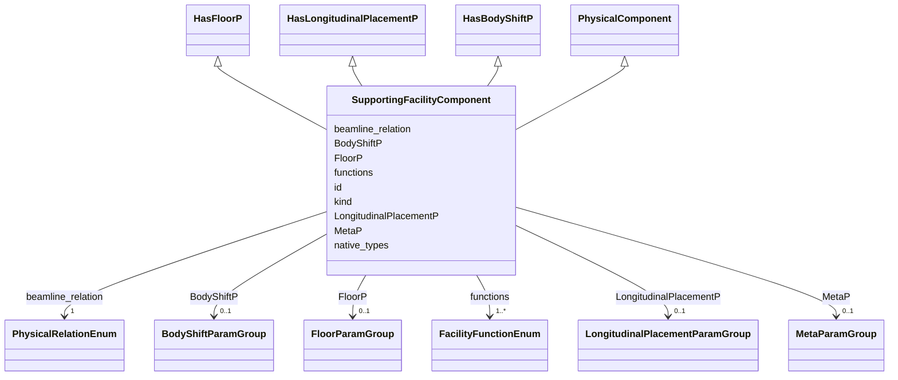

# Class: SupportingFacilityComponent 


_A physical component that supports accelerator operation  without a specific beam-pipe placement,  such as a power supply, control rack, or radiation detector. These can include Girders, Racks, Power Supplies,  and other physical infrastructure components that are important for understanding  the structure and function of the accelerator system but are not inline with the beamline._


URI: [pals:SupportingFacilityComponent](https://pals-project.readthedocs.io/SupportingFacilityComponent)





## Inheritance
* [Component](Component.md) [ [HasMetaP](HasMetaP.md)]
    * [PhysicalComponent](PhysicalComponent.md) [ [HasFloorP](HasFloorP.md) [HasLongitudinalPlacementP](HasLongitudinalPlacementP.md)]
        * **SupportingFacilityComponent** [ [HasFloorP](HasFloorP.md) [HasLongitudinalPlacementP](HasLongitudinalPlacementP.md) [HasBodyShiftP](HasBodyShiftP.md)]


## Slots

| Name | Cardinality and Range | Description | Inheritance |
| ---  | --- | --- | --- |
| [functions](functions.md) | 1..* <br/> [FacilityFunctionEnum](FacilityFunctionEnum.md) | The function of the supporting facility component,  which can be used to iden... | direct |
| [FloorP](FloorP.md) | 0..1 <br/> [FloorParamGroup](FloorParamGroup.md) | A mixin for floor plan parameters that are aligned with PALS FloorP (Floor Pl... | [HasFloorP](HasFloorP.md) |
| [LongitudinalPlacementP](LongitudinalPlacementP.md) | 0..1 <br/> [LongitudinalPlacementParamGroup](LongitudinalPlacementParamGroup.md) | A mixin for an element's extent and position along the longitudinal (beam-dir... | [HasLongitudinalPlacementP](HasLongitudinalPlacementP.md) |
| [BodyShiftP](BodyShiftP.md) | 0..1 <br/> [BodyShiftParamGroup](BodyShiftParamGroup.md) | A mixin for floor plan shift parameters that are aligned with PALS BodyShiftP... | [HasBodyShiftP](HasBodyShiftP.md) |
| [beamline_relation](beamline_relation.md) | 1 <br/> [PhysicalRelationEnum](PhysicalRelationEnum.md) | The relationship of the physical component to the beamline,  which can be use... | [PhysicalComponent](PhysicalComponent.md) |
| [id](id.md) | 1 <br/> [String](String.md) | A unique identifier for the instance | [Component](Component.md) |
| [kind](kind.md) | 1 <br/> [String](String.md) | The LinkML class name of this instance | [Component](Component.md) |
| [native_types](native_types.md) | * <br/> [String](String.md) | The native type of the component in the source system, which can be used to i... | [Component](Component.md) |
| [MetaP](MetaP.md) | 0..1 <br/> [MetaParamGroup](MetaParamGroup.md) | A mixin for metadata parameters that are aligned with PALS MetaP (Metadata Pa... | [HasMetaP](HasMetaP.md) |


## Identifier and Mapping Information


### Schema Source


* from schema: https://w3id.org/accelerator-core


## Mappings

| Mapping Type | Mapped Value |
| ---  | ---  |
| self | pals:SupportingFacilityComponent |
| native | pals:SupportingFacilityComponent |
| broad | pals:StructuralElement |


## LinkML Source

<!-- TODO: investigate https://stackoverflow.com/questions/37606292/how-to-create-tabbed-code-blocks-in-mkdocs-or-sphinx -->

### Direct

<details>
```yaml
name: SupportingFacilityComponent
description: A physical component that supports accelerator operation  without a specific
  beam-pipe placement,  such as a power supply, control rack, or radiation detector.
  These can include Girders, Racks, Power Supplies,  and other physical infrastructure
  components that are important for understanding  the structure and function of the
  accelerator system but are not inline with the beamline.
from_schema: https://w3id.org/accelerator-core
broad_mappings:
- pals:StructuralElement
is_a: PhysicalComponent
mixins:
- HasFloorP
- HasLongitudinalPlacementP
- HasBodyShiftP
attributes:
  functions:
    name: functions
    description: The function of the supporting facility component,  which can be
      used to identify the component across different source systems.
    from_schema: https://w3id.org/accelerator-core
    slot_uri: pals:supporting_facility_function
    domain_of:
    - PhysicalComponent
    - VirtualComponent
    - SupportingFacilityComponent
    range: FacilityFunctionEnum
    required: true
    multivalued: true

```
</details>

### Induced

<details>
```yaml
name: SupportingFacilityComponent
description: A physical component that supports accelerator operation  without a specific
  beam-pipe placement,  such as a power supply, control rack, or radiation detector.
  These can include Girders, Racks, Power Supplies,  and other physical infrastructure
  components that are important for understanding  the structure and function of the
  accelerator system but are not inline with the beamline.
from_schema: https://w3id.org/accelerator-core
broad_mappings:
- pals:StructuralElement
is_a: PhysicalComponent
mixins:
- HasFloorP
- HasLongitudinalPlacementP
- HasBodyShiftP
attributes:
  functions:
    name: functions
    description: The function of the supporting facility component,  which can be
      used to identify the component across different source systems.
    from_schema: https://w3id.org/accelerator-core
    slot_uri: pals:supporting_facility_function
    alias: functions
    owner: SupportingFacilityComponent
    domain_of:
    - PhysicalComponent
    - VirtualComponent
    - SupportingFacilityComponent
    range: FacilityFunctionEnum
    required: true
    multivalued: true
  FloorP:
    name: FloorP
    description: A mixin for floor plan parameters that are aligned with PALS FloorP
      (Floor Plan Parameters) for interoperability with the Particle Accelerator Language
      Standard (PALS).
    from_schema: https://w3id.org/accelerator-core
    rank: 1000
    alias: FloorP
    owner: SupportingFacilityComponent
    domain_of:
    - HasFloorP
    range: FloorParamGroup
    inlined: true
  LongitudinalPlacementP:
    name: LongitudinalPlacementP
    description: A mixin for an element's extent and position along the longitudinal
      (beam-direction, "s") axis that are aligned with PALS LongitudinalPlacementP
      (Longitudinal Placement Parameters) for interoperability with the Particle Accelerator
      Language Standard (PALS).
    from_schema: https://w3id.org/accelerator-core
    rank: 1000
    alias: LongitudinalPlacementP
    owner: SupportingFacilityComponent
    domain_of:
    - HasLongitudinalPlacementP
    range: LongitudinalPlacementParamGroup
    inlined: true
  BodyShiftP:
    name: BodyShiftP
    description: A mixin for floor plan shift parameters that are aligned with PALS
      BodyShiftP (Floor Plan Shift Parameters) for interoperability with the Particle
      Accelerator Language Standard (PALS).
    from_schema: https://w3id.org/accelerator-core
    rank: 1000
    alias: BodyShiftP
    owner: SupportingFacilityComponent
    domain_of:
    - HasBodyShiftP
    range: BodyShiftParamGroup
    inlined: true
  beamline_relation:
    name: beamline_relation
    description: The relationship of the physical component to the beamline,  which
      can be used to identify the component across different source systems.
    from_schema: https://w3id.org/accelerator-core
    rank: 1000
    slot_uri: pals:physical_beamline_relation
    alias: beamline_relation
    owner: SupportingFacilityComponent
    domain_of:
    - PhysicalComponent
    - VirtualComponent
    range: PhysicalRelationEnum
    required: true
  id:
    name: id
    description: A unique identifier for the instance.
    from_schema: https://w3id.org/accelerator-core
    rank: 1000
    slot_uri: pals:id
    identifier: true
    alias: id
    owner: SupportingFacilityComponent
    domain_of:
    - Affiliation
    - Component
    - Signal
    - Relationship
    range: string
    required: true
  kind:
    name: kind
    description: The LinkML class name of this instance.
    from_schema: https://w3id.org/accelerator-core
    rank: 1000
    slot_uri: pals:kind
    alias: kind
    owner: SupportingFacilityComponent
    domain_of:
    - PALS
    - Component
    - Signal
    range: string
    required: true
  native_types:
    name: native_types
    description: The native type of the component in the source system, which can
      be used to identify the component across different source systems.
    from_schema: https://w3id.org/accelerator-core
    rank: 1000
    alias: native_types
    owner: SupportingFacilityComponent
    domain_of:
    - Component
    range: string
    multivalued: true
  MetaP:
    name: MetaP
    description: A mixin for metadata parameters that are aligned with PALS MetaP
      (Metadata Parameters) for interoperability with the Particle Accelerator Language
      Standard (PALS).
    from_schema: https://w3id.org/accelerator-core
    rank: 1000
    alias: MetaP
    owner: SupportingFacilityComponent
    domain_of:
    - HasMetaP
    range: MetaParamGroup
    inlined: true

```
</details>