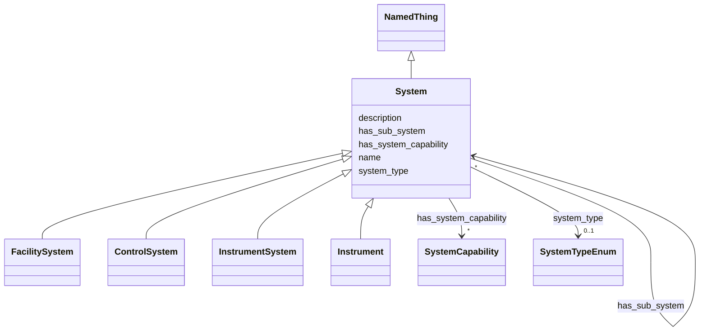

# Class: System 


_A physical, logical, or cyber-physical system involved in sensing, monitoring, control, or actuation. Broadly aligned to ssn:System._

__


URI: [narad:System](https://w3id.org/narad_linkml/schema/narad/System)





## Inheritance
* [NamedThing](NamedThing.md)
    * **System**
        * [FacilitySystem](FacilitySystem.md)
        * [ControlSystem](ControlSystem.md)
        * [InstrumentSystem](InstrumentSystem.md)
        * [Instrument](Instrument.md)


## Slots

| Name | Cardinality and Range | Description | Inheritance |
| ---  | --- | --- | --- |
| [system_type](system_type.md) | 0..1 <br/> [SystemTypeEnum](SystemTypeEnum.md) | High-level system type for classification and querying | direct |
| [has_sub_system](has_sub_system.md) | * <br/> [System](System.md) | Relates a System to one of its subsystems (SSN alignment) | direct |
| [has_system_capability](has_system_capability.md) | * <br/> [SystemCapability](SystemCapability.md) | Relates a System to a SystemCapability it supports (SSN-System alignment) | direct |
| [name](name.md) | 1 <br/> [String](String.md) | Human-readable name or local string key for the entity | [NamedThing](NamedThing.md) |
| [description](description.md) | 0..1 <br/> [String](String.md) | Detailed description of the entity | [NamedThing](NamedThing.md) |


## Usages

| used by | used in | type | used |
| ---  | --- | --- | --- |
| [NaradConfig](NaradConfig.md) | [has_sub_system](has_sub_system.md) | domain | [System](System.md) |
| [FacilitySystem](FacilitySystem.md) | [has_sub_system](has_sub_system.md) | domain | [System](System.md) |
| [FacilitySystem](FacilitySystem.md) | [has_sub_system](has_sub_system.md) | range | [System](System.md) |
| [FacilitySystem](FacilitySystem.md) | [has_system_capability](has_system_capability.md) | domain | [System](System.md) |
| [System](System.md) | [has_sub_system](has_sub_system.md) | domain | [System](System.md) |
| [System](System.md) | [has_sub_system](has_sub_system.md) | range | [System](System.md) |
| [System](System.md) | [has_system_capability](has_system_capability.md) | domain | [System](System.md) |
| [ControlSystem](ControlSystem.md) | [has_sub_system](has_sub_system.md) | domain | [System](System.md) |
| [ControlSystem](ControlSystem.md) | [has_sub_system](has_sub_system.md) | range | [System](System.md) |
| [ControlSystem](ControlSystem.md) | [has_system_capability](has_system_capability.md) | domain | [System](System.md) |
| [InstrumentSystem](InstrumentSystem.md) | [has_sub_system](has_sub_system.md) | domain | [System](System.md) |
| [InstrumentSystem](InstrumentSystem.md) | [has_sub_system](has_sub_system.md) | range | [System](System.md) |
| [InstrumentSystem](InstrumentSystem.md) | [has_system_capability](has_system_capability.md) | domain | [System](System.md) |
| [Instrument](Instrument.md) | [has_sub_system](has_sub_system.md) | domain | [System](System.md) |
| [Instrument](Instrument.md) | [has_sub_system](has_sub_system.md) | range | [System](System.md) |
| [Instrument](Instrument.md) | [has_system_capability](has_system_capability.md) | domain | [System](System.md) |


## Identifier and Mapping Information


### Schema Source


* from schema: https://w3id.org/narad_linkml/schema/narad/system


## Mappings

| Mapping Type | Mapped Value |
| ---  | ---  |
| self | narad:System |
| native | narad:System |
| exact | ssn:System |


## LinkML Source

<!-- TODO: investigate https://stackoverflow.com/questions/37606292/how-to-create-tabbed-code-blocks-in-mkdocs-or-sphinx -->

### Direct

<details>
```yaml
name: System
description: 'A physical, logical, or cyber-physical system involved in sensing, monitoring,
  control, or actuation. Broadly aligned to ssn:System.

  '
from_schema: https://w3id.org/narad_linkml/schema/narad/system
exact_mappings:
- ssn:System
is_a: NamedThing
slots:
- system_type
- has_sub_system
- has_system_capability
slot_usage:
  has_sub_system:
    name: has_sub_system
    range: System
    inlined_as_list: true
  has_system_capability:
    name: has_system_capability
    range: SystemCapability
    multivalued: true
    inlined: true

```
</details>

### Induced

<details>
```yaml
name: System
description: 'A physical, logical, or cyber-physical system involved in sensing, monitoring,
  control, or actuation. Broadly aligned to ssn:System.

  '
from_schema: https://w3id.org/narad_linkml/schema/narad/system
exact_mappings:
- ssn:System
is_a: NamedThing
slot_usage:
  has_sub_system:
    name: has_sub_system
    range: System
    inlined_as_list: true
  has_system_capability:
    name: has_system_capability
    range: SystemCapability
    multivalued: true
    inlined: true
attributes:
  system_type:
    name: system_type
    description: High-level system type for classification and querying.
    from_schema: https://w3id.org/narad_linkml/schema/narad/system
    rank: 1000
    alias: system_type
    owner: System
    domain_of:
    - System
    range: SystemTypeEnum
  has_sub_system:
    name: has_sub_system
    description: 'Relates a System to one of its subsystems (SSN alignment). Use for
      facility → control-system, facility → device, and device → component decomposition.

      '
    from_schema: https://w3id.org/narad_linkml/schema/narad/system
    exact_mappings:
    - ssn-system:hasSubSystem
    rank: 1000
    domain: System
    alias: has_sub_system
    owner: System
    domain_of:
    - NaradConfig
    - System
    - InstrumentSystem
    range: System
    multivalued: true
    inlined_as_list: true
  has_system_capability:
    name: has_system_capability
    description: 'Relates a System to a SystemCapability it supports (SSN-System alignment).
      Prefer this over directly attaching signals to systems when capability context
      matters.

      '
    from_schema: https://w3id.org/narad_linkml/schema/narad/system
    exact_mappings:
    - ssn-system:hasSystemCapability
    rank: 1000
    domain: System
    alias: has_system_capability
    owner: System
    domain_of:
    - System
    - InstrumentSystem
    range: SystemCapability
    multivalued: true
    inlined: true
  name:
    name: name
    description: Human-readable name or local string key for the entity.
    from_schema: https://w3id.org/narad_linkml/schema/narad/system
    rank: 1000
    identifier: true
    alias: name
    owner: System
    domain_of:
    - NamedThing
    range: string
    required: true
  description:
    name: description
    description: Detailed description of the entity.
    from_schema: https://w3id.org/narad_linkml/schema/narad/system
    rank: 1000
    alias: description
    owner: System
    domain_of:
    - NamedThing
    range: string

```
</details>