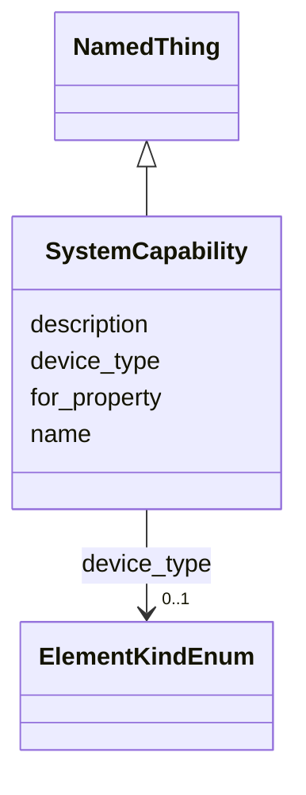

# Class: SystemCapability 


_A capability of a system. SystemCapability describes what a system can expose, monitor, control, or actuate with respect to one or more signals. Aligned to ssn-system:SystemCapability; linked from System instances via ssn-system:hasSystemCapability, and from Signals via ssn:forProperty. Profile-level inheritance (shared vs. type-specific signals) is expressed in CapabilityProfile, not here._

__


URI: [narad:SystemCapability](https://w3id.org/narad_linkml/schema/narad/SystemCapability)





## Inheritance
* [NamedThing](NamedThing.md)
    * **SystemCapability**


## Slots

| Name | Cardinality and Range | Description | Inheritance |
| ---  | --- | --- | --- |
| [for_property](for_property.md) | * <br/> [String](String.md) | SystemCapability → Signal: the capability can expose, monitor, control, or ac... | direct |
| [device_type](device_type.md) | 0..1 <br/> [ElementKindEnum](ElementKindEnum.md) | Represents the generic, semantic class of the device (e | direct |
| [name](name.md) | 1 <br/> [String](String.md) | Human-readable name or local string key for the entity | [NamedThing](NamedThing.md) |
| [description](description.md) | 0..1 <br/> [String](String.md) | Detailed description of the entity | [NamedThing](NamedThing.md) |


## Usages

| used by | used in | type | used |
| ---  | --- | --- | --- |
| [FacilitySystem](FacilitySystem.md) | [has_system_capability](has_system_capability.md) | range | [SystemCapability](SystemCapability.md) |
| [System](System.md) | [has_system_capability](has_system_capability.md) | range | [SystemCapability](SystemCapability.md) |
| [ControlSystem](ControlSystem.md) | [has_system_capability](has_system_capability.md) | range | [SystemCapability](SystemCapability.md) |
| [DeviceSystem](DeviceSystem.md) | [has_system_capability](has_system_capability.md) | range | [SystemCapability](SystemCapability.md) |
| [Instrument](Instrument.md) | [has_system_capability](has_system_capability.md) | range | [SystemCapability](SystemCapability.md) |


## Identifier and Mapping Information


### Schema Source


* from schema: https://w3id.org/narad_linkml/schema/narad/system


## Mappings

| Mapping Type | Mapped Value |
| ---  | ---  |
| self | narad:SystemCapability |
| native | narad:SystemCapability |
| exact | ssn-system:SystemCapability |


## LinkML Source

<!-- TODO: investigate https://stackoverflow.com/questions/37606292/how-to-create-tabbed-code-blocks-in-mkdocs-or-sphinx -->

### Direct

<details>
```yaml
name: SystemCapability
description: 'A capability of a system. SystemCapability describes what a system can
  expose, monitor, control, or actuate with respect to one or more signals. Aligned
  to ssn-system:SystemCapability; linked from System instances via ssn-system:hasSystemCapability,
  and from Signals via ssn:forProperty. Profile-level inheritance (shared vs. type-specific
  signals) is expressed in CapabilityProfile, not here.

  '
from_schema: https://w3id.org/narad_linkml/schema/narad/system
exact_mappings:
- ssn-system:SystemCapability
is_a: NamedThing
slots:
- for_property
- device_type
slot_usage:
  for_property:
    name: for_property
    multivalued: true

```
</details>

### Induced

<details>
```yaml
name: SystemCapability
description: 'A capability of a system. SystemCapability describes what a system can
  expose, monitor, control, or actuate with respect to one or more signals. Aligned
  to ssn-system:SystemCapability; linked from System instances via ssn-system:hasSystemCapability,
  and from Signals via ssn:forProperty. Profile-level inheritance (shared vs. type-specific
  signals) is expressed in CapabilityProfile, not here.

  '
from_schema: https://w3id.org/narad_linkml/schema/narad/system
exact_mappings:
- ssn-system:SystemCapability
is_a: NamedThing
slot_usage:
  for_property:
    name: for_property
    multivalued: true
attributes:
  for_property:
    name: for_property
    description: 'SystemCapability → Signal: the capability can expose, monitor, control,
      or actuate that signal.

      '
    from_schema: https://w3id.org/narad_linkml/schema/narad/system
    exact_mappings:
    - ssn:forProperty
    rank: 1000
    alias: for_property
    owner: SystemCapability
    domain_of:
    - SystemCapability
    - InstanceSignalBinding
    range: string
    multivalued: true
  device_type:
    name: device_type
    description: Represents the generic, semantic class of the device (e.g., "Quadrupole",
      "BPM") and is used for capability, instrument, and signal profile matching.
    from_schema: https://w3id.org/narad_linkml/schema/narad/system
    rank: 1000
    alias: device_type
    owner: SystemCapability
    domain_of:
    - ControlCapability
    - SignalDefinitions
    - DeviceSystem
    - SystemCapability
    range: ElementKindEnum
  name:
    name: name
    description: Human-readable name or local string key for the entity.
    from_schema: https://w3id.org/narad_linkml/schema/narad/system
    rank: 1000
    identifier: true
    alias: name
    owner: SystemCapability
    domain_of:
    - NamedThing
    range: string
    required: true
  description:
    name: description
    description: Detailed description of the entity.
    from_schema: https://w3id.org/narad_linkml/schema/narad/system
    rank: 1000
    alias: description
    owner: SystemCapability
    domain_of:
    - NamedThing
    range: string

```
</details>