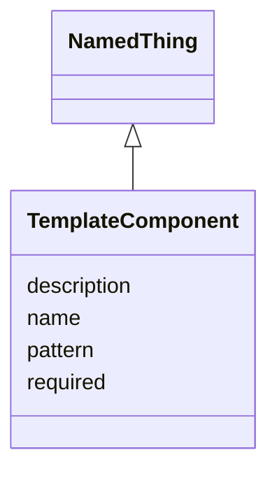

# Class: TemplateComponent 


_A component of a naming convention template, representing a variable part of the control system PV name that is substituted based on the device instance and signal definition.  For example, in the template "{device_name}{signal_code_suffix}", "device_name" and "signal_code_suffix" would be TemplateComponents that are replaced with the actual device name and signal code suffix for each specific binding._

__


URI: [narad:TemplateComponent](https://example.org/narad_linkml/schema/narad/TemplateComponent)





## Inheritance
* [NamedThing](NamedThing.md)
    * **TemplateComponent**


## Slots

| Name | Cardinality and Range | Description | Inheritance |
| ---  | --- | --- | --- |
| [required](required.md) | 0..1 <br/> [Boolean](Boolean.md) | Indicates whether this configuration element is required for a valid configur... | direct |
| [pattern](pattern.md) | 0..1 <br/> [String](String.md) | A regex pattern that the value of this slot must match for validation | direct |
| [name](name.md) | 1 <br/> [String](String.md) | Human-readable name or local string key for the entity | [NamedThing](NamedThing.md) |
| [description](description.md) | 0..1 <br/> [String](String.md) | Detailed description of the entity | [NamedThing](NamedThing.md) |


## Usages

| used by | used in | type | used |
| ---  | --- | --- | --- |
| [NamingConvention](NamingConvention.md) | [template_components](template_components.md) | range | [TemplateComponent](TemplateComponent.md) |


## Identifier and Mapping Information


### Schema Source


* from schema: https://w3id.org/narad_linkml/schema/narad/system


## Mappings

| Mapping Type | Mapped Value |
| ---  | ---  |
| self | narad:TemplateComponent |
| native | narad:TemplateComponent |


## LinkML Source

<!-- TODO: investigate https://stackoverflow.com/questions/37606292/how-to-create-tabbed-code-blocks-in-mkdocs-or-sphinx -->

### Direct

<details>
```yaml
name: TemplateComponent
description: 'A component of a naming convention template, representing a variable
  part of the control system PV name that is substituted based on the device instance
  and signal definition.  For example, in the template "{device_name}{signal_code_suffix}",
  "device_name" and "signal_code_suffix" would be TemplateComponents that are replaced
  with the actual device name and signal code suffix for each specific binding.

  '
from_schema: https://w3id.org/narad_linkml/schema/narad/system
is_a: NamedThing
slots:
- required
- pattern

```
</details>

### Induced

<details>
```yaml
name: TemplateComponent
description: 'A component of a naming convention template, representing a variable
  part of the control system PV name that is substituted based on the device instance
  and signal definition.  For example, in the template "{device_name}{signal_code_suffix}",
  "device_name" and "signal_code_suffix" would be TemplateComponents that are replaced
  with the actual device name and signal code suffix for each specific binding.

  '
from_schema: https://w3id.org/narad_linkml/schema/narad/system
is_a: NamedThing
attributes:
  required:
    name: required
    description: Indicates whether this configuration element is required for a valid
      configuration.
    in_subset:
    - label
    from_schema: https://w3id.org/narad_linkml/schema/narad/system
    rank: 1000
    alias: required
    owner: TemplateComponent
    domain_of:
    - TemplateComponent
    range: boolean
  pattern:
    name: pattern
    description: A regex pattern that the value of this slot must match for validation.
    in_subset:
    - label
    from_schema: https://w3id.org/narad_linkml/schema/narad/system
    rank: 1000
    alias: pattern
    owner: TemplateComponent
    domain_of:
    - TemplateComponent
    range: string
  name:
    name: name
    description: Human-readable name or local string key for the entity.
    in_subset:
    - label
    from_schema: https://w3id.org/narad_linkml/schema/narad/system
    rank: 1000
    identifier: true
    alias: name
    owner: TemplateComponent
    domain_of:
    - NamedThing
    range: string
    required: true
  description:
    name: description
    description: Detailed description of the entity.
    in_subset:
    - label
    from_schema: https://w3id.org/narad_linkml/schema/narad/system
    rank: 1000
    alias: description
    owner: TemplateComponent
    domain_of:
    - NamedThing
    - NamingConventionExample
    - TemplateExample
    range: string

```
</details>