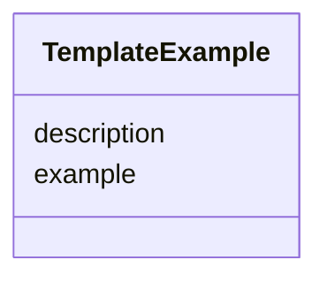

# Class: TemplateExample 


_An example of a control system PV name generated from a naming convention template, along with a description of what it represents.  This can be used to illustrate how the template works in practice and to provide concrete examples of the expected PV naming convention for different device types and signals._

__


URI: [narad:TemplateExample](https://example.org/narad_linkml/schema/narad/TemplateExample)





<!-- no inheritance hierarchy -->


## Slots

| Name | Cardinality and Range | Description | Inheritance |
| ---  | --- | --- | --- |
| [example](example.md) | 1 <br/> [String](String.md) | A single example of how this naming convention is applied to a specific devic... | direct |
| [description](description.md) | 0..1 <br/> [String](String.md) | Detailed description of the entity | direct |


## Identifier and Mapping Information


### Schema Source


* from schema: https://w3id.org/narad_linkml/schema/narad/system


## Mappings

| Mapping Type | Mapped Value |
| ---  | ---  |
| self | narad:TemplateExample |
| native | narad:TemplateExample |


## LinkML Source

<!-- TODO: investigate https://stackoverflow.com/questions/37606292/how-to-create-tabbed-code-blocks-in-mkdocs-or-sphinx -->

### Direct

<details>
```yaml
name: TemplateExample
description: 'An example of a control system PV name generated from a naming convention
  template, along with a description of what it represents.  This can be used to illustrate
  how the template works in practice and to provide concrete examples of the expected
  PV naming convention for different device types and signals.

  '
from_schema: https://w3id.org/narad_linkml/schema/narad/system
slots:
- example
- description
slot_usage:
  example:
    name: example
    identifier: true

```
</details>

### Induced

<details>
```yaml
name: TemplateExample
description: 'An example of a control system PV name generated from a naming convention
  template, along with a description of what it represents.  This can be used to illustrate
  how the template works in practice and to provide concrete examples of the expected
  PV naming convention for different device types and signals.

  '
from_schema: https://w3id.org/narad_linkml/schema/narad/system
slot_usage:
  example:
    name: example
    identifier: true
attributes:
  example:
    name: example
    description: A single example of how this naming convention is applied to a specific
      device instance and signal.
    in_subset:
    - label
    from_schema: https://w3id.org/narad_linkml/schema/narad/system
    rank: 1000
    identifier: true
    alias: example
    owner: TemplateExample
    domain_of:
    - NamingConventionExample
    - TemplateExample
    range: string
  description:
    name: description
    description: Detailed description of the entity.
    in_subset:
    - label
    from_schema: https://w3id.org/narad_linkml/schema/narad/system
    rank: 1000
    alias: description
    owner: TemplateExample
    domain_of:
    - NamedThing
    - NamingConventionExample
    - TemplateExample
    range: string

```
</details>