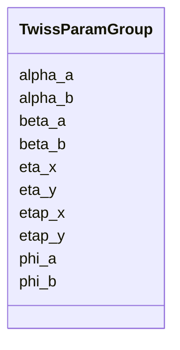

# Class: TwissParamGroup 


_Mixin for Twiss parameters, which can be used to describe the beam optics of an accelerator element._


URI: [pals:TwissParamGroup](https://pals-project.readthedocs.io/TwissParamGroup)





<!-- no inheritance hierarchy -->

## Slots

| Name | Cardinality and Range | Description | Inheritance |
| ---  | --- | --- | --- |
| [alpha_a](alpha_a.md) | 0..1 <br/> [Float](Float.md) | Twiss alpha parameter in the horizontal plane | direct |
| [alpha_b](alpha_b.md) | 0..1 <br/> [Float](Float.md) | Twiss alpha parameter in the vertical plane | direct |
| [beta_a](beta_a.md) | 0..1 <br/> [Float](Float.md) | Twiss beta parameter in the horizontal plane | direct |
| [beta_b](beta_b.md) | 0..1 <br/> [Float](Float.md) | Twiss beta parameter in the vertical plane | direct |
| [eta_x](eta_x.md) | 0..1 <br/> [Float](Float.md) | Twiss dispersion parameter in the horizontal plane | direct |
| [eta_y](eta_y.md) | 0..1 <br/> [Float](Float.md) | Twiss dispersion parameter in the vertical plane | direct |
| [etap_x](etap_x.md) | 0..1 <br/> [Float](Float.md) | Twiss dispersion slope parameter in the horizontal plane | direct |
| [etap_y](etap_y.md) | 0..1 <br/> [Float](Float.md) | Twiss dispersion slope parameter in the vertical plane | direct |
| [phi_a](phi_a.md) | 0..1 <br/> [Float](Float.md) | Twiss phase advance parameter in the horizontal plane | direct |
| [phi_b](phi_b.md) | 0..1 <br/> [Float](Float.md) | Twiss phase advance parameter in the vertical plane | direct |


## Usages

| used by | used in | type | used |
| ---  | --- | --- | --- |
| [HasTwissP](HasTwissP.md) | [TwissP](TwissP.md) | range | [TwissParamGroup](TwissParamGroup.md) |
| [Magnet](Magnet.md) | [TwissP](TwissP.md) | range | [TwissParamGroup](TwissParamGroup.md) |
| [Solenoid](Solenoid.md) | [TwissP](TwissP.md) | range | [TwissParamGroup](TwissParamGroup.md) |
| [Multipole](Multipole.md) | [TwissP](TwissP.md) | range | [TwissParamGroup](TwissParamGroup.md) |
| [Bend](Bend.md) | [TwissP](TwissP.md) | range | [TwissParamGroup](TwissParamGroup.md) |
| [Quadrupole](Quadrupole.md) | [TwissP](TwissP.md) | range | [TwissParamGroup](TwissParamGroup.md) |
| [Octupole](Octupole.md) | [TwissP](TwissP.md) | range | [TwissParamGroup](TwissParamGroup.md) |
| [Sextupole](Sextupole.md) | [TwissP](TwissP.md) | range | [TwissParamGroup](TwissParamGroup.md) |
| [Kicker](Kicker.md) | [TwissP](TwissP.md) | range | [TwissParamGroup](TwissParamGroup.md) |
| [ACKicker](ACKicker.md) | [TwissP](TwissP.md) | range | [TwissParamGroup](TwissParamGroup.md) |
| [BeamProfileMonitor](BeamProfileMonitor.md) | [TwissP](TwissP.md) | range | [TwissParamGroup](TwissParamGroup.md) |
| [BeamPositionMonitor](BeamPositionMonitor.md) | [TwissP](TwissP.md) | range | [TwissParamGroup](TwissParamGroup.md) |
| [Aperture](Aperture.md) | [TwissP](TwissP.md) | range | [TwissParamGroup](TwissParamGroup.md) |
| [Cavity](Cavity.md) | [TwissP](TwissP.md) | range | [TwissParamGroup](TwissParamGroup.md) |
| [CrabCavity](CrabCavity.md) | [TwissP](TwissP.md) | range | [TwissParamGroup](TwissParamGroup.md) |
| [RFCavity](RFCavity.md) | [TwissP](TwissP.md) | range | [TwissParamGroup](TwissParamGroup.md) |
| [NormalConductingRFCavity](NormalConductingRFCavity.md) | [TwissP](TwissP.md) | range | [TwissParamGroup](TwissParamGroup.md) |
| [SuperConductingRFCavity](SuperConductingRFCavity.md) | [TwissP](TwissP.md) | range | [TwissParamGroup](TwissParamGroup.md) |
| [Marker](Marker.md) | [TwissP](TwissP.md) | range | [TwissParamGroup](TwissParamGroup.md) |


## Identifier and Mapping Information


### Schema Source


* from schema: https://w3id.org/accelerator-core


## Mappings

| Mapping Type | Mapped Value |
| ---  | ---  |
| self | pals:TwissParamGroup |
| native | pals:TwissParamGroup |
| broad | pals:TwissP |


## LinkML Source

<!-- TODO: investigate https://stackoverflow.com/questions/37606292/how-to-create-tabbed-code-blocks-in-mkdocs-or-sphinx -->

### Direct

<details>
```yaml
name: TwissParamGroup
description: Mixin for Twiss parameters, which can be used to describe the beam optics
  of an accelerator element.
from_schema: https://w3id.org/accelerator-core
broad_mappings:
- pals:TwissP
attributes:
  alpha_a:
    name: alpha_a
    description: Twiss alpha parameter in the horizontal plane.
    from_schema: https://w3id.org/accelerator-core
    aliases:
    - alpha_x
    - alphax
    rank: 1000
    slot_uri: pals:alpha_a
    domain_of:
    - TwissParamGroup
    range: float
  alpha_b:
    name: alpha_b
    description: Twiss alpha parameter in the vertical plane.
    from_schema: https://w3id.org/accelerator-core
    aliases:
    - alpha_y
    - alphay
    rank: 1000
    slot_uri: pals:alpha_b
    domain_of:
    - TwissParamGroup
    range: float
  beta_a:
    name: beta_a
    description: Twiss beta parameter in the horizontal plane.
    from_schema: https://w3id.org/accelerator-core
    aliases:
    - beta_x
    - betax
    rank: 1000
    slot_uri: pals:beta_a
    domain_of:
    - TwissParamGroup
    range: float
  beta_b:
    name: beta_b
    description: Twiss beta parameter in the vertical plane.
    from_schema: https://w3id.org/accelerator-core
    aliases:
    - beta_y
    - betay
    rank: 1000
    slot_uri: pals:beta_b
    domain_of:
    - TwissParamGroup
    range: float
  eta_x:
    name: eta_x
    description: Twiss dispersion parameter in the horizontal plane.
    from_schema: https://w3id.org/accelerator-core
    aliases:
    - etax
    rank: 1000
    slot_uri: pals:eta_x
    domain_of:
    - TwissParamGroup
    range: float
  eta_y:
    name: eta_y
    description: Twiss dispersion parameter in the vertical plane.
    from_schema: https://w3id.org/accelerator-core
    aliases:
    - etay
    rank: 1000
    slot_uri: pals:eta_y
    domain_of:
    - TwissParamGroup
    range: float
  etap_x:
    name: etap_x
    description: Twiss dispersion slope parameter in the horizontal plane.
    from_schema: https://w3id.org/accelerator-core
    aliases:
    - etapx
    rank: 1000
    slot_uri: pals:etap_x
    domain_of:
    - TwissParamGroup
    range: float
  etap_y:
    name: etap_y
    description: Twiss dispersion slope parameter in the vertical plane.
    from_schema: https://w3id.org/accelerator-core
    aliases:
    - etapy
    rank: 1000
    slot_uri: pals:etap_y
    domain_of:
    - TwissParamGroup
    range: float
  phi_a:
    name: phi_a
    description: Twiss phase advance parameter in the horizontal plane.
    from_schema: https://w3id.org/accelerator-core
    aliases:
    - phi_x
    - phix
    - psi_x
    - psix
    rank: 1000
    slot_uri: pals:phi_a
    domain_of:
    - TwissParamGroup
    range: float
  phi_b:
    name: phi_b
    description: Twiss phase advance parameter in the vertical plane.
    from_schema: https://w3id.org/accelerator-core
    aliases:
    - phi_y
    - phiy
    - psi_y
    - psiy
    rank: 1000
    slot_uri: pals:phi_b
    domain_of:
    - TwissParamGroup
    range: float

```
</details>

### Induced

<details>
```yaml
name: TwissParamGroup
description: Mixin for Twiss parameters, which can be used to describe the beam optics
  of an accelerator element.
from_schema: https://w3id.org/accelerator-core
broad_mappings:
- pals:TwissP
attributes:
  alpha_a:
    name: alpha_a
    description: Twiss alpha parameter in the horizontal plane.
    from_schema: https://w3id.org/accelerator-core
    aliases:
    - alpha_x
    - alphax
    rank: 1000
    slot_uri: pals:alpha_a
    alias: alpha_a
    owner: TwissParamGroup
    domain_of:
    - TwissParamGroup
    range: float
  alpha_b:
    name: alpha_b
    description: Twiss alpha parameter in the vertical plane.
    from_schema: https://w3id.org/accelerator-core
    aliases:
    - alpha_y
    - alphay
    rank: 1000
    slot_uri: pals:alpha_b
    alias: alpha_b
    owner: TwissParamGroup
    domain_of:
    - TwissParamGroup
    range: float
  beta_a:
    name: beta_a
    description: Twiss beta parameter in the horizontal plane.
    from_schema: https://w3id.org/accelerator-core
    aliases:
    - beta_x
    - betax
    rank: 1000
    slot_uri: pals:beta_a
    alias: beta_a
    owner: TwissParamGroup
    domain_of:
    - TwissParamGroup
    range: float
  beta_b:
    name: beta_b
    description: Twiss beta parameter in the vertical plane.
    from_schema: https://w3id.org/accelerator-core
    aliases:
    - beta_y
    - betay
    rank: 1000
    slot_uri: pals:beta_b
    alias: beta_b
    owner: TwissParamGroup
    domain_of:
    - TwissParamGroup
    range: float
  eta_x:
    name: eta_x
    description: Twiss dispersion parameter in the horizontal plane.
    from_schema: https://w3id.org/accelerator-core
    aliases:
    - etax
    rank: 1000
    slot_uri: pals:eta_x
    alias: eta_x
    owner: TwissParamGroup
    domain_of:
    - TwissParamGroup
    range: float
  eta_y:
    name: eta_y
    description: Twiss dispersion parameter in the vertical plane.
    from_schema: https://w3id.org/accelerator-core
    aliases:
    - etay
    rank: 1000
    slot_uri: pals:eta_y
    alias: eta_y
    owner: TwissParamGroup
    domain_of:
    - TwissParamGroup
    range: float
  etap_x:
    name: etap_x
    description: Twiss dispersion slope parameter in the horizontal plane.
    from_schema: https://w3id.org/accelerator-core
    aliases:
    - etapx
    rank: 1000
    slot_uri: pals:etap_x
    alias: etap_x
    owner: TwissParamGroup
    domain_of:
    - TwissParamGroup
    range: float
  etap_y:
    name: etap_y
    description: Twiss dispersion slope parameter in the vertical plane.
    from_schema: https://w3id.org/accelerator-core
    aliases:
    - etapy
    rank: 1000
    slot_uri: pals:etap_y
    alias: etap_y
    owner: TwissParamGroup
    domain_of:
    - TwissParamGroup
    range: float
  phi_a:
    name: phi_a
    description: Twiss phase advance parameter in the horizontal plane.
    from_schema: https://w3id.org/accelerator-core
    aliases:
    - phi_x
    - phix
    - psi_x
    - psix
    rank: 1000
    slot_uri: pals:phi_a
    alias: phi_a
    owner: TwissParamGroup
    domain_of:
    - TwissParamGroup
    range: float
  phi_b:
    name: phi_b
    description: Twiss phase advance parameter in the vertical plane.
    from_schema: https://w3id.org/accelerator-core
    aliases:
    - phi_y
    - phiy
    - psi_y
    - psiy
    rank: 1000
    slot_uri: pals:phi_b
    alias: phi_b
    owner: TwissParamGroup
    domain_of:
    - TwissParamGroup
    range: float

```
</details>