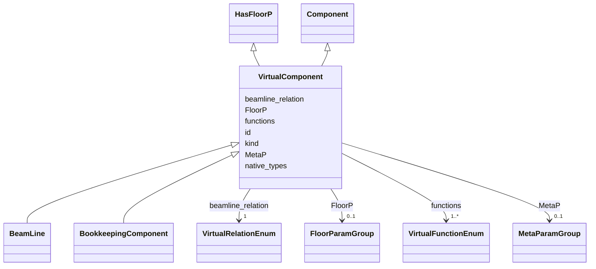

# Class: VirtualComponent 


_A virtual or logical component that represents a concept, function, or role in the accelerator  beamline operation but does not have a physical instantiation.  This can be used to capture abstract components, such as Markers, BeamLineSections, and FacilitySpaces that are important for understanding the structure and function of the accelerator system but are not physical devices._


URI: [pals:VirtualComponent](https://pals-project.readthedocs.io/VirtualComponent)





## Inheritance
* [Component](Component.md) [ [HasMetaP](HasMetaP.md)]
    * **VirtualComponent** [ [HasFloorP](HasFloorP.md)]
        * [BeamLine](BeamLine.md)
        * [BookkeepingComponent](BookkeepingComponent.md) [ [HasBodyShiftP](HasBodyShiftP.md)]


## Slots

| Name | Cardinality and Range | Description | Inheritance |
| ---  | --- | --- | --- |
| [functions](functions.md) | 1..* <br/> [VirtualFunctionEnum](VirtualFunctionEnum.md) | The function of the virtual component,  which can be used to identify the com... | direct |
| [beamline_relation](beamline_relation.md) | 1 <br/> [VirtualRelationEnum](VirtualRelationEnum.md) | The relationship of the virtual component to the beamline,  which can be used... | direct |
| [FloorP](FloorP.md) | 0..1 <br/> [FloorParamGroup](FloorParamGroup.md) | A mixin for floor plan parameters that are aligned with PALS FloorP (Floor Pl... | [HasFloorP](HasFloorP.md) |
| [id](id.md) | 1 <br/> [String](String.md) | A unique identifier for the instance | [Component](Component.md) |
| [kind](kind.md) | 1 <br/> [String](String.md) | The LinkML class name of this instance | [Component](Component.md) |
| [native_types](native_types.md) | * <br/> [String](String.md) | The native type of the component in the source system, which can be used to i... | [Component](Component.md) |
| [MetaP](MetaP.md) | 0..1 <br/> [MetaParamGroup](MetaParamGroup.md) | A mixin for metadata parameters that are aligned with PALS MetaP (Metadata Pa... | [HasMetaP](HasMetaP.md) |


## Identifier and Mapping Information


### Schema Source


* from schema: https://w3id.org/accelerator-core


## Mappings

| Mapping Type | Mapped Value |
| ---  | ---  |
| self | pals:VirtualComponent |
| native | pals:VirtualComponent |
| broad | pals:Element, pals:BookkeepingElement |


## LinkML Source

<!-- TODO: investigate https://stackoverflow.com/questions/37606292/how-to-create-tabbed-code-blocks-in-mkdocs-or-sphinx -->

### Direct

<details>
```yaml
name: VirtualComponent
description: A virtual or logical component that represents a concept, function, or
  role in the accelerator  beamline operation but does not have a physical instantiation.  This
  can be used to capture abstract components, such as Markers, BeamLineSections, and
  FacilitySpaces that are important for understanding the structure and function of
  the accelerator system but are not physical devices.
from_schema: https://w3id.org/accelerator-core
broad_mappings:
- pals:Element
- pals:BookkeepingElement
is_a: Component
mixins:
- HasFloorP
attributes:
  functions:
    name: functions
    description: The function of the virtual component,  which can be used to identify
      the component across different source systems.
    from_schema: https://w3id.org/accelerator-core
    slot_uri: pals:virtual_function
    domain_of:
    - PhysicalComponent
    - VirtualComponent
    - SupportingFacilityComponent
    range: VirtualFunctionEnum
    required: true
    multivalued: true
  beamline_relation:
    name: beamline_relation
    description: The relationship of the virtual component to the beamline,  which
      can be used to identify the component across different source systems.
    from_schema: https://w3id.org/accelerator-core
    slot_uri: pals:virtual_beamline_relation
    domain_of:
    - PhysicalComponent
    - VirtualComponent
    range: VirtualRelationEnum
    required: true

```
</details>

### Induced

<details>
```yaml
name: VirtualComponent
description: A virtual or logical component that represents a concept, function, or
  role in the accelerator  beamline operation but does not have a physical instantiation.  This
  can be used to capture abstract components, such as Markers, BeamLineSections, and
  FacilitySpaces that are important for understanding the structure and function of
  the accelerator system but are not physical devices.
from_schema: https://w3id.org/accelerator-core
broad_mappings:
- pals:Element
- pals:BookkeepingElement
is_a: Component
mixins:
- HasFloorP
attributes:
  functions:
    name: functions
    description: The function of the virtual component,  which can be used to identify
      the component across different source systems.
    from_schema: https://w3id.org/accelerator-core
    slot_uri: pals:virtual_function
    alias: functions
    owner: VirtualComponent
    domain_of:
    - PhysicalComponent
    - VirtualComponent
    - SupportingFacilityComponent
    range: VirtualFunctionEnum
    required: true
    multivalued: true
  beamline_relation:
    name: beamline_relation
    description: The relationship of the virtual component to the beamline,  which
      can be used to identify the component across different source systems.
    from_schema: https://w3id.org/accelerator-core
    slot_uri: pals:virtual_beamline_relation
    alias: beamline_relation
    owner: VirtualComponent
    domain_of:
    - PhysicalComponent
    - VirtualComponent
    range: VirtualRelationEnum
    required: true
  FloorP:
    name: FloorP
    description: A mixin for floor plan parameters that are aligned with PALS FloorP
      (Floor Plan Parameters) for interoperability with the Particle Accelerator Language
      Standard (PALS).
    from_schema: https://w3id.org/accelerator-core
    rank: 1000
    alias: FloorP
    owner: VirtualComponent
    domain_of:
    - HasFloorP
    range: FloorParamGroup
    inlined: true
  id:
    name: id
    description: A unique identifier for the instance.
    from_schema: https://w3id.org/accelerator-core
    rank: 1000
    slot_uri: pals:id
    identifier: true
    alias: id
    owner: VirtualComponent
    domain_of:
    - Affiliation
    - Component
    - Signal
    - Relationship
    range: string
    required: true
  kind:
    name: kind
    description: The LinkML class name of this instance.
    from_schema: https://w3id.org/accelerator-core
    rank: 1000
    slot_uri: pals:kind
    alias: kind
    owner: VirtualComponent
    domain_of:
    - PALS
    - Component
    - Signal
    range: string
    required: true
  native_types:
    name: native_types
    description: The native type of the component in the source system, which can
      be used to identify the component across different source systems.
    from_schema: https://w3id.org/accelerator-core
    rank: 1000
    alias: native_types
    owner: VirtualComponent
    domain_of:
    - Component
    range: string
    multivalued: true
  MetaP:
    name: MetaP
    description: A mixin for metadata parameters that are aligned with PALS MetaP
      (Metadata Parameters) for interoperability with the Particle Accelerator Language
      Standard (PALS).
    from_schema: https://w3id.org/accelerator-core
    rank: 1000
    alias: MetaP
    owner: VirtualComponent
    domain_of:
    - HasMetaP
    range: MetaParamGroup
    inlined: true

```
</details>